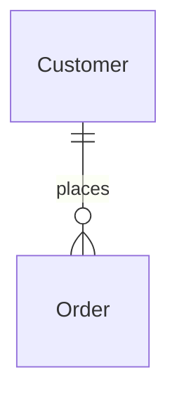

# SDLC Mermaid Diagrams

## Purpose

Diagrams are documents. They live as text in the repository, are reviewed like code, are registered like any
other document and must show only what exists. Mermaid renders in GitHub, GitLab, MkDocs and most editors without
extra tooling.

## Scope

The nine diagram types of the catalog (CTX, C4, CMP, SEQ, ACT, ERD, DFD, DPL, WFL), their source files, embedding,
validation and evidence. Document content around diagrams follows the templates.

## How to use

Pick the diagram from the table, gather its facts from the code (never from memory), write the `.mmd` source,
run the checklist, embed it, register it. Update the diagram when the facts change; do not redraw unrelated ones.

## Which diagram documents what

| Type | Shows | Mermaid type | Facts come from |
|---|---|---|---|
| CTX System context | The system, its users and external systems | `flowchart` or `C4Context` | Settings, integrations, authentication, requirements |
| C4 Architecture | Containers: web, workers, database, cache, broker | `C4Container` (also `C4Context`, `C4Component`, `C4Dynamic`) | Deployment files, settings, `INSTALLED_APPS`, Celery/broker config |
| CMP Component | Django apps and layers with dependency direction | `flowchart` or `classDiagram` | Imports between apps, service/selector modules |
| SEQ Sequence | One request, task or integration flow in time order | `sequenceDiagram` | URLconf, view, serializer, service, task, outbound client calls |
| ACT Activity | Branching process inside one operation | `flowchart` or `stateDiagram-v2` | The function or service containing the branches |
| ERD Entity relationship | Models and their relationships | `erDiagram` | `models.py` fields and foreign keys, migrations |
| DFD Data flow | How data moves between stores, tasks and external systems | `flowchart` | Models, tasks, import/export, integrations |
| DPL Deployment | Runtime environment, nodes and how they connect | `flowchart` or `C4Deployment` | Dockerfile, compose, pipeline, infrastructure code |
| WFL Workflow | States of a business object and its transitions | `stateDiagram-v2` or `flowchart` | Status fields, choices, transition methods |

## Files and embedding

- Source: `docs/diagrams/<type>-<subject>.mmd` (for example `docs/diagrams/erd-orders.mmd`). One diagram per
  file, the first line is the diagram type, no Markdown fence in the file.
- Register each file with its type and `sources` (the code that justifies it).
- Embed it in the relevant document, right after a marker comment, as a copy of the source:

````markdown
<!-- mermaid-source: docs/diagrams/erd-orders.mmd -->

````

  The embedded block must equal the source file; when the source changes, re-embed it in every document that
  embeds it (the registry's `related` ids tell you which). The validator reports drift.
- Diagram and document are separate registry entries; the document `related` lists the diagram.

## Writing rules

- Node ids are plain identifiers (`OrderService`), labels carry the readable text (`OrderService["Order service"]`).
  Quote labels that contain punctuation.
- Use only names that exist: app, model, class, endpoint and queue names are copied from the code. If a name
  is unknown, leave it out or label it `(unverified)` and list it in the document's open questions.
- Show direction of dependency and data flow consistently; one level of abstraction per diagram. More than about
  15 nodes: split the diagram.
- No secrets, hostnames, account ids or real data in labels.
- ERDs show models and the relationships declared by the code, including `through` models; attributes are optional
  and limited to keys and the fields that matter. Relationship cardinality follows the field type
  (`ForeignKey` many-to-one, `OneToOneField` one-to-one, `ManyToManyField` many-to-many) and `null=True`/`blank`
  decide optionality.

## Validation checklist

Run it on every diagram before registering it. The validator's `mermaid` and `check` commands automate the
structural items; a person or CI runs them (see the registry reference). Without it, apply the list by reading.

- [ ] The first line declares a known diagram type, and it is allowed for the registered document type.
- [ ] Brackets, parentheses and braces balance; every `subgraph`, `alt`, `loop`, `opt`, `par` has its `end`.
- [ ] No edge lacks a source or a target; `style`, `class` and `click` name nodes that exist.
- [ ] Sequence diagrams declare their participants and every message uses a declared one.
- [ ] ER relationships use valid cardinality (`||--o{`) and have a label; attribute lines have a type and a name.
- [ ] C4 relationships refer only to elements defined in the same diagram.
- [ ] Every entity, app, endpoint or class named in the diagram exists in the code (ERD entities are checked
  against the model classes in the registered sources).
- [ ] The embedded copy equals the source file.
- [ ] The diagram is registered, its `sources` are listed and the embedding document references it.

The validator is a structural lint, not a renderer: it does not prove the diagram renders identically everywhere. Say so
in the report and recommend a render check (the project's documentation build or a Mermaid preview).

## Not misrepresenting the system

- Draw current behaviour from the code. Draw intended design only in design documents and label it `proposed`.
- A diagram that shows something not in the code is a defect: fix the diagram or record the difference as a conflict.
- Do not generate a diagram when the facts are insufficient; record the gap as an open question.

## Related skills and rules

[django-architecture](../skills/django-architecture/SKILL.md) (boundaries and layering to draw) ·
[django-orm](../skills/django-orm/SKILL.md) (relationships for ERDs) ·
[django-documentation-standards](../rules/django-documentation-standards/SKILL.md) (`DOC-R2`, `DOC-M1`) ·
[SDLC documentation registry](sdlc-documentation-registry.md).
