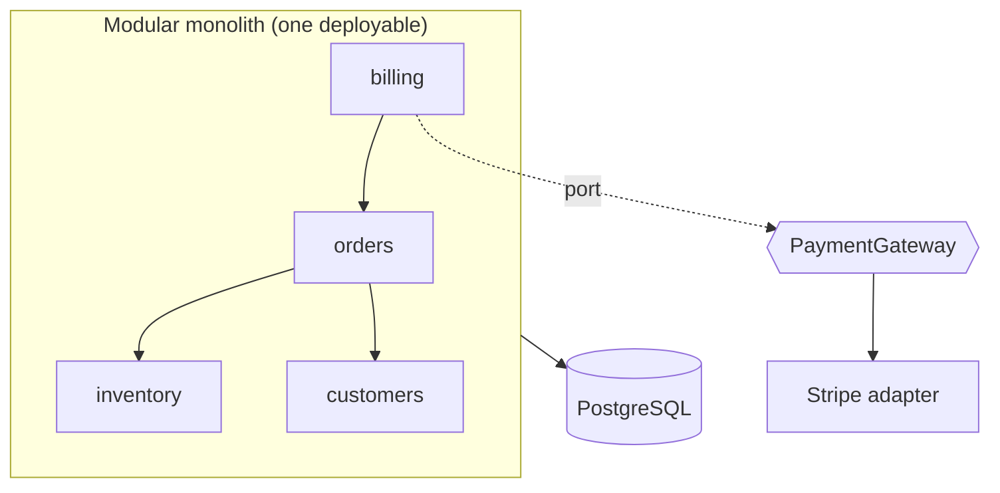

# Architectural styles

> Scope: survey of monolith, modular monolith, layered, hexagonal, clean, microservices and
> event-driven styles as they apply to Django, and how to choose. Not covered here: deep dives —
> [modular-monolith.md](./modular-monolith.md), [layered-architecture.md](./layered-architecture.md),
> [event-driven-architecture.md](./event-driven-architecture.md),
> [distributed-systems.md](./distributed-systems.md); principles in
> [architecture-fundamentals.md](./architecture-fundamentals.md).

## Purpose

Help an agent pick — or recognise — the overall shape of a Django system and know the cost of
each shape. Default recommendation: **modular monolith with a light service layer**; move away
from it only when a concrete constraint demands it.

## Technical concepts

### Monolith (unstructured)

One deployable, one database, apps organised loosely. Django's default `startproject` +
`startapp` produces this. Fine for small teams and early products; degrades as cross-app
imports and shared tables accumulate.

### Modular monolith

One deployable and usually one database, but apps are **modules** with explicit public
interfaces, owned data and one-way dependencies. Keeps Django's strengths (transactions, admin,
ORM joins, single deploy) while keeping options open for extraction.
Deep dive: [modular-monolith.md](./modular-monolith.md).

### Layered architecture

Horizontal split: presentation → application → domain → infrastructure. In Django it maps to
views/serializers → services/selectors → models + domain rules → ORM/gateways. Orthogonal to
modularity: each app can be layered internally.
Deep dive: [layered-architecture.md](./layered-architecture.md).

### Hexagonal (ports and adapters)

The core exposes *ports* (interfaces it needs or offers); *adapters* plug in HTTP, DB, queues,
SDKs. In strict form the domain does not import Django at all. Pragmatic Django version: keep
the ORM as the persistence mechanism, but put **ports around volatile external systems**
(payments, email providers, search) — e.g. `PaymentGateway` protocol with `StripeGateway` and
`FakeGateway` adapters.

### Clean architecture

Hexagonal plus explicit concentric rings (entities → use cases → interface adapters →
frameworks) and the dependency rule "source code points inward". Strict clean architecture in
Django means plain-Python entities mapped to/from ORM models — a large tax, justified only when
the domain is rich and must outlive the framework.

### Microservices

Independently deployable services, each owning its data, communicating over the network. Buys
independent scaling, deployment and team autonomy; costs distributed transactions, network
failure modes, duplicated infra, and operational maturity. See
[distributed-systems.md](./distributed-systems.md).

### Event-driven architecture

Components communicate by publishing facts ("OrderPlaced") rather than calling each other.
Can be in-process ([domain-events.md](./domain-events.md)) or via a broker
([event-driven-architecture.md](./event-driven-architecture.md)). Usually *combined* with one of
the styles above rather than chosen instead of them.

## Internal mechanics



What actually differs between styles is **where boundaries are enforced**:

| Style | Boundary enforced by | Failure mode when violated |
|---|---|---|
| Monolith | Nothing | Big ball of mud |
| Modular monolith | Convention, code review, import contracts | Gradual erosion |
| Layered / hexagonal / clean | Import direction inside each app | Leaky layers, anaemic services |
| Microservices | Network + separate databases | Distributed monolith |
| Event-driven | Message contracts | Invisible control flow, consistency bugs |

## Decision guidance

| Situation | Recommended style |
|---|---|
| New product, 1–3 teams, uncertain domain | Modular monolith, light service layer |
| Mostly CRUD + admin, little logic | Plain Django monolith; skip services where trivial |
| Rich domain rules, several entry points (web, API, jobs) | Modular monolith + layered apps + selected ports |
| Several volatile third-party integrations | Hexagonal ports *only* around those integrations |
| Domain must outlive Django, or shared with non-Django runtimes | Clean/hexagonal core in plain Python (accept mapping cost) |
| Component needs independent scaling/runtime, separate team cadence, or compliance isolation — measured, not predicted | Extract that one component as a service |
| Many independent reactions to a business fact, tolerant of delay | Add events (in-process first, broker when cross-process) |

Questions to ask before leaving the modular monolith:

1. Is the boundary already clean inside the monolith (no shared tables, only public calls)?
2. Is the driver measured (load profile, release contention, audit finding)?
3. Does the team operate distributed tracing, retries, idempotency, and on-call for N services?

If any answer is "no", stay in the monolith and fix the boundary first.

## Django implementation examples

Pragmatic hexagonal port — only where volatility exists:

```python
# apps/billing/gateways.py
from typing import Protocol
from django.conf import settings
from django.utils.module_loading import import_string

class PaymentGateway(Protocol):
    def charge(self, *, invoice_id: int, amount_cents: int, currency: str) -> str: ...

class StripeGateway:
    def charge(self, *, invoice_id, amount_cents, currency):
        ...  # call the SDK, translate its errors to billing.exceptions.PaymentFailed

class FakeGateway:
    def charge(self, *, invoice_id, amount_cents, currency):
        return f"fake-{invoice_id}"

def get_gateway() -> PaymentGateway:
    return import_string(settings.BILLING_GATEWAY)()
```

Strict clean architecture (shown to judge its cost, not as a default):

```python
# domain/order.py — no Django imports
@dataclass
class OrderEntity:
    id: int | None
    lines: list[LineEntity]
    def total(self) -> Decimal: ...

# infrastructure/orm_order_repository.py
class OrmOrderRepository:
    def get(self, order_id: int) -> OrderEntity:
        row = Order.objects.prefetch_related("lines").get(pk=order_id)
        return OrderEntity(id=row.pk, lines=[LineEntity(...) for l in row.lines.all()])
```

Every model now needs a mapper, and admin/forms/DRF `ModelSerializer` no longer apply to the
entity. Accept this only for the reasons in the decision table.

## Production use cases

- **E-commerce platform**: modular monolith (`catalog`, `inventory`, `orders`, `billing`),
  hexagonal port for payments and shipping carriers, Celery tasks for emails.
- **Image/PDF rendering bottleneck**: extract rendering into a separate worker service that
  consumes jobs — the classic justified extraction.
- **Regulated data** (e.g. card data, health records): isolate the compliant component with its
  own database and access controls.

## Advantages and disadvantages

| Style | Advantages | Disadvantages |
|---|---|---|
| Monolith | Fastest start, one deploy, full ORM/admin | Erodes without discipline |
| Modular monolith | Clear ownership, ACID transactions, cheap refactors, extractable | Needs review discipline/import contracts |
| Layered | Testable use cases, thin entry points | Ceremony for CRUD |
| Hexagonal (pragmatic) | Swappable integrations, fast tests | Extra modules per integration |
| Clean (strict) | Framework-independent domain | Mapping layer, loses Django productivity |
| Microservices | Independent deploy/scale, team autonomy | Network failures, eventual consistency, ops cost |
| Event-driven | Decoupled reactions, extensibility | Hard to trace, ordering/duplication handling |

## Security and performance considerations

- Every network boundary added is an authentication, authorisation and encryption boundary.
  Microservices multiply secrets, service identities and attack surface.
- In-process calls cost microseconds; a service call costs milliseconds plus failure handling.
  Chatty boundaries kill latency — don't split along boundaries that need many calls per
  request.
- A single PostgreSQL database scales further than most teams need (replicas, pooling,
  partitioning — see [scalability-patterns.md](./scalability-patterns.md)).

## Common mistakes

- Choosing microservices to "enforce boundaries" — the network enforces the *existence* of a
  boundary, not that it is in the right place.
- Applying strict clean architecture to a CRUD admin app.
- Declaring "event-driven" and replacing every function call with a signal.
- Layering without modularity: global `services/`, `repositories/` packages spanning all domains.

## Troubleshooting and evaluation

Signs the current style no longer fits:

| Symptom | Likely cause | Move |
|---|---|---|
| Every feature edits 5+ apps | Boundaries misplaced | Re-draw modules ([modular-monolith.md](./modular-monolith.md)) |
| Deploys block on unrelated teams | Release coupling | Clean boundaries, then consider extraction |
| One endpoint saturates all workers | Resource isolation | Separate worker pool/queue before a separate service |
| Services must deploy together | Distributed monolith | Merge back or fix contracts ([architecture-anti-patterns.md](./architecture-anti-patterns.md)) |

## Related knowledge

[modular-monolith.md](./modular-monolith.md) · [layered-architecture.md](./layered-architecture.md) ·
[dependency-management.md](./dependency-management.md) ·
[event-driven-architecture.md](./event-driven-architecture.md) ·
[distributed-systems.md](./distributed-systems.md) ·
[architecture-decision-records.md](./architecture-decision-records.md)

## Official documentation

- Django design philosophies: https://docs.djangoproject.com/en/stable/misc/design-philosophies/
- Alistair Cockburn, Hexagonal architecture: https://alistair.cockburn.us/hexagonal-architecture/
- Martin Fowler, MonolithFirst: https://martinfowler.com/bliki/MonolithFirst.html
- Martin Fowler, Microservices: https://martinfowler.com/articles/microservices.html
- microservices.io patterns: https://microservices.io/patterns/
