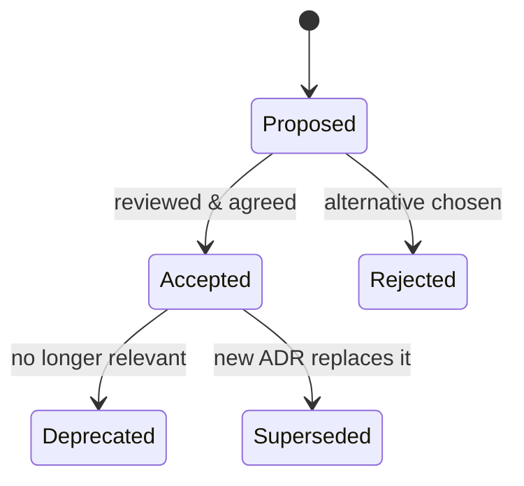

# Architecture Decision Records

> Scope: when and how to record architectural decisions for a Django codebase — format, sections,
> status lifecycle, storage, review and a worked example. Not covered here: how to make the
> decision itself (see [architectural-styles.md](./architectural-styles.md),
> [modular-monolith.md](./modular-monolith.md), [scalability-patterns.md](./scalability-patterns.md),
> [event-driven-architecture.md](./event-driven-architecture.md)), and patterns to avoid
> ([architecture-anti-patterns.md](./architecture-anti-patterns.md)).

## Purpose

An ADR captures **one** significant decision: the context that forced it, the options weighed,
the choice and its consequences. Code shows *what* the system does. ADRs preserve *why*, so a
later engineer or AI agent doesn't "fix" a deliberate trade-off or reopen a settled question.
For an agent, existing ADRs are binding context. Read `docs/adr/` before proposing a change
that touches an area they cover.

## Technical concepts

| Section | Content | Quality bar |
|---|---|---|
| **Title** | Imperative decision: "Use transactional outbox for order events" | States the choice, not the topic |
| **Status** | Proposed → Accepted → (Deprecated \| Superseded by ADR-NNNN) | Exactly one status, dated |
| **Context / problem** | Forces at play: requirements, incidents, numbers | Specific and measurable ("12 lost events/week") |
| **Constraints** | Fixed limits: team size, budget, Django/Python version, compliance, existing infra | Things that cannot be traded |
| **Considered alternatives** | 2–4 real options including "do nothing" | Each with pros and cons, not strawmen |
| **Decision** | The chosen option in one or two sentences | Unambiguous |
| **Rationale** | Why this option wins *under these constraints* | Links back to context |
| **Consequences** | Positive, negative and neutral follow-ups | Includes new work, new risks, what gets harder |
| **Trade-offs** | What was explicitly given up | Lets readers know when to revisit |

**Formats.**
- *Nygard* (the original): Title, Status, Context, Decision, Consequences. Minimal and fast.
- *MADR* (Markdown Any Decision Records): adds decision drivers, considered options with pros
  and cons, and confirmation. Better when alternatives are close.

Use one format repo-wide. Default to MADR-lite (the table above).

## Internal mechanics

**Immutability.** An accepted ADR is not rewritten when the decision changes. A new ADR
supersedes it, and the old one's status becomes "Superseded by ADR-0012". The history of
reasoning is the point. Typo fixes and added links are fine.

**Lifecycle.**



**Storage.** `docs/adr/NNNN-kebab-title.md`, numbered sequentially and never reused, plus
`docs/adr/README.md` as an index (number, title, status). They live in the repository so they
are reviewed in the same pull request as the code that implements them, and versioned with it.

## Decision guidance

**Write an ADR when the decision**:

| Trigger | Django examples |
|---|---|
| Is expensive to reverse | Custom user model strategy, multi-tenancy model (schema vs row), primary key type |
| Changes structure or boundaries | New app layering rules, extracting a worker/service, introducing a service layer |
| Adds infrastructure | Celery + Redis, read replicas, a broker, Channels |
| Sets a cross-cutting convention | Domain events mechanism, error-to-HTTP mapping, API versioning |
| Rejects an obvious option | "We will not adopt microservices this year", "No repository layer over the ORM" |

**Don't write one for**: library minor upgrades, naming one view, choices reversible in one PR,
or anything already dictated by an existing ADR. Rejected-but-recurring proposals deserve an ADR
precisely so the debate doesn't repeat.

**Size**: one to two pages. If it needs more, it is probably several decisions.

## Django implementation examples

Repository layout:

```text
docs/adr/
├── README.md                                   # index table
├── 0001-record-architecture-decisions.md
├── 0002-modular-monolith-with-layered-apps.md
├── 0003-custom-user-model.md
└── 0007-transactional-outbox-for-order-events.md
```

Worked example:

```markdown
# 0007. Use a transactional outbox for order events

- Status: Accepted (2026-03-14)
- Deciders: platform team, orders team
- Supersedes: —

## Context
`apps.orders.place_order` publishes `OrderPlaced` to RabbitMQ with `transaction.on_commit`.
If the process dies or the broker is unreachable after commit, the event is lost: 9 occurrences
last month, each requiring manual reconciliation in the warehouse system. Billing and the
warehouse consume the event.

## Constraints
- Single PostgreSQL database; Django 5.2 LTS; Celery already deployed.
- No new infrastructure this quarter (no CDC/Debezium).
- At-least-once delivery acceptable; consumers can be made idempotent.

## Considered options
1. **Keep `on_commit` publish + retries** — simple; still loses events on crash after commit.
2. **Transactional outbox** — write `OutboxMessage` rows in the same transaction; a relay
   publishes and marks them sent.
3. **CDC (Debezium) on the orders table** — no app changes; new infra and ops skill required.
4. **Publish inside the transaction** — event may be published for a rolled-back order.

## Decision
Adopt option 2. `apps.platform` owns `OutboxMessage` and a relay (Celery beat every 5 s using
`SELECT … FOR UPDATE SKIP LOCKED`). Services record events via
`platform.outbox.record(event)` inside their `transaction.atomic` block.

## Rationale
Only option 2 guarantees that an event exists if and only if the order commits, without new
infrastructure. Option 3 is equivalent in guarantees but violates the infra constraint.

## Consequences
- + No lost events; replay is possible from the table.
- − Delivery is at-least-once: all consumers must dedupe on `event_id` (tracked in ADR-0008).
- − Up to ~5 s added latency; table needs a retention job (`purge_outbox` command, 14 days).
- − Ordering is per-aggregate only (relay orders by `id` within `aggregate_id`).
- Revisit if event volume exceeds ~200/s or CDC infrastructure becomes available.
```

Why this example works: numbers in the context, constraints that eliminate options honestly, a
rejected alternative that is technically equal and why it lost, and negative consequences that
generate follow-up work.

## Production use cases

- **Onboarding agents and engineers**: `docs/adr/README.md` is the first file to read before
  structural changes.
- **Code review**: a PR that introduces Celery or a new top-level app links its ADR. Reviewers
  check that the code matches the decision.
- **Incident follow-ups**: postmortems that change architecture produce an ADR (for example,
  timeouts policy after an outage).
- **Audits and compliance**: data-residency or PII-isolation decisions have a traceable
  rationale.

## Advantages and disadvantages

| Advantages | Disadvantages |
|---|---|
| Preserves reasoning; prevents repeated debates | Writing cost; can become ceremony |
| Makes trade-offs explicit and reviewable | Stale if superseding isn't enforced |
| Gives agents durable, local context | Too many trivial ADRs bury important ones |
| Cheap: plain Markdown, no tooling | Requires a habit at decision time, not after |

## Security and performance considerations

- Security-relevant decisions (auth mechanism, tenant isolation, secrets handling, file access
  model) warrant ADRs and a security reviewer
  ([django-security-engineering](../../django-security-engineering/SKILL.md)).
- Never put secrets, credentials, internal hostnames or customer data in ADRs. They are in the
  repo forever.
- Record performance decisions with their measured basis ("p95 1.8 s on `order_list`, 70%
  DB time") so later readers can tell whether the premise still holds.

## Common mistakes

- Writing the ADR after implementation as justification, with no real alternatives.
- Strawman alternatives ("Option B: rewrite in Go").
- Missing negative consequences, which signals the analysis wasn't done.
- Editing an accepted ADR to reflect a new decision instead of superseding it.
- ADRs in a wiki detached from the code, so they drift and nobody finds them.
- Bundling several decisions ("Adopt Celery, Redis and DRF throttling") into one record.
- Vague context ("performance is bad") with no numbers.

## Troubleshooting and evaluation

Review checklist for an ADR PR:

- [ ] Title states a decision; status and date set.
- [ ] Context has concrete forces (metrics, incidents, requirements).
- [ ] Constraints listed and respected by the chosen option.
- [ ] At least two real alternatives, each with pros and cons.
- [ ] Rationale ties the choice to context and constraints.
- [ ] Negative consequences and follow-up work identified.
- [ ] Revisit conditions stated.
- [ ] Superseded ADRs updated with a forward link; index updated.

**Signals the practice is failing**: repeated debates about settled topics, code contradicting
accepted ADRs, or an index full of "Proposed" items older than a month. Fix by reviewing ADRs in
architecture syncs and closing or rejecting stale proposals.

## Related knowledge

- [architectural-styles.md](./architectural-styles.md),
  [modular-monolith.md](./modular-monolith.md): the most common ADR subjects.
- [event-driven-architecture.md](./event-driven-architecture.md): outbox details behind the
  example.
- [architecture-anti-patterns.md](./architecture-anti-patterns.md): decisions that recur as
  problems.

## Official documentation

- Michael Nygard, "Documenting Architecture Decisions":
  https://cognitect.com/blog/2011/11/15/documenting-architecture-decisions
- ADR community resources and templates: https://adr.github.io/
- MADR template: https://adr.github.io/madr/
