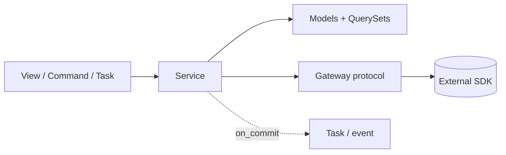

# Architecture fundamentals

> Scope: architecture vs implementation, separation of concerns, SOLID/DRY/KISS/YAGNI applied to
> Django, coupling and cohesion, abstraction boundaries, maintainability and extensibility.
> Not covered here: style selection ([architectural-styles.md](./architectural-styles.md)),
> app boundaries ([django-application-boundaries.md](./django-application-boundaries.md)),
> service mechanics ([service-layer.md](./service-layer.md)), Django's own component model
> ([django-core fundamentals](../../django-core/references/fundamentals.md)).

## Purpose

Give an agent a small, consistent vocabulary for judging Django code at the level above a
single function: *where* a responsibility lives, *what* may depend on what, and *when* an
abstraction pays for itself. Every other reference in this skill applies these principles.

## Technical concepts

### Architecture versus implementation

| Architecture (expensive to change) | Implementation (cheap to change) |
|---|---|
| Which apps exist and what each owns | How a view renders its template |
| Dependency direction between apps | Whether a view is a FBV or CBV |
| Where transactions begin and end | Field names inside one model |
| Sync vs async processing, one DB vs many | Choice of a QuerySet filter |
| Public interfaces between apps | Private helpers inside a service module |

Rule of thumb: a decision is architectural if reversing it touches many apps, migrations, or
deployment. Spend review effort there; let implementation details stay local and boring.

### Separation of concerns in Django

Django already separates HTTP (views, middleware), presentation (templates, serializers),
input validation (forms, serializers) and persistence (models, ORM). The concern Django does
**not** separate for you is *business behaviour*. Its default home is ambiguous — views,
`Model.save()`, signals, serializers all "work" — which is why most Django architecture debt is
business logic spread across those places.

| Concern | Django home |
|---|---|
| Transport (HTTP, CLI, task payload) | view, management command, task |
| Input shape and coercion | form, serializer |
| Data and single-row invariants | model fields, `Meta.constraints`, `clean()` |
| Reusable query vocabulary | `QuerySet` methods |
| Use cases spanning rows/apps, transactions, side effects | service functions |
| Read use cases with scoping/loading strategy | selector functions |
| External systems | adapter/gateway module |

### SOLID, translated to Django

- **Single responsibility** — one *reason to change* per module. `orders/services.py` changes when
  ordering rules change; it should not also change when the email template does.
- **Open/closed** — extend via configuration or registration, not edits: a new payment provider
  is a new adapter class selected by `BILLING_GATEWAY`, not a new `elif` in `place_order`.
- **Liskov** — subclasses of CBVs, managers or adapters must honour the parent's contract.
  A `FakeGateway` that never raises `PaymentDeclined` is not a valid substitute in tests.
- **Interface segregation** — expose small public functions (`reserve_stock`) rather than the
  whole `inventory` model graph.
- **Dependency inversion** — high-level policy (`billing.services`) depends on a protocol
  (`PaymentGateway`), not on the Stripe SDK. Apply only at real volatility points — see
  [dependency-management.md](./dependency-management.md).

### DRY, KISS, YAGNI

- **DRY** is about *knowledge*, not text. Two views with similar code but different business
  reasons may stay duplicated; the rule "orders over 10 000 need approval" must exist once.
- **KISS** — prefer a function to a class, a QuerySet method to a repository, a direct call to
  an event, until there is evidence otherwise.
- **YAGNI** — no interfaces with one implementation, no plugin systems without a second plugin,
  no microservice "for later". The second real use case is the trigger for abstraction.

### Coupling and cohesion

- **Cohesion**: things that change together live together. An `orders` app holding `Order`,
  `OrderLine`, order services and order selectors is cohesive; a `models` app holding every
  model is not.
- **Coupling**: how much one app must know about another. Ranked from loosest to tightest:

| Coupling form | Example | Acceptable? |
|---|---|---|
| Event | `orders` publishes `OrderPlaced`; `billing` subscribes | Yes, for reactions |
| Id reference | `Invoice.order_id` stored, no FK | Yes, for loose lifecycle |
| Public function call | `inventory.api.reserve_stock()` | Yes — the default |
| Foreign key to another app's model | `ForeignKey("customers.Customer")` | Yes, downward only |
| Reading another app's tables via its models | `Product.objects.filter(...)` from `orders` | Reads only, via selectors when non-trivial |
| Writing another app's rows directly | `Stock.objects.update(...)` from `orders` | No |
| Importing private helpers | `from inventory.services import _recalc` | No |

### Abstraction boundaries

An abstraction boundary is a place where callers stop needing to know internals. In Django the
useful boundaries are: an app's public module (`api.py`/`services.py`/`selectors.py`), a
`QuerySet` method, a gateway protocol around a third-party SDK, and a domain exception
hierarchy. A boundary is worth adding when *either side changes independently* of the other.

## Internal mechanics

Why Django codebases drift: the framework gives many hook points that run implicitly —
`save()` overrides, signals, middleware, template tags, serializer `create()`. Each is
convenient locally, but implicit execution raises coupling invisibly: a reader of
`place_order()` cannot see that a `post_save` handler in `billing` also runs. Architecture work
in Django is mostly about making control flow explicit again.



## Decision guidance

| Question | Lean towards |
|---|---|
| Will this rule be needed from >1 entry point (web, API, admin, command)? | Service function |
| Does it touch only one row's own fields? | Model method / constraint |
| Is there a second, real implementation now? | Introduce a protocol/adapter |
| Is the abstraction only for "testability"? | Use Django's test tools or `mock` instead |
| Will the change ripple across apps? | Treat as architecture: write an ADR ([architecture-decision-records.md](./architecture-decision-records.md)) |

## Django implementation examples

Bad — one view mixes transport, rules, persistence and side effects:

```python
def checkout(request):
    cart = request.session["cart"]
    if sum(i["qty"] * i["price"] for i in cart) > 10_000 and not request.user.is_staff:
        return HttpResponseForbidden()
    order = Order.objects.create(customer=request.user.customer)
    for item in cart:
        Stock.objects.filter(product_id=item["id"]).update(quantity=F("quantity") - item["qty"])
    send_mail("Thanks", "...", None, [request.user.email])   # before commit, blocks request
    return redirect("orders:detail", pk=order.pk)
```

Good — concerns separated; each piece testable on its own:

```python
def checkout(request):
    form = CheckoutForm(request.POST, cart=request.session.get("cart", []))
    if not form.is_valid():
        return render(request, "orders/checkout.html", {"form": form})
    try:
        order = place_order(customer=request.user.customer, lines=form.cleaned_lines())
    except OutOfStock as exc:
        form.add_error(None, str(exc))
        return render(request, "orders/checkout.html", {"form": form})
    return redirect("orders:detail", pk=order.pk)
```

`place_order` owns the approval rule, the transaction, the call to `inventory.api.reserve_stock`
and the `on_commit` confirmation — see [service-layer.md](./service-layer.md).

## Production use cases

- A rule must apply identically to the website, the DRF API and a nightly import command →
  single service, three thin entry points.
- A payment provider will be swapped next quarter → gateway protocol now (real volatility).
- A CRUD admin-only screen → no service; `ModelAdmin` + `ModelForm` are enough (KISS).

## Advantages and disadvantages

| Principle applied | Gains | Costs when over-applied |
|---|---|---|
| Separation of concerns | Testable units, reuse across entry points | Indirection for trivial CRUD |
| Dependency inversion | Swappable infra, fast tests | Interfaces nobody swaps |
| DRY of knowledge | One place to change a rule | Premature shared helpers coupling unrelated code |
| YAGNI | Small codebase, fast delivery | Rework if a known requirement was ignored |

## Security and performance considerations

- Authorisation is a concern too: decide it at the entry point, enforce it again by scoping
  queries (`Order.objects.for_user(user)`) so no new entry point can bypass it.
- Abstractions can hide queries. A selector that returns a `QuerySet` keeps laziness and lets
  callers add `select_related`; a repository returning lists forces evaluation and N+1 risks.
- Implicit hooks (signals, `save()` overrides) add hidden queries per write; explicit calls make
  cost visible in review.

## Common mistakes

- Treating DRY as "never repeat three lines" and building a `utils` app everybody imports.
- Applying SOLID by creating a class per verb with `@staticmethod`s — a module of functions is
  already a cohesive unit in Python.
- Adding interfaces "for testing" when `override_settings`, `mock.patch` or a fake adapter at a
  real boundary would do.
- Considering a choice "just implementation" when it fixes cross-app dependencies.

## Troubleshooting and evaluation

Quick health signals for an existing codebase:

- How many files change for a typical feature? Many apps per feature → low cohesion.
- `grep -R "from apps\." apps/<app>` — does a foundational app import feature apps?
- Can a service be called from `manage.py shell` without a `request`? If not, transport leaked in.
- Are rules duplicated between serializer `validate()` and form `clean()`? Move to the service
  or model.
- Does a test of one use case need half the project's fixtures? Coupling is too high.

## Related knowledge

[architectural-styles.md](./architectural-styles.md) ·
[django-application-boundaries.md](./django-application-boundaries.md) ·
[service-layer.md](./service-layer.md) · [design-patterns.md](./design-patterns.md) ·
[architecture-anti-patterns.md](./architecture-anti-patterns.md) ·
[django-core project-structure](../../django-core/references/project-structure.md)

## Official documentation

- Django design philosophies: https://docs.djangoproject.com/en/stable/misc/design-philosophies/
- Applications: https://docs.djangoproject.com/en/stable/ref/applications/
- Martin Fowler, "Is High Quality Software Worth the Cost?": https://martinfowler.com/articles/is-quality-worth-cost.html
