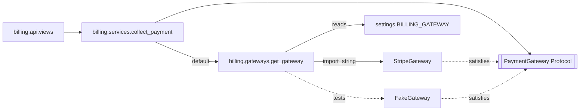

# Dependency management

> Scope: dependency inversion, dependency injection without a framework, Protocol interfaces,
> composition roots, settings-driven dependencies, testing with fakes, the service-locator
> anti-pattern. Not covered here: app import tiers and cycles
> ([django-application-boundaries.md](./django-application-boundaries.md)), pattern catalogue
> ([design-patterns.md](./design-patterns.md)), settings mechanics
> ([settings-configuration.md](../../django-core/references/settings-configuration.md)), Python
> package dependencies (not an architecture concern).

## Purpose

Business code should depend on **what it needs** (charge a card), not **who provides it**
(Stripe SDK). This keeps services testable, lets infrastructure change locally, and keeps import
graphs acyclic. Django already does this pervasively — storages, cache backends, email backends,
auth backends are all chosen by dotted paths in settings. Reuse that idiom instead of adding a DI
container.

## Technical concepts

| Concept | In Django terms |
|---|---|
| Dependency inversion (DIP) | `billing.services` depends on a `PaymentGateway` Protocol it owns; `StripeGateway` implements it |
| Dependency injection (DI) | Passing the gateway in as an argument (with a sensible default) |
| Interface boundary | `typing.Protocol` — structural, no inheritance needed, checked by mypy/pyright |
| Composition root | The one place that wires implementations: a factory reading settings, or `AppConfig.ready()` |
| Configuration-driven dependency | `BILLING_GATEWAY = "apps.billing.gateways.StripeGateway"` + `import_string` |
| Service locator (anti-pattern) | A global registry that code queries at arbitrary points (`container.get("gateway")`) |

Not every dependency needs inverting. The ORM, `django.conf.settings`, `timezone.now` and the
standard library are stable dependencies — import them directly. Invert **volatile** ones:
third-party APIs, message brokers, clocks in time-critical logic, anything you'd fake in tests.

## Internal mechanics



How Django's own pluggable backends work — and how to copy it:

1. A setting holds a dotted path (and options).
2. `django.utils.module_loading.import_string(path)` imports the class lazily at first use.
3. A cached accessor returns the instance (`django.core.cache.caches`, `storages`).
4. Tests replace the path with `override_settings`; some accessors listen to
   `setting_changed` to reset caches.

Lazy resolution matters: importing implementations at module import time creates import cycles
and loads SDKs in processes that never use them (e.g., `migrate`).

## Decision guidance

| Need | Technique |
|---|---|
| Swap provider in tests only | Parameter with default + fake passed in tests |
| Swap provider per environment | Setting with dotted path + `import_string` factory |
| Multiple implementations active at once (per tenant/country) | Strategy registry keyed by value — see [design-patterns.md](./design-patterns.md) |
| Lower app must call into a higher app | Inversion: lower app defines a callback/event hook; higher app registers in `ready()` |
| Many dependencies, complex lifetimes | Reconsider design first; a DI library (e.g. `dependency-injector`) only with team agreement and a proven need |

Prefer **explicit parameters** over hidden lookups. A function whose signature shows
`gateway: PaymentGateway | None = None` documents its collaborator.

## Django implementation examples

**Port and adapters:**

```python
# apps/billing/gateways.py
from functools import cache
from typing import Protocol
from django.conf import settings
from django.utils.module_loading import import_string

@dataclass(frozen=True, slots=True)
class PaymentResult:
    reference: str
    succeeded: bool

class PaymentGateway(Protocol):
    def charge(self, *, amount: Money, token: str, idempotency_key: str) -> PaymentResult: ...

class StripeGateway:
    def __init__(self, api_key: str | None = None, timeout: float = 10.0):
        self._api_key = api_key or settings.STRIPE_API_KEY
        self._timeout = timeout

    def charge(self, *, amount, token, idempotency_key):
        ...  # SDK call with timeout + idempotency key; translate response to PaymentResult

class FakeGateway:
    def __init__(self, succeed: bool = True):
        self.succeed, self.calls = succeed, []

    def charge(self, *, amount, token, idempotency_key):
        self.calls.append((amount, token, idempotency_key))
        return PaymentResult(reference=f"fake-{idempotency_key}", succeeded=self.succeed)

@cache
def get_gateway() -> PaymentGateway:                 # composition root for billing
    return import_string(settings.BILLING_GATEWAY)()
```

```python
# config/settings.py
BILLING_GATEWAY = os.environ.get("BILLING_GATEWAY", "apps.billing.gateways.StripeGateway")
```

**Injection via parameter with default:**

```python
# apps/billing/services.py
@transaction.atomic
def collect_payment(*, invoice_id: int, token: str,
                    gateway: PaymentGateway | None = None) -> Invoice:
    gateway = gateway or get_gateway()
    invoice = Invoice.objects.select_for_update().get(pk=invoice_id)
    if invoice.is_paid:
        return invoice                                   # idempotent
    result = gateway.charge(amount=invoice.total, token=token,
                            idempotency_key=f"invoice-{invoice.pk}")
    ...
```

(Calling an external API inside `atomic()` holds the row lock for the call's duration; that is a
deliberate trade-off here to prevent double charges — keep the timeout short, or move to a
two-step "pending → confirm" flow for slow providers.)

**Inverting a dependency between apps** — `inventory` (lower tier) must notify on low stock
without importing `purchasing` (higher tier):

```python
# apps/inventory/hooks.py
low_stock_handlers: list[Callable[[int, int], None]] = []

def on_low_stock(handler):
    low_stock_handlers.append(handler)
    return handler

# apps/purchasing/apps.py
class PurchasingConfig(AppConfig):
    name = "apps.purchasing"
    def ready(self):
        from apps.inventory.hooks import on_low_stock
        from .services import create_reorder
        on_low_stock(lambda product_id, qty: create_reorder(product_id=product_id))
```

**Bad — service locator:**

```python
# apps/platform/container.py
REGISTRY = {}
def resolve(name): return REGISTRY[name]

# anywhere
def collect_payment(invoice_id):
    gateway = resolve("payments")       # hidden dependency, fails at runtime, untyped
```

## Production use cases

- `FakeGateway` in local/dev and CI via `BILLING_GATEWAY`, sandbox provider in staging, live in
  production — no code branches on environment.
- Migrating from one SMS provider to another behind the same Protocol, toggled by setting.
- Email via `EMAIL_BACKEND` and files via `STORAGES` — Django's built-in config-driven DI;
  don't wrap them again.

## Advantages and disadvantages

| Advantages | Disadvantages |
|---|---|
| Services testable without network | Indirection; "go to definition" lands on a Protocol |
| Provider swaps are configuration | Misconfigured dotted path fails at first use, not startup (mitigate with a system check) |
| Acyclic imports between apps | Over-applied, every collaborator becomes an interface |
| Matches Django's own idioms | Cached singletons must be reset in tests that override settings |

## Security and performance considerations

- Never let **user input** choose a dotted path for `import_string` — that is arbitrary code
  loading. Only settings or a fixed allow-list registry.
- Credentials are read inside the adapter from settings/env, not passed through services.
- Cache instances (`@cache`) for clients with connection pools; creating an SDK client per call
  wastes TLS handshakes. Ensure the client is thread-safe for threaded/async servers.
- Validate configuration early: a custom system check in `AppConfig.ready()` registration can
  verify `import_string(settings.BILLING_GATEWAY)` resolves — see
  [models-application-lifecycle.md](../../django-core/references/models-application-lifecycle.md).

## Common mistakes

- Abstract base classes with one implementation and no fake — pure ceremony.
- Importing `stripe` at module top in `services.py`, coupling every test to the SDK.
- Wiring dependencies inside `ready()` with DB access or network calls.
- `@cache`d factories not cleared after `override_settings` → tests use the wrong backend.
  Call `get_gateway.cache_clear()` or subscribe to `setting_changed`.
- Global mutable registries modified at import time from many modules (order-dependent).

## Troubleshooting and evaluation

- **`ImportError` from `import_string`** → typo in the setting or missing package in this
  environment; add a system check.
- **Tests hit the real API** → dependency not injected and not overridden; pass a fake or use
  `override_settings(BILLING_GATEWAY="apps.billing.gateways.FakeGateway")` plus cache clear.
- **Circular import between apps** → a lower app imports a higher one; invert with a hook or
  event ([domain-events.md](./domain-events.md)).
- Evaluate: can each volatile collaborator be replaced in one test without `mock.patch` of a
  module path? If not, consider injection.

## Related knowledge

[design-patterns.md](./design-patterns.md) · [layered-architecture.md](./layered-architecture.md) ·
[service-layer.md](./service-layer.md) ·
[django-application-boundaries.md](./django-application-boundaries.md) ·
[settings-configuration.md](../../django-core/references/settings-configuration.md) ·
[django-testing](../../django-testing/SKILL.md) · [django-integrations](../../django-integrations/SKILL.md)

## Official documentation

- https://docs.djangoproject.com/en/stable/ref/utils/#module-django.utils.module_loading
- https://docs.djangoproject.com/en/stable/topics/testing/tools/#overriding-settings
- https://docs.djangoproject.com/en/stable/ref/signals/#setting-changed
- https://docs.djangoproject.com/en/stable/topics/checks/
- https://docs.djangoproject.com/en/stable/ref/applications/#django.apps.AppConfig.ready
- https://docs.python.org/3/library/typing.html#typing.Protocol
- https://martinfowler.com/articles/injection.html
