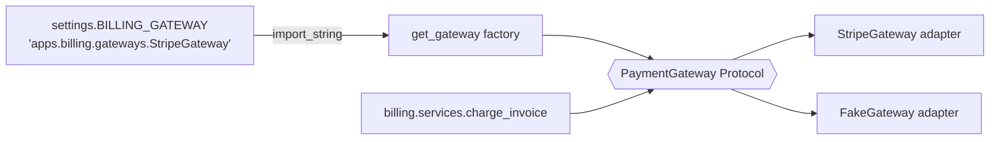

# Design patterns in Django

> Scope: when Factory, Strategy, Adapter, Observer, Command, Repository, Unit of Work, Decorator, Facade and Dependency Injection pay off in a Django codebase, and where Django already provides them. Not covered here: injection mechanics ([dependency-management.md](./dependency-management.md)), repositories and aggregates in DDD ([domain-driven-design.md](./domain-driven-design.md)), event dispatch ([domain-events.md](./domain-events.md)), service design ([service-layer.md](./service-layer.md)), how signals work ([django-core signals](../../django-core/references/signals-management-commands.md)).

## Purpose

Patterns are names for solutions to recurring forces. In Django most of them **already exist in
the framework**: recognise and reuse those before you hand-roll one. A pattern earns its place
only when the force it resolves is present *now*, e.g. two real payment providers, not "we might
switch one day". Each pattern added without its force is indirection a reader has to pay for.

## Technical concepts

| Pattern | Force it resolves | Django already does it in… |
|---|---|---|
| **Factory** | Choosing/constructing an implementation from config | `import_string`, `storages[...]` (Django ≥ 4.2), `caches[...]`, `get_user_model()` |
| **Strategy** | Interchangeable algorithms behind one interface | Auth backends, storage backends, cache backends, password hashers, email backends |
| **Adapter** | Wrapping a foreign API in your own interface | DB backends adapting drivers; your payment/SMS gateways |
| **Observer** | Notifying unknown listeners of an event | Signals (`post_save`, `user_logged_in`) |
| **Command** | Encapsulating an invocable action with arguments | Management commands, Celery tasks, migration operations |
| **Repository** | A collection-like interface over persistence | Managers/QuerySets (`Order.objects.open()`) |
| **Unit of Work** | Committing a set of changes atomically | `transaction.atomic()` + the DB transaction |
| **Decorator** | Adding behaviour around a callable without changing it | `@login_required`, `@cache_page`, `@transaction.atomic`, middleware |
| **Facade** | One simple entry point over a subsystem | `django.core.mail.send_mail`, `call_command`; an app's `api.py` |
| **Dependency Injection** | Supplying collaborators from outside instead of hard-coding | Settings-driven backends; passing a gateway argument to a service |

## Internal mechanics

Django's "pluggable backend" machinery is Factory + Strategy combined: a setting holds a dotted
path, `django.utils.module_loading.import_string` resolves it to a class, and the framework
calls a fixed interface on it. Auth is the canonical example: `AUTHENTICATION_BACKENDS` is a
list of strategies tried in order; each implements `authenticate()` / `get_user()`. Reusing this
convention in your own code means other Django developers already understand it.



## Decision guidance

| Pattern | Justified when | Overkill when |
|---|---|---|
| Factory | Implementation chosen by environment/config; ≥2 real implementations (prod + fake counts) | One implementation; a constructor call is enough |
| Strategy | Algorithms vary per tenant/plan/region and are swapped at runtime | An `if` with two branches that never grows |
| Adapter | A third-party SDK whose types/errors must not leak into your domain | Wrapping Django's own ORM or cache API |
| Observer | Publisher must not know subscribers (lower app notifying higher app) | Main-path business flow: an explicit call is clearer |
| Command | Actions must be queued, retried, logged, or run from CLI/cron | A plain function called from one place |
| Repository | Non-ORM storage (external API, search index) or a true DDD aggregate boundary | Wrapping `Order.objects` 1:1: QuerySet methods already do this |
| Unit of Work | Multiple writes must commit together | Building your own: use `transaction.atomic` |
| Decorator | Cross-cutting concern on selected callables (auth, caching, retries, timing) | Hiding business rules in a decorator |
| Facade | Other apps need a stable, small surface over your app | A facade that re-exports every function 1:1 with no curation |
| DI | Collaborator has side effects (HTTP, payments, clock) you swap in tests/environments | Injecting the ORM, settings, or pure functions |

Rule of thumb: **a pattern needs a second real use.** "Real" includes a test fake for a
collaborator with external side effects, which is why gateways are the most common justified
abstraction in Django apps.

## Django implementation examples

**Adapter + Strategy + Factory (justified).** The payment provider is external and must be
fakeable.

```python
# apps/billing/gateways.py
from dataclasses import dataclass
from decimal import Decimal
from typing import Protocol
from django.conf import settings
from django.utils.module_loading import import_string

@dataclass(frozen=True)
class ChargeResult:
    reference: str
    succeeded: bool

class PaymentGateway(Protocol):
    def charge(self, *, amount: Decimal, currency: str, idempotency_key: str) -> ChargeResult: ...

class StripeGateway:
    """Adapter: translates Stripe SDK calls/errors into our types."""
    def __init__(self, api_key: str | None = None):
        import stripe
        self._stripe = stripe
        self._api_key = api_key or settings.STRIPE_API_KEY

    def charge(self, *, amount, currency, idempotency_key):
        try:
            intent = self._stripe.PaymentIntent.create(
                amount=int(amount * 100), currency=currency, confirm=True,
                api_key=self._api_key, idempotency_key=idempotency_key,
            )
        except self._stripe.error.CardError:
            return ChargeResult(reference="", succeeded=False)
        return ChargeResult(reference=intent.id, succeeded=intent.status == "succeeded")

class FakeGateway:
    def __init__(self):
        self.charges: list[tuple[Decimal, str]] = []
    def charge(self, *, amount, currency, idempotency_key):
        self.charges.append((amount, currency))
        return ChargeResult(reference=f"fake-{idempotency_key}", succeeded=True)

def get_gateway() -> PaymentGateway:          # Factory
    return import_string(settings.BILLING_GATEWAY)()
```

**Repository: bad vs good.**

```python
# Bad: a repository that only renames the ORM; adds a layer, removes QuerySet composability
class OrderRepository:
    def get(self, pk): return Order.objects.get(pk=pk)
    def filter_open(self): return list(Order.objects.exclude(status="cancelled"))

# Good: the QuerySet *is* the repository vocabulary; stays lazy and chainable
class OrderQuerySet(models.QuerySet):
    def open(self):
        return self.exclude(status__in=[Order.Status.CANCELLED, Order.Status.FULFILLED])
```

A Repository is justified for data **not** in your database, e.g. a `ProductSearchRepository`
over OpenSearch, so services do not depend on the search client. Depth:
[domain-driven-design.md](./domain-driven-design.md).

**Unit of Work.** Use the one you have:

```python
with transaction.atomic():              # the unit of work
    order = place_order(customer=customer, lines=lines)
    create_invoice(order=order)         # joins the same transaction
```

**Command.** A management command is the CLI shell; the service is the command's body:

```python
class Command(BaseCommand):
    def handle(self, *args, **options):
        expired = expire_unpaid_orders(older_than=timedelta(hours=24))
        self.stdout.write(f"expired={expired}")
```

**Decorator (justified: cross-cutting retry around external I/O only).**

```python
def retry_on(*excs, attempts=3, base_delay=0.2):
    def wrap(fn):
        @functools.wraps(fn)
        def inner(*a, **kw):
            for i in range(attempts):
                try:
                    return fn(*a, **kw)
                except excs:
                    if i == attempts - 1:
                        raise
                    time.sleep(base_delay * 2 ** i)
        return inner
    return wrap
```

Never wrap a function holding a DB transaction in a sleeping retry: it keeps locks open.

**Facade.** An app's curated public surface:

```python
# apps/inventory/api.py
from .services import reserve_stock, release_stock
from .selectors import stock_level
__all__ = ["reserve_stock", "release_stock", "stock_level"]
```

**Observer.** Prefer explicit domain events over model signals for your own workflows; see
[domain-events.md](./domain-events.md).

**Dependency Injection, the lightweight Django way.** Pass the collaborator as an optional
keyword argument that defaults to the configured one:

```python
def charge_invoice(*, invoice: Invoice, gateway: PaymentGateway | None = None) -> Invoice:
    gateway = gateway or get_gateway()
    ...
```

No container needed; depth in [dependency-management.md](./dependency-management.md).

## Production use cases

- Multi-provider payments/SMS/email per region: Strategy chosen by tenant setting.
- Swapping S3 for local storage in dev: Django's `STORAGES` setting (Strategy + Factory) rather than your own abstraction.
- Batch jobs that must be retryable and observable: Command objects as Celery tasks calling services.
- An app consumed by several others: Facade (`api.py`) keeps internal refactors private.

## Advantages and disadvantages

| | Advantages | Disadvantages |
|---|---|---|
| Framework-provided patterns | Zero code, familiar to every Django dev | Must follow Django's interface shape |
| Hand-rolled patterns | Fit your domain exactly | Indirection, more files, onboarding cost; often duplicate Django |

## Security and performance considerations

- `import_string` on **settings** is safe; on user input it is arbitrary code loading: never do that.
- Adapters are the single place to enforce timeouts, TLS, secret handling and error redaction for an external API.
- Repository wrappers that return lists instead of QuerySets defeat laziness and cause N+1 and memory blow-ups.
- Decorators run on every call; keep them O(1) and never perform DB queries in them for hot paths.

## Common mistakes

- Pattern-first design: introducing Strategy/Factory "for flexibility" with one implementation.
- Repository + Unit of Work classes over the ORM, copied from other ecosystems.
- Observer (signals) for core business flow, hiding control flow and transaction boundaries.
- Adapters that leak the SDK's exceptions/types into services.
- Facades that re-export every internal symbol, which makes them no boundary at all.

## Troubleshooting and evaluation

Ask of any pattern in review:
1. What concrete force does it resolve today? Name the second implementation or use.
2. Does Django already provide it (backend setting, QuerySet, `atomic`, decorator)?
3. If removed, how many lines and call sites change? If "few", it was probably unneeded.
4. Can a test replace the collaborator without `mock.patch` on module internals? If not, consider injection.

## Related knowledge

[dependency-management.md](./dependency-management.md) · [domain-driven-design.md](./domain-driven-design.md) ·
[service-layer.md](./service-layer.md) · [domain-events.md](./domain-events.md) ·
[architecture-anti-patterns.md](./architecture-anti-patterns.md) ·
[django-core: urls-views](../../django-core/references/urls-views.md) ·
[django-orm](../../django-orm/SKILL.md)

## Official documentation

- https://docs.djangoproject.com/en/stable/topics/auth/customizing/#other-authentication-sources
- https://docs.djangoproject.com/en/stable/ref/utils/#module-django.utils.module_loading
- https://docs.djangoproject.com/en/stable/topics/db/managers/
- https://docs.djangoproject.com/en/stable/topics/db/transactions/
- https://docs.djangoproject.com/en/stable/topics/http/decorators/
- https://martinfowler.com/eaaCatalog/ (Repository, Unit of Work definitions)
