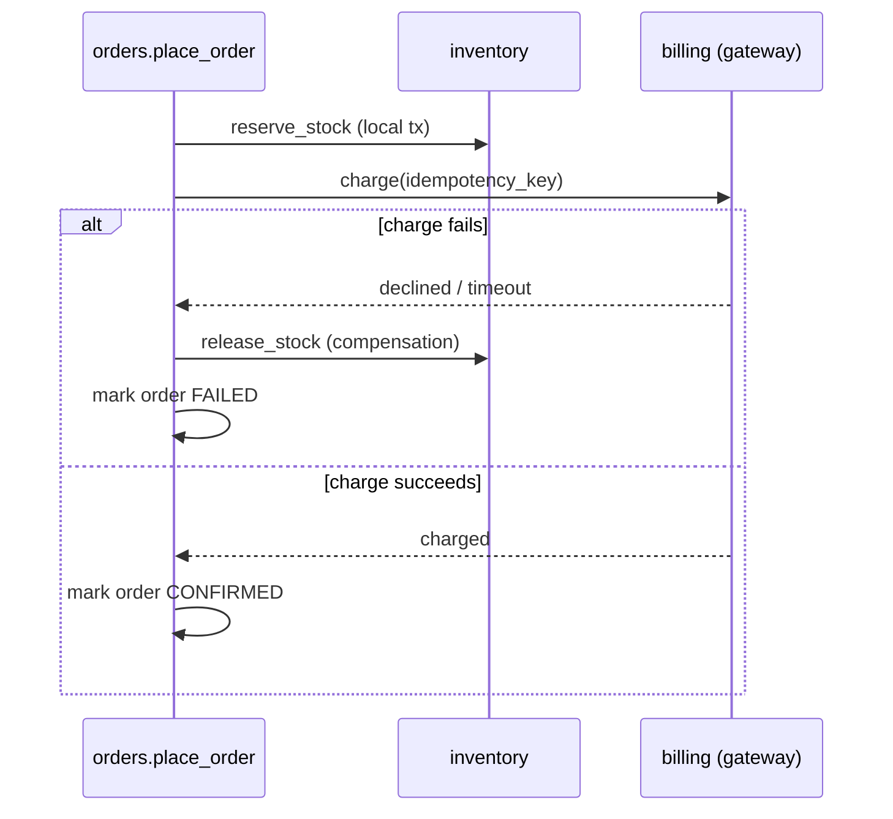

# Distributed systems

> Scope: what changes once a Django app talks to other processes over a network — communication
> styles, timeouts, retries, idempotency, why there are no distributed transactions, sagas,
> consistency models, failure isolation and observability. Not covered here: brokers, outbox and
> dead-letter queues ([event-driven-architecture.md](./event-driven-architecture.md)), in-process
> events ([domain-events.md](./domain-events.md)), whether to split at all
> ([architectural-styles.md](./architectural-styles.md)), log configuration
> ([django-core logging-exceptions](../../django-core/references/logging-exceptions.md)),
> third-party API clients in depth ([django-integrations](../../django-integrations/SKILL.md)).

## Purpose

Most Django systems become distributed long before anyone extracts a microservice: a payment
gateway, an email provider, a worker queue, a search cluster. Every network call can be slow,
fail, or succeed without the caller finding out. This reference gives agents the rules for
making those calls safe, and the patterns for keeping data consistent across them.

## Technical concepts

| Concept | Meaning in a Django codebase |
|---|---|
| **Synchronous call** | The request thread waits for a reply (HTTP/gRPC to `StripeGateway`). Latency and availability are coupled to the callee. |
| **Asynchronous message** | The caller records intent and moves on (task queue, broker event). Availability is decoupled; the result arrives later. |
| **Timeout** | An upper bound on waiting. Without one, a stuck upstream holds a worker until the server kills it. |
| **Retry** | Re-sending after a failure. Only safe when the operation is **idempotent** (same effect if applied twice). |
| **Idempotency key** | A client-chosen unique token so the receiver can detect and collapse duplicates. |
| **Distributed transaction (2PC)** | Atomic commit across several resource managers. Practically unavailable across HTTP services and brokers. |
| **Saga** | A sequence of local transactions, each with a **compensating action** that undoes it semantically. |
| **Consistency model** | Strong (read sees latest write), read-your-writes, eventual (converges later). |
| **Circuit breaker** | Stops calling a failing dependency for a cool-down period to fail fast. |
| **Bulkhead** | Separate resource pools so one slow dependency can't exhaust all workers. |

## Internal mechanics

**Why timeouts matter in Django specifically.** A WSGI deployment has a fixed number of worker
processes × threads. Each in-flight outbound call without a timeout pins one. Twenty slow calls
to a payment API can take a 20-slot gunicorn deployment offline for *all* endpoints — including
health checks — so the load balancer starts cycling instances. Under ASGI the event loop isn't
pinned by async I/O, but sync views still consume the thread pool
([django-core asgi-wsgi](../../django-core/references/asgi-wsgi.md)).

**Why `transaction.atomic` can't span a network call.** `atomic` controls one database
connection. If a service calls `gateway.charge()` inside `atomic` and the DB later rolls back,
the charge has still happened. If the commit succeeds but the process dies before the HTTP
response is read, you don't know whether the charge happened. So:

1. Keep remote calls **outside** DB transactions (or after commit via `on_commit`).
2. Make the remote call idempotent so it can be retried after an unknown outcome.
3. Record state locally *before* the call (`Payment(status=PENDING, idempotency_key=…)`) so a
   reconciler can finish the job.

**Two-phase commit.** PostgreSQL supports prepared transactions, but Django doesn't expose a
2PC coordinator, HTTP APIs and brokers don't take part, and a coordinator that dies holds locks
indefinitely. Treat 2PC as unavailable. Use sagas, the outbox pattern and idempotency instead.



## Decision guidance

| Situation | Choose | Why |
|---|---|---|
| User needs the answer to render the page (price quote, card auth) | Sync call with tight timeout + fallback | The user is waiting; async adds no value |
| Side effect the user doesn't wait for (email, webhook, PDF) | Async task enqueued `on_commit` | Removes upstream latency and failures from the request path |
| Several services must all change or all compensate | Saga (orchestrated by default) | No distributed transactions |
| Data owned elsewhere, read often | Local read model updated by events | Removes the sync dependency; accept staleness |
| Callee is flaky and non-critical | Circuit breaker + degraded response | Fail fast instead of queueing timeouts |

**Orchestration vs choreography.**

| | Orchestration | Choreography |
|---|---|---|
| Control | One coordinator (e.g. `apps.orders` saga service + state field) | Each participant reacts to events |
| Visibility | Whole flow in one place; easy to debug | Flow emerges from subscriptions; hard to trace |
| Coupling | Coordinator knows participants | Participants know event names only |
| Default | **Yes** for ≤ ~5 steps owned by one team | When participants belong to different teams/services |

**Consistency.** Default to strong consistency inside the monolith's single database: it's free.
Accept eventual consistency only at boundaries where it buys availability or decoupling, and
state the expected lag ("search reflects edits within 60 s").

## Django implementation examples

**Outbound HTTP with explicit timeouts and bounded retries** (`httpx` or `requests` —
whichever the project already uses):

```python
# apps/billing/gateways.py
import random, time, httpx

class GatewayUnavailable(Exception): ...

class StripeGateway:
    def __init__(self, *, api_key: str, base_url: str):
        self._client = httpx.Client(
            base_url=base_url,
            headers={"Authorization": f"Bearer {api_key}"},
            timeout=httpx.Timeout(connect=2.0, read=5.0, write=5.0, pool=2.0),
        )

    def charge(self, *, amount_cents: int, currency: str, idempotency_key: str) -> str:
        for attempt in range(3):
            try:
                resp = self._client.post(
                    "/charges",
                    json={"amount": amount_cents, "currency": currency},
                    headers={"Idempotency-Key": idempotency_key},
                )
            except (httpx.ConnectError, httpx.ReadTimeout) as exc:
                last = exc
            else:
                if resp.status_code < 500 and resp.status_code != 429:
                    resp.raise_for_status()          # 4xx: don't retry, it won't change
                    return resp.json()["id"]
                last = GatewayUnavailable(resp.status_code)
            time.sleep(min(2 ** attempt, 8) * random.uniform(0.5, 1.5))  # backoff + jitter
        raise GatewayUnavailable("charge failed after retries") from last
```

Why: retries are safe only because the same `Idempotency-Key` is sent each time. Jitter stops
many workers retrying in lockstep. Retrying 4xx responses wastes capacity. Inside a request,
keep total retry time below the server's request timeout; longer retry chains belong in a task.

**Idempotency for *incoming* requests** (webhooks, mobile clients retrying `POST`): a
unique-constraint table turns "have I seen this?" into an atomic DB check.

```python
# apps/platform/models.py
class IdempotencyRecord(models.Model):
    key = models.CharField(max_length=128)
    scope = models.CharField(max_length=64)            # e.g. "orders.place"
    response_status = models.PositiveSmallIntegerField(null=True)
    response_body = models.JSONField(null=True)
    created_at = models.DateTimeField(auto_now_add=True)

    class Meta:
        constraints = [models.UniqueConstraint(fields=["scope", "key"], name="uniq_idem_scope_key")]

# apps/orders/services.py
@transaction.atomic
def place_order_idempotent(*, key: str, customer, lines) -> tuple[Order, bool]:
    record, created = IdempotencyRecord.objects.select_for_update().get_or_create(
        scope="orders.place", key=key
    )
    if not created and record.response_body:
        return Order.objects.get(pk=record.response_body["order_id"]), False
    order = place_order(customer=customer, lines=lines)
    record.response_status, record.response_body = 201, {"order_id": order.pk}
    record.save(update_fields=["response_status", "response_body"])
    return order, True
```

Scope the key per customer if clients choose keys, and purge old records with a management
command.

**Orchestrated saga** with state persisted on the aggregate so a crash can resume:

```python
# apps/orders/sagas.py
def checkout(*, order_id: int) -> None:
    order = Order.objects.get(pk=order_id)
    try:
        reserve_stock(order_id=order.pk, lines=order.line_inputs())      # step 1
        _set_status(order, Order.Status.STOCK_RESERVED)
        charge_order(order_id=order.pk)                                  # step 2 (idempotent)
        _set_status(order, Order.Status.CONFIRMED)
    except PaymentDeclined:
        release_stock(order_id=order.pk)                                 # compensation
        _set_status(order, Order.Status.PAYMENT_FAILED)
    except GatewayUnavailable:
        retry_checkout.apply_async(args=[order.pk], countdown=60)        # unknown outcome: retry, don't compensate
```

Note the distinction: a **definite** failure triggers compensation, but an **unknown** outcome
(a timeout) triggers an idempotent retry or reconciliation. Compensating after a timeout can
release stock for an order that was actually paid.

**Propagating correlation IDs** to downstream services, reusing django-core's
`request_id_var`:

```python
from config.logging import request_id_var
self._client.post(url, json=payload, headers={"X-Request-ID": request_id_var.get()})
```

## Production use cases

- **Payment checkout**: sync authorization with a 5 s read timeout, idempotency key = order UUID,
  plus a nightly reconciliation command that compares `Payment(PENDING)` rows with the provider.
- **Webhook receivers**: verify the signature, store the event id under a unique constraint,
  return 200 quickly, and process in a task.
- **Multi-system fulfilment**: an orchestrated saga reserves stock, charges, then books a
  shipment, with a compensation for each step.
- **Slow non-critical dependency** (a recommendations API): 300 ms timeout and a circuit breaker;
  render the page without the widget when it's open.

## Advantages and disadvantages

| Pattern | Gains | Costs |
|---|---|---|
| Async messaging | Availability, burst absorption | Eventual consistency, harder debugging, broker to run |
| Sagas | Consistency without 2PC | Compensations to design and test; intermediate states are visible to users |
| Retries | Masks transient faults | Amplifies load during outages; requires idempotency |
| Circuit breakers | Fast failure, protects workers | Tuning; a degraded mode must exist |
| Local read models | Removes runtime dependency | Staleness, sync pipeline to maintain |

## Security and performance considerations

- Authenticate service-to-service calls (mTLS or signed tokens); verify webhook signatures
  before parsing the body ([django-security-engineering](../../django-security-engineering/SKILL.md)).
- Never forward user cookies or sessions to downstream services; pass explicit, scoped claims.
- Idempotency keys must be unguessable or scoped per principal, or one client can replay
  another's result.
- Timeouts bound tail latency: a request's total budget is the sum of its sequential calls.
  Parallelise independent calls (async views, see
  [django-core asynchronous-django](../../django-core/references/asynchronous-django.md)) only
  when they dominate latency.
- Reuse HTTP clients per process (connection pooling); creating a client per call costs a TLS
  handshake each time.
- Bulkhead: route slow integrations to a dedicated worker queue so they can't starve fast tasks.

## Common mistakes

- No timeout (the `requests` default is to wait forever) or one timeout value for connect and read.
- Retrying non-idempotent `POST`s without a key, which double-charges customers.
- An HTTP call inside `transaction.atomic`, holding row locks for the duration of a remote call.
- Compensating on timeout instead of reconciling.
- Choreography with ten event types and nobody able to describe the end-to-end flow.
- Treating "eventually consistent" as "unspecified": no lag target and no reconciliation.
- A retry loop in the web request *and* in the task *and* in the client library, which
  multiplies retries.

## Troubleshooting and evaluation

| Symptom | Likely cause | Check |
|---|---|---|
| All endpoints slow or 502 when one provider is degraded | Missing timeouts; workers pinned | Thread dumps (`py-spy dump`), outbound latency metrics |
| Duplicate charges or orders | Retry without idempotency | Search logs for the same request id with multiple writes |
| Stuck "PENDING" rows | Crash between remote call and local update | Reconciliation job; saga state field |
| Load spike after recovery | Synchronized retries | Add jitter, cap attempts, circuit breaker |
| Can't follow a request across services | No propagated correlation id | `X-Request-ID` / W3C `traceparent` headers |

**Evaluation questions**: for each outbound call — what's the timeout, is it retried, is it
idempotent, what happens on an unknown outcome, what does the user see when the dependency is
down? For observability, OpenTelemetry instrumentation for Django and HTTP clients gives
cross-service traces; adopt it only when logs with correlation IDs no longer suffice.

## Related knowledge

- [event-driven-architecture.md](./event-driven-architecture.md): brokers, delivery guarantees,
  outbox, DLQ.
- [domain-events.md](./domain-events.md): in-process events and `on_commit`.
- [scalability-patterns.md](./scalability-patterns.md): background processing capacity.
- [architecture-anti-patterns.md](./architecture-anti-patterns.md): distributed monolith.
- [django-core logging-exceptions](../../django-core/references/logging-exceptions.md): request
  IDs.
- [django-integrations](../../django-integrations/SKILL.md): concrete API client implementations.

## Official documentation

- Django transactions and `on_commit`: https://docs.djangoproject.com/en/stable/topics/db/transactions/
- Django constraints: https://docs.djangoproject.com/en/stable/ref/models/constraints/
- Saga pattern: https://microservices.io/patterns/data/saga.html
- HTTPX timeouts: https://www.python-httpx.org/advanced/timeouts/
- OpenTelemetry Python: https://opentelemetry.io/docs/languages/python/
