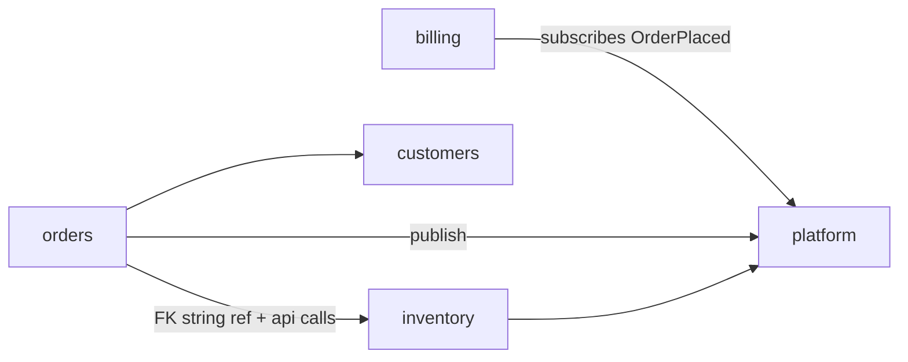

# Django application boundaries

> Scope: project vs app boundaries, app sizing, domain-oriented and reusable apps, app
> responsibilities, app tiers, public interfaces, cross-app references, circular dependencies,
> custom user placement, large-project organisation, extraction criteria. Not covered here:
> module communication and DB ownership levels ([modular-monolith.md](./modular-monolith.md)),
> service/selector internals ([service-layer.md](./service-layer.md)), `AppConfig` mechanics
> ([django-core models-application-lifecycle](../../django-core/references/models-application-lifecycle.md)),
> directory layout basics ([django-core project-structure](../../django-core/references/project-structure.md)).

## Purpose

Decide what a Django app is, how big it should be, what it may expose and import, and how to
keep cross-app dependencies acyclic. The Django app is the unit of code ownership, migrations
and data ownership, so these boundaries are the most important architecture decision in a
Django codebase.

## Technical concepts

### Project vs app

- **Project** (`config/`): settings, root URLconf, ASGI/WSGI entry points, project-wide
  middleware. Contains *no* business logic.
- **App** (`apps/<name>/`): models, migrations, services, selectors, views/API, admin, tasks,
  tests for one business capability.

### Domain-oriented apps

Apps follow the domain (`orders`, `billing`), never the technical layer (`models`, `views`,
`api`). An app is right-sized when it owns one cohesive set of concepts that change together
and can be explained in one sentence ("billing issues invoices and records payments").

| Too big | Too small |
|---|---|
| > ~15 models | One model every other app imports |
| Unrelated teams edit it | Always changes together with another app |
| Migrations conflict weekly | Exists only to hold "shared" helpers |

### Reusable vs project apps

| Project app | Reusable app |
|---|---|
| Lives under `apps/`, knows the project's domain | Pip-installable, knows nothing about the project |
| May depend on other project apps (downward) | Depends only on Django (and declared deps) |
| Uses project settings directly | Reads its own namespaced settings with defaults |
| Custom user via `settings.AUTH_USER_MODEL` | Must also use `settings.AUTH_USER_MODEL` / `get_user_model()` |

Make an app reusable only when a second project actually needs it; until then, *design* it
dependency-clean but keep it in-tree.

### App tiers

```text
platform     accounts, tenancy, audit, files, platform   (imports: Django only)
domain       catalog, inventory, customers               (imports: platform)
feature      orders, billing, reporting                  (imports: domain, platform)
interface    config/urls.py, admin site, API router      (imports: anything)
```

Imports flow **down** only. A lower app that needs to react to a higher one uses an event it
subscribes to, an explicitly registered callback, or a task — never a direct import.

### App responsibilities

Each app owns: its models and migrations, the invariants on that data, the services that write
it, the selectors that read it for others, its entry points (views, API, admin, commands,
tasks), and its tests. Other apps may reference its **models** for foreign keys and type hints,
but change its data only through its services.

## Internal mechanics

Why boundaries matter more in Django than elsewhere:

- `INSTALLED_APPS` order affects template, static-file and management-command resolution, and
  the app registry imports every `models.py` at startup — a cycle at import time breaks
  `django.setup()`.
- Migrations encode cross-app FKs as migration `dependencies`; an upward FK creates a migration
  dependency in the wrong direction and later prevents clean extraction.
- String model references (`"inventory.Product"`) are resolved lazily by the app registry, which
  is why they avoid import cycles that direct class imports cause.



## Decision guidance

### Cross-app references

| Need | Do |
|---|---|
| Hard relationship, same lifecycle | `ForeignKey("inventory.Product", on_delete=models.PROTECT)` (string ref avoids import cycles) |
| Loose reference, may be archived independently | Store the id + a denormalised label (e.g. `product_name`) |
| React to another app's event | Publishing app defines the event; subscriber registers in its `AppConfig.ready()` |
| Long-running reaction | Enqueue a task in `on_commit` |
| Read another app's data | Its selector / `api.py`; avoid reaching through multiple relations |

### Breaking circular imports

1. Use string model references (`"app_label.Model"`) in fields.
2. Use `TYPE_CHECKING` imports for type hints only.
3. If two apps call each other's services, the shared concept is in the wrong place — move it
   down a tier or merge the apps.
4. Invert the dependency with an event or a callback registry owned by the lower app.
5. Function-local imports are a last resort and need a comment saying why.

### Custom user placement

- Set `AUTH_USER_MODEL` to a custom user in `accounts` **at project start**; switching later
  requires a painful migration. Reference it with `settings.AUTH_USER_MODEL` in fields and
  `get_user_model()` at runtime.
- Keep `accounts` thin (identity, auth). Domain profile data (e.g. `Customer`) lives in its
  domain app with a `OneToOneField(settings.AUTH_USER_MODEL, ...)`.

### When to extract an app into a service

Extract only when at least one is true *and measured*: the component needs independent scaling
the monolith can't give it (e.g. CPU-heavy rendering), a separate team ships it on its own
cadence, or compliance requires isolation of its data. Before extracting, the boundary must
already be clean in the monolith: no shared tables, no inbound FKs, communication only through
its public interface and events. See [distributed-systems.md](./distributed-systems.md).

## Django implementation examples

Public interface:

```python
# apps/inventory/api.py  (or services.py + selectors.py with __all__)
from .selectors import stock_level
from .services import release_stock, reserve_stock

__all__ = ["reserve_stock", "release_stock", "stock_level"]
```

App structure for a feature app:

```text
apps/orders/
├── apps.py          # OrdersConfig(name="apps.orders", label="orders"); subscribes handlers in ready()
├── models.py        # Order, OrderLine; constraints, clean()
├── querysets.py     # OrderQuerySet.for_user(), .open()
├── selectors.py     # order_list()
├── services.py      # place_order(), cancel_order()
├── exceptions.py    # OrderError, OutOfStock, OrderNotCancellable
├── events.py        # OrderPlaced dataclass
├── api.py           # public interface for other apps
├── views.py / urls.py / admin.py / tasks.py
└── tests/
```

Bad vs good cross-app FK:

```python
# Bad — inventory (domain tier) points up at orders (feature tier)
class StockReservation(models.Model):
    order = models.ForeignKey("orders.Order", on_delete=models.CASCADE)

# Good — inventory stores an opaque reference; orders owns the relationship
class StockReservation(models.Model):
    reference = models.CharField(max_length=64, db_index=True)  # e.g. "order:123"
```

Reusable-app settings with defaults:

```python
# apps/audit/conf.py
from django.conf import settings

def retention_days() -> int:
    return getattr(settings, "AUDIT_RETENTION_DAYS", 365)
```

### Large-project organisation

- Group apps under `apps/` with a flat list; add one level of grouping (`apps/commerce/orders`)
  only past ~30 apps, keeping `label` short and unique.
- CODEOWNERS per app directory; each app has its own `tests/`.
- Project-level `config/urls.py` includes each app's URLconf with an `app_name` namespace.
- Keep `INSTALLED_APPS` grouped by tier so reviewers can see dependency order at a glance.

## Production use cases

- Splitting a 40-model `shop` app: identify clusters by FK density and co-change in Git, carve
  out `catalog` and `inventory` first (lowest tier), then `orders`. Use
  `SeparateDatabaseAndState` migrations to move models without data copies (see
  [django-orm](../../django-orm/SKILL.md)).
- Multi-tenant SaaS: `tenancy` in the platform tier; every domain selector scopes by tenant.
- Shared internal library across two Django projects: promote `audit` to a reusable app once the
  second project exists.

## Advantages and disadvantages

| Practice | Advantage | Disadvantage |
|---|---|---|
| Domain-oriented apps | Cohesion, clear ownership | Requires domain understanding up front |
| Strict tiers | No cycles, extractable modules | Needs events for upward reactions |
| Public `api.py` | Stable contract, private internals | One more file to maintain |
| Id references instead of FK | Loose coupling, extraction-ready | No DB referential integrity |
| Reusable apps | Sharing across projects | Versioning, settings indirection |

## Security and performance considerations

- Authorisation is decided at the entry point **and** enforced by scoping queries in selectors
  (`Order.objects.for_user(user)`); see [django-security-engineering](../../django-security-engineering/SKILL.md).
- Cross-app selectors own `select_related`/`prefetch_related` so each read use case is optimised
  once ([django-performance](../../django-performance/SKILL.md)).
- `on_delete=PROTECT` on cross-app FKs prevents one app's cleanup from cascading through
  another app's data.

## Common mistakes

- A `core`/`common`/`utils` app that every app imports and that imports everything back.
- Reaching into another app's models to change its state instead of calling its service.
- Business logic in the project package (`config/`).
- Swapping `AUTH_USER_MODEL` mid-project, or putting domain fields on the user model.
- Hard-coded model imports in reusable apps (`from accounts.models import User`).
- Duplicate app labels after nesting (`label` must be unique project-wide).

## Troubleshooting and evaluation

| Symptom | Diagnosis | Fix |
|---|---|---|
| `ImportError: cannot import name ... (partially initialized module)` | Import cycle between apps | String FK refs, `TYPE_CHECKING`, move concept down, or event |
| `AppRegistryNotReady` at startup | Model import at module top of a module loaded during setup | Import inside functions/`ready()` |
| Migrations from two apps depend on each other | Upward FK | Replace with id reference or move model |
| Every PR touches the same 3 apps | Wrong boundaries | Merge or re-draw |

### Review checklist

- [ ] New code lives in the app that owns the data it changes.
- [ ] No imports from a higher tier; no new cycles.
- [ ] Cross-app writes go through the owning app's service.
- [ ] Cross-app FKs point downward and use string references.
- [ ] No new abstraction without a second real use.
- [ ] Views, serializers, commands and tasks only translate and delegate.

## Related knowledge

[modular-monolith.md](./modular-monolith.md) · [service-layer.md](./service-layer.md) ·
[domain-driven-design.md](./domain-driven-design.md) ·
[architecture-anti-patterns.md](./architecture-anti-patterns.md) ·
[django-core models-application-lifecycle](../../django-core/references/models-application-lifecycle.md) ·
[django-core authentication-sessions](../../django-core/references/authentication-sessions.md)

## Official documentation

- Applications: https://docs.djangoproject.com/en/stable/ref/applications/
- Reusable apps tutorial: https://docs.djangoproject.com/en/stable/intro/reusable-apps/
- Substituting a custom user model: https://docs.djangoproject.com/en/stable/topics/auth/customizing/#substituting-a-custom-user-model
- Models across files / lazy relationships: https://docs.djangoproject.com/en/stable/ref/models/fields/#foreignkey
- `SeparateDatabaseAndState`: https://docs.djangoproject.com/en/stable/ref/migration-operations/#separatedatabaseandstate
