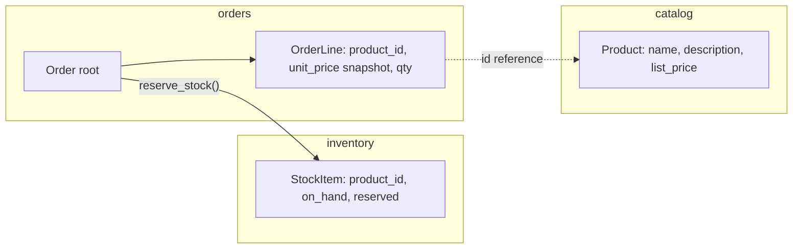

# Domain-driven design in Django

> Scope: subdomains, bounded contexts mapped to apps, entities, value objects, aggregates and
> roots, domain services, repositories, domain events (brief) and pragmatic DDD on top of the
> Django ORM. Not covered here: app sizing and import tiers
> ([django-application-boundaries.md](./django-application-boundaries.md)), service mechanics
> ([service-layer.md](./service-layer.md)), event dispatch ([domain-events.md](./domain-events.md)),
> pattern catalogue ([design-patterns.md](./design-patterns.md)), query design
> ([django-orm](../../django-orm/SKILL.md)).

## Purpose

DDD gives a vocabulary for deciding **where a rule lives and who may change which data**. In
Django the value is not in the tactical class names — it is in drawing app boundaries along the
business, keeping invariants in one place, and protecting consistency under concurrency. Use the
parts that pay for themselves; skip ceremony that fights the ORM.

## Technical concepts

| Concept | Meaning | Django mapping |
|---|---|---|
| Domain / subdomain | The business area / a coherent part of it (core, supporting, generic) | Core → your hand-written apps; generic → third-party packages (auth, payments SDK) |
| Bounded context | A boundary inside which a term has one meaning and one model | One app or a small group of apps with one public interface |
| Ubiquitous language | Same words in code, tickets and conversations | Model, field, service and exception names (`OrderNotCancellable`, not `Error42`) |
| Entity | Object with identity that persists through change | A `Model` with a primary key |
| Value object | Defined only by its attributes, immutable, replaceable | Frozen `dataclass`, a group of fields, `TextChoices`, a custom field |
| Aggregate | Cluster of objects changed together under one consistency rule | `Order` + `OrderLine` |
| Aggregate root | The only entry point for changing the aggregate | `Order`; lines are changed via order services/methods |
| Domain service | Domain logic that belongs to no single entity | Function in `services.py` (or `domain.py`) operating on several aggregates |
| Repository | Collection-like access to aggregates | Manager + custom `QuerySet` by default |
| Domain event | A fact the business cares about, in past tense | Frozen dataclass `OrderPlaced`, published after commit |

Subdomain classification drives investment: the **core** subdomain (here: ordering and pricing
rules) deserves rich modelling and tests; **supporting** ones (customer profiles) get plain Django
CRUD; **generic** ones (auth, email, payment processing) are bought or reused — `django.contrib.auth`,
a payment provider SDK behind an adapter.

## Internal mechanics

**Bounded contexts as apps.** The same real-world thing can be different models in different
contexts. "Product" in `catalog` has descriptions and images; in `inventory` it is a SKU with a
stock count; in `orders` it is a line with a *price snapshot*. Each context owns its tables and
migrations; others refer by FK string (`"catalog.Product"`) or by id.



**Aggregate consistency.** An aggregate is the unit of transactional consistency. In Django that
means: one `transaction.atomic()` block, the **root row locked** with `select_for_update()`, and
children modified only through code that also validates the root's invariants. Different
aggregates may be updated in the same transaction inside a monolith, but design as if they could
not — it keeps lock scope small and the path to eventual consistency open.

**Identity.** Entities are equal by primary key — Django's `Model.__eq__` already compares
`pk` (and concrete model). Value objects are equal by value — `@dataclass(frozen=True)` gives
that for free.

## Decision guidance

| Situation | Use DDD tactic? |
|---|---|
| Complex rules, many states, money, concurrency (orders, billing, scheduling) | Yes: aggregates, value objects, domain exceptions, domain events |
| CRUD with validation (customer profile, CMS pages) | No: ModelForm / serializer + model constraints |
| Term means different things to different teams | Yes: separate bounded contexts (apps), translate at boundaries |
| You want a `Repository` class "because DDD" | No: QuerySets are the repository. See below |
| Logic spans two aggregates | Domain service; consider eventual consistency via events |
| Need to hide a third-party model (payment provider) | Anti-corruption layer: adapter translating to your value objects |

**Repositories.** Django's Manager/QuerySet already provides collection semantics, identity
lookups, and composable filters. An explicit repository class is justified only when (a) the
aggregate is persisted somewhere other than the ORM (external API, document store), or (b) you
must swap storage in tests and the ORM test database is genuinely unavailable — rare. See
[design-patterns.md](./design-patterns.md).

## Django implementation examples

**Value object** — money as `Decimal` + currency, never float:

```python
# apps/platform/money.py
from dataclasses import dataclass
from decimal import Decimal, ROUND_HALF_UP

@dataclass(frozen=True, slots=True)
class Money:
    amount: Decimal
    currency: str

    def __post_init__(self):
        if not isinstance(self.amount, Decimal):
            raise TypeError("Money.amount must be Decimal")
        if len(self.currency) != 3:
            raise ValueError("ISO 4217 currency code expected")

    def __add__(self, other: "Money") -> "Money":
        if other.currency != self.currency:
            raise ValueError("currency mismatch")
        return Money(self.amount + other.amount, self.currency)

    def quantize(self) -> "Money":
        return Money(self.amount.quantize(Decimal("0.01"), ROUND_HALF_UP), self.currency)
```

Persist it as two fields and expose it via a property — no custom field needed unless many
models store money:

```python
class Order(models.Model):
    total_amount = models.DecimalField(max_digits=12, decimal_places=2, default=0)
    currency = models.CharField(max_length=3, default="EUR")

    @property
    def total(self) -> Money:
        return Money(self.total_amount, self.currency)
```

**Aggregate root guarding its children:**

```python
# apps/orders/models.py
class Order(models.Model):
    class Status(models.TextChoices):
        PENDING = "pending"; PAID = "paid"; CANCELLED = "cancelled"; FULFILLED = "fulfilled"

    customer = models.ForeignKey("customers.Customer", on_delete=models.PROTECT)
    status = models.CharField(max_length=16, choices=Status.choices, default=Status.PENDING)
    objects = OrderQuerySet.as_manager()

    def ensure_editable(self) -> None:
        if self.status != self.Status.PENDING:
            raise OrderNotEditable(self.pk)

# apps/orders/services.py
@transaction.atomic
def add_line(*, order_id: int, product_id: int, quantity: int, unit_price: Money) -> OrderLine:
    order = Order.objects.select_for_update().get(pk=order_id)   # lock the root
    order.ensure_editable()                                      # root invariant
    line = OrderLine.objects.create(order=order, product_id=product_id,
                                    quantity=quantity, unit_price=unit_price.amount)
    _recalculate_total(order)                                    # keep aggregate consistent
    return line
```

Bad — bypasses the root, no lock, invariant skipped:

```python
OrderLine.objects.create(order_id=order_id, product_id=p, quantity=3, unit_price=price)
```

**Domain service** spanning contexts, expressed in the ubiquitous language:

```python
# apps/orders/pricing.py
def price_order_line(*, product_id: int, quantity: int, customer: Customer) -> Money:
    base = catalog_selectors.list_price(product_id=product_id)        # catalog's public API
    discount = customer_selectors.discount_rate(customer=customer)    # customers' public API
    return Money(base.amount * quantity * (1 - discount), base.currency).quantize()
```

**Anti-corruption layer** — translate a provider's model at the edge:

```python
# apps/billing/gateways.py
def _to_payment_result(raw: dict) -> PaymentResult:      # provider dict -> our value object
    return PaymentResult(reference=raw["id"], succeeded=raw["status"] == "succeeded",
                         amount=Money(Decimal(raw["amount"]) / 100, raw["currency"].upper()))
```

**Domain events** are recorded by the aggregate's service and published after commit — see
[domain-events.md](./domain-events.md).

## Production use cases

- **Order placement**: `Order` aggregate locks its row, snapshots prices into lines, reserves
  stock through `inventory`'s service, and publishes `OrderPlaced` after commit.
- **Billing** as a separate context: it subscribes to `OrderPlaced`, creates an `Invoice`
  aggregate, and never writes `orders` tables.
- **Multi-team codebase**: bounded contexts give each team an app with a documented public
  interface, reducing merge and migration conflicts.

## Advantages and disadvantages

| Advantages | Disadvantages |
|---|---|
| Rules live in one place; easier review of money/state logic | Overhead for CRUD-heavy apps |
| Clear ownership per app; supports later extraction | Translation code between contexts |
| Aggregates make concurrency explicit (locks, transactions) | Pure-DDD purists fight the Active Record ORM — friction if done dogmatically |
| Ubiquitous language reduces misunderstanding | Requires domain experts' time |

## Security and performance considerations

- Aggregate services are a natural place to **enforce authorisation-relevant invariants**
  (e.g., only the owning customer's pending order can be edited); still scope queries at the
  entry point — see [django-security-engineering](../../django-security-engineering/SKILL.md).
- Keep aggregates **small**: locking a root that has thousands of children serialises writers.
  If `Order` and its lines are fine, `Customer` with all orders is not an aggregate.
- Value objects as `Decimal` avoid float rounding errors in money — a correctness *and* audit
  concern.
- Loading a whole aggregate for each read is wasteful; reads go through selectors with
  `select_related`/`prefetch_related` — DDD applies to the write side.

## Common mistakes

- Creating `entities/`, `value_objects/`, `repositories/` folders that duplicate models.
- A `Repository` that only wraps `Model.objects.get/filter`.
- Making every model an aggregate root, or one giant aggregate (`Customer` owns everything).
- Modifying child rows directly from views, skipping root invariants and locks.
- Sharing one `Product` model across contexts with fields for everyone's needs.
- Float money; mutable value objects; comparing entities by field values.

## Troubleshooting and evaluation

- **Lock contention / deadlocks** → aggregate too large, or two services lock roots in different
  orders; lock in a consistent order (by pk) and shrink the aggregate.
- **"Which app owns this field?" debates** → the bounded contexts are unclear; write a
  one-sentence purpose for each app and a context map.
- **Same rule in three places** → the rule is not owned; move it to the aggregate's model
  method or service and call it.
- Evaluate: can each core rule be found by grepping one module? Does every write to a child go
  through the root?

## Related knowledge

[service-layer.md](./service-layer.md) · [domain-events.md](./domain-events.md) ·
[modular-monolith.md](./modular-monolith.md) · [design-patterns.md](./design-patterns.md) ·
[models-application-lifecycle.md](../../django-core/references/models-application-lifecycle.md) ·
[django-orm](../../django-orm/SKILL.md)

## Official documentation

- https://docs.djangoproject.com/en/stable/topics/db/models/
- https://docs.djangoproject.com/en/stable/topics/db/managers/
- https://docs.djangoproject.com/en/stable/topics/db/transactions/
- https://docs.djangoproject.com/en/stable/ref/models/querysets/#select-for-update
- https://martinfowler.com/bliki/BoundedContext.html
- https://martinfowler.com/bliki/DDD_Aggregate.html
- https://www.domainlanguage.com/ddd/reference/
