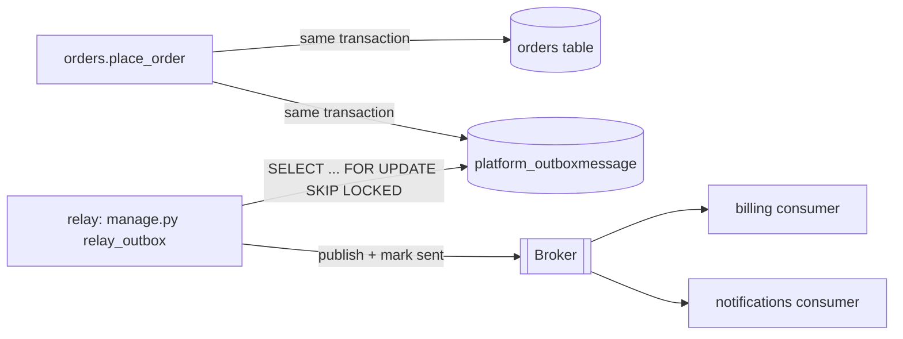

# Event-driven architecture

> Scope: producers and consumers across processes, brokers, async processing, delivery guarantees, retries and dead-letter queues, the transactional outbox, ordering, eventual consistency and idempotent consumers, applied to Django. Not covered here: in-process domain events ([domain-events.md](./domain-events.md)), sagas, timeouts and cross-service consistency ([distributed-systems.md](./distributed-systems.md)), worker scaling ([scalability-patterns.md](./scalability-patterns.md)), task-queue setup ([django-integrations](../../django-integrations/SKILL.md)).

## Purpose

Event-driven architecture (EDA) moves reactions **out of the request and out of the process**:
a producer records a fact; one or more consumers act on it later. In a Django system that buys
three things: faster responses (slow work leaves the request), failure isolation (a down
email provider does not fail checkout), and decoupled integration with other systems.

It costs immediate consistency, simple debugging and "it either happened or it didn't"
semantics. Adopt it per flow, not as a system-wide style.

## Technical concepts

- **Producer**: code that emits a message (a Django service via the outbox).
- **Consumer**: a worker process that handles messages (Celery worker, Kafka consumer, management command loop).
- **Broker**: durable transport. **Task queue** (Celery on Redis/RabbitMQ/SQS): a message is *work for one consumer*. **Event log/bus** (Kafka, SNS→SQS fan-out, RabbitMQ topic exchanges): a message is a *fact for many consumers*, possibly replayable.
- **Delivery guarantees**:

| Guarantee | Meaning | Practical status |
|---|---|---|
| At-most-once | May be lost, never duplicated | Fire-and-forget `.delay()` without outbox |
| At-least-once | Never lost, may be duplicated | Outbox + acks + retries; the realistic target |
| Exactly-once | Effect happens once | Achieved as **at-least-once + idempotent consumer** |

- **Eventual consistency**: readers may briefly see the state before a consumer has acted. Design UIs and APIs for that ("processing" states).

## Internal mechanics

### The dual-write problem

```python
@transaction.atomic
def place_order(...):
    order = Order.objects.create(...)
    publish_to_broker("order.placed", {...})   # BAD: broker write is not part of the DB transaction
```

If the broker call succeeds and the transaction rolls back, consumers act on a phantom order. If
the commit succeeds and the publish fails (or the process dies), the event is lost. Moving the
publish into `on_commit` fixes the first case but not the second.

### Transactional outbox

Write the message **into the same database transaction** as the state change; a relay ships it
to the broker afterwards.



```python
# apps/platform/models.py
class OutboxMessage(models.Model):
    id = models.UUIDField(primary_key=True, default=uuid.uuid4)   # message id = dedup key
    topic = models.CharField(max_length=100)
    key = models.CharField(max_length=100)          # partition/ordering key, e.g. order id
    payload = models.JSONField()
    created_at = models.DateTimeField(auto_now_add=True)
    sent_at = models.DateTimeField(null=True, db_index=True)
    attempts = models.PositiveIntegerField(default=0)

    class Meta:
        indexes = [models.Index(fields=["created_at"], condition=models.Q(sent_at__isnull=True),
                                name="outbox_unsent_idx")]

# apps/platform/outbox.py
def enqueue(*, topic: str, key: str, payload: dict) -> OutboxMessage:
    assert transaction.get_connection().in_atomic_block, "outbox writes must be transactional"
    return OutboxMessage.objects.create(topic=topic, key=key, payload=payload)
```

```python
# apps/platform/management/commands/relay_outbox.py
class Command(BaseCommand):
    help = "Publish unsent outbox messages to the broker."

    def add_arguments(self, parser):
        parser.add_argument("--batch", type=int, default=100)

    def handle(self, *args, batch, **options):
        publisher = get_publisher()          # adapter over the broker client
        while True:
            with transaction.atomic():
                msgs = list(OutboxMessage.objects
                            .select_for_update(skip_locked=True)
                            .filter(sent_at__isnull=True)
                            .order_by("created_at")[:batch])
                for m in msgs:
                    publisher.publish(topic=m.topic, key=m.key, message_id=str(m.id), payload=m.payload)
                    m.sent_at = timezone.now()
                OutboxMessage.objects.bulk_update(msgs, ["sent_at"])
            if not msgs:
                time.sleep(1)
```

`skip_locked=True` lets several relay processes run without double-sending the same rows; it is
supported on PostgreSQL, Oracle and MySQL 8.0.1+ (not SQLite). A crash after publish but before
commit re-sends the batch, so delivery is **at-least-once**, which is why consumers must be
idempotent. Prune sent rows on a schedule.

A simpler variant for Celery-only systems: the outbox row is written in the transaction and
`on_commit` enqueues a task that publishes it; a periodic sweeper retries rows still unsent after
N minutes. This covers the crash window without a dedicated relay process.

## Decision guidance

| Need | Choose |
|---|---|
| Offload slow work from a request; one consumer | Celery/RQ task enqueued `on_commit` (no outbox) if loss on crash is tolerable |
| Same, but the work must not be lost | Outbox + task/relay |
| Multiple independent consumers, other services/teams | Event bus (Kafka/SNS+SQS/RabbitMQ topics) fed by the outbox |
| Replay history, rebuild projections | Log-based broker (Kafka) with retention |
| Strict per-entity ordering | Partition/queue by entity key; single consumer per partition |
| Global ordering | Avoid; it removes parallelism. Redesign around per-key ordering |

Celery is a **task queue**, not an event bus: a task names *who* does the work. Using it as a bus
means the producer knows every consumer. That is acceptable inside a monolith; not across teams.

## Django implementation examples

**Idempotent consumer** with a processed-message table:

```python
# apps/platform/models.py
class ProcessedMessage(models.Model):
    consumer = models.CharField(max_length=100)
    message_id = models.UUIDField()
    processed_at = models.DateTimeField(auto_now_add=True)
    class Meta:
        constraints = [models.UniqueConstraint(fields=["consumer", "message_id"], name="uniq_processed")]

# apps/billing/consumers.py
def on_order_placed(*, message_id: str, payload: dict) -> None:
    with transaction.atomic():
        try:
            with transaction.atomic():                       # savepoint so IntegrityError is recoverable
                ProcessedMessage.objects.create(consumer="billing.invoice", message_id=message_id)
        except IntegrityError:
            return                                           # duplicate delivery: already handled
        create_invoice_for_order(order_id=payload["order_id"])  # same transaction as the marker
```

Because the marker and the effect commit together, a crash rolls back both and redelivery is safe.

**Retries with backoff and a dead-letter path (Celery).**

```python
@shared_task(bind=True, acks_late=True, autoretry_for=(GatewayTimeout,),
             retry_backoff=True, retry_backoff_max=600, retry_jitter=True, max_retries=8)
def sync_invoice_to_erp(self, invoice_id: int) -> None:
    push_invoice(invoice_id=invoice_id)
```

- Retry **transient** errors only (timeouts, 5xx, 429). Permanent errors (validation, 4xx) go straight to the dead-letter store.
- After `max_retries`, record the failure (a `FailedMessage` row or the broker's DLQ) with payload, error and attempts, and alert. A DLQ nobody watches is data loss with extra steps.
- `acks_late=True` means a worker crash redelivers the task, which again requires idempotency.

**Message envelope.** Version the schema from the start:

```json
{"id": "6f1c…", "type": "order.placed", "version": 1, "occurred_at": "2026-11-04T10:00:00Z",
 "key": "order:1842", "data": {"order_id": 1842, "customer_id": 77, "total": "129.90"}}
```

Additive changes keep the version; breaking changes publish `version: 2` alongside v1 until all
consumers migrate.

## Production use cases

- Checkout writes order + outbox; billing, notifications and analytics consume independently.
- ERP/CRM sync with retries and DLQ; a partner outage does not affect checkout.
- Search index updates from product changes, keyed by product id to keep per-product order.
- Read-model projections (reporting tables) rebuilt from a replayable log.

## Advantages and disadvantages

| Advantages | Disadvantages |
|---|---|
| Request latency independent of downstream work | Eventual consistency visible to users |
| Failure isolation, natural retry | Duplicates, reordering and poison messages to handle |
| New consumers without touching the producer | Harder tracing; needs correlation ids and good tooling |
| Smooths load spikes via the queue | More infrastructure: broker, relay, workers, DLQ monitoring |

## Security and performance considerations

- Payloads are data at rest in broker and outbox: no secrets, minimal PII, and encryption/ACLs on topics.
- Consumers must authorise on their own terms; a message is not proof the action was permitted for that tenant.
- Validate payloads (schema/version) in consumers; reject rather than crash on malformed input.
- Outbox table growth: partial index on unsent rows, scheduled pruning, keep relay batches small to keep lock time short.
- Size worker concurrency to the DB connection budget; each worker thread holds a connection.
- Propagate the request/correlation id in the envelope and log it in consumers (see [django-core logging](../../django-core/references/logging-exceptions.md)).

## Common mistakes

- Publishing to the broker inside `atomic()` (dual write) or relying only on `on_commit` for must-not-lose events.
- Passing model instances or querysets as task arguments instead of ids.
- Consumers that are not idempotent while the system is at-least-once.
- Infinite retries on permanent errors; no DLQ alerting.
- Assuming global ordering; assuming the consumer reads the producer's committed data from a lagging replica.
- Using events for request/response interactions that need an immediate answer.

## Troubleshooting and evaluation

| Symptom | Check |
|---|---|
| Consumer can't find the row | Task enqueued before commit; read replica lag |
| Duplicated side effects | Missing processed-message marker / idempotency key |
| Outbox backlog grows | Relay down, broker unavailable, slow publish; monitor oldest unsent `created_at` |
| Events out of order | Different partition keys, parallel consumers per key, retries reordering |
| Poison message blocks a queue | No max retries / DLQ routing |

Key metrics: outbox lag (oldest unsent age), queue depth, consumer error rate, DLQ size, end-to-end latency.

## Related knowledge

[domain-events.md](./domain-events.md) · [distributed-systems.md](./distributed-systems.md) ·
[scalability-patterns.md](./scalability-patterns.md) · [architectural-styles.md](./architectural-styles.md) ·
[django-core signals & commands](../../django-core/references/signals-management-commands.md) ·
[django-integrations](../../django-integrations/SKILL.md)

## Official documentation

- https://docs.djangoproject.com/en/stable/topics/db/transactions/#performing-actions-after-commit
- https://docs.djangoproject.com/en/stable/ref/models/querysets/#select-for-update
- https://docs.celeryq.dev/en/stable/userguide/tasks.html#retrying
- https://microservices.io/patterns/data/transactional-outbox.html
- https://microservices.io/patterns/communication-style/idempotent-consumer.html
