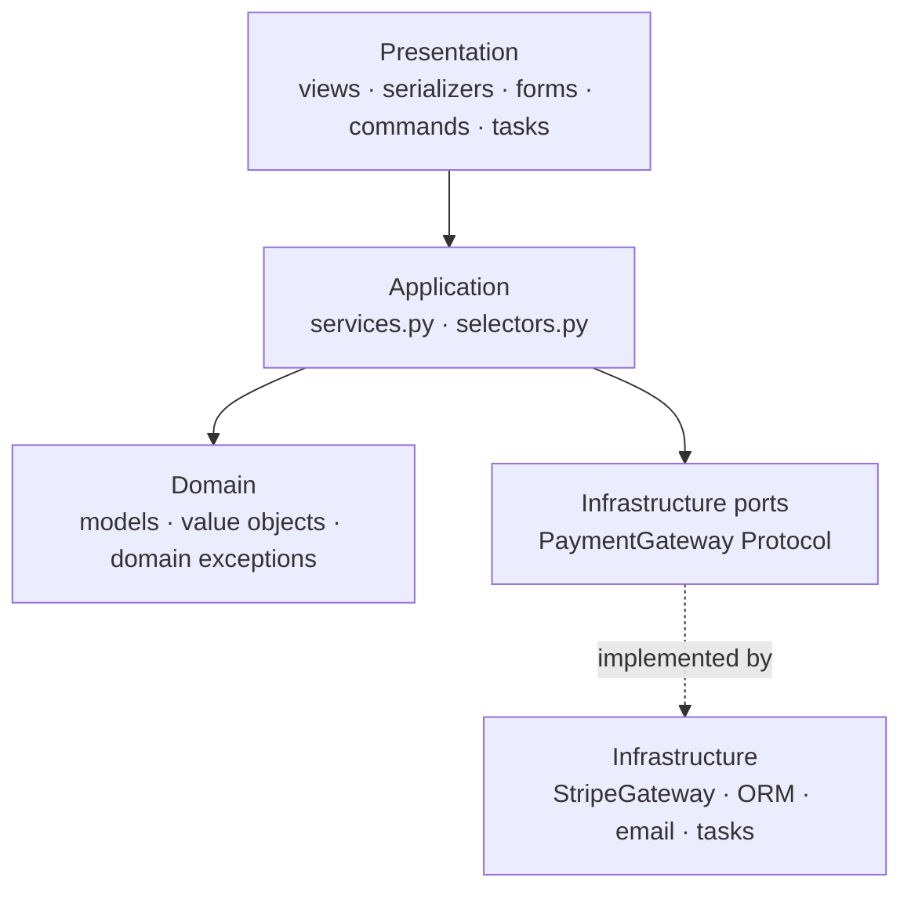

# Layered architecture in Django

> Scope: presentation, application, domain and infrastructure layers; how they map onto Django
> files; dependency direction; when layering is worth it. Not covered here: app-level tiers and
> cross-app imports ([django-application-boundaries.md](./django-application-boundaries.md)),
> hexagonal/clean comparison ([architectural-styles.md](./architectural-styles.md)), service
> implementation ([service-layer.md](./service-layer.md)), injecting infrastructure
> ([dependency-management.md](./dependency-management.md)).

## Purpose

Layers separate **why the code changes**: HTTP formats change for different reasons than
pricing rules, which change for different reasons than the payment provider. In Django, layers
live **inside each app** (files/modules), not as top-level projects. The goal is that business
rules can be called and tested without HTTP and without real external systems.

## Technical concepts

| Layer | Responsibility | Django artefacts | Must not |
|---|---|---|---|
| Presentation (interface) | Translate I/O: parse input, authenticate, authorise entry, render output, map errors | views, DRF serializers/views, forms, templates, admin, management commands, task entry points | contain business rules, open multi-step transactions |
| Application | Orchestrate a use case: transaction, load aggregates, call domain logic, schedule side effects | `services.py` (writes), `selectors.py` (reads) | know about `request`, HTTP status codes, templates |
| Domain | Business rules and invariants | models (fields, constraints, `clean()`, state methods), value objects, domain services, domain exceptions | call external APIs, send email, depend on views |
| Infrastructure | Talk to the outside world | ORM (already built in), gateways/adapters (`gateways.py`), email/storage backends, task queue client, outbox relay | encode business decisions |

Django's ORM is an Active Record implementation: models are **both** domain and persistence.
Accept this — splitting models into "domain entity + ORM record" doubles the code for little
benefit in most projects.

## Internal mechanics

Dependencies point **inward/downward**: presentation → application → domain; infrastructure is
reached through narrow interfaces chosen by the application layer.



How a request flows through the layers (for `POST /orders/`):

1. View authenticates, validates input shape with a serializer/form → DTO.
2. View calls `place_order(customer=..., lines=...)`.
3. Service opens `transaction.atomic()`, locks/loads the aggregate, calls model methods and
   other apps' public services, records events.
4. Service registers `transaction.on_commit` side effects (tasks, events).
5. Service returns the domain object or raises a domain exception.
6. View maps the result to a response or the exception to 400/409/422.

Layer violations show up as imports: `from rest_framework` inside `services.py`, `from
.views` anywhere outside `urls.py`, `requests` imported in `models.py`.

## Decision guidance

| Project shape | Layering depth |
|---|---|
| Small CRUD app, admin-driven | Two layers: views/forms + models. No `services.py` |
| Some multi-model writes, side effects, multiple entry points (web + API + command) | Add `services.py`/`selectors.py` where needed |
| Core domain with complex rules and external integrations | Full four layers; gateways behind Protocols; domain exceptions |
| Domain must run without Django (shared library, other runtime) | Consider hexagonal with plain-Python domain — see [architectural-styles.md](./architectural-styles.md) |

Apply layering **per app**: `orders` can be fully layered while `pages` stays plain CRUD.

## Django implementation examples

Per-app layout:

```text
apps/orders/
├── models.py          # domain: fields, constraints, state methods
├── querysets.py       # domain/infra: reusable query vocabulary
├── exceptions.py      # domain exceptions
├── services.py        # application: write use cases
├── selectors.py       # application: read use cases
├── api/serializers.py # presentation
├── api/views.py       # presentation
├── views.py, forms.py # presentation (HTML)
├── tasks.py           # presentation (async entry points)
└── management/commands/expire_orders.py   # presentation (CLI)
```

Presentation — HTML view, same service as the API:

```python
# apps/orders/views.py
@login_required
@require_POST
def cancel(request, pk):
    form = CancelOrderForm(request.POST)
    if not form.is_valid():
        return render(request, "orders/cancel.html", {"form": form}, status=400)
    order = get_object_or_404(Order.objects.for_user(request.user), pk=pk)
    try:
        cancel_order(order_id=order.pk, actor=request.user, reason=form.cleaned_data["reason"])
    except OrderNotCancellable:
        messages.error(request, "This order can no longer be cancelled.")
    return redirect("orders:detail", pk=pk)
```

Infrastructure behind a port (application owns the interface):

```python
# apps/billing/gateways.py
class PaymentGateway(Protocol):
    def charge(self, *, amount: Money, token: str, idempotency_key: str) -> PaymentResult: ...
```

Good vs bad — the domain layer must not reach infrastructure:

```python
# BAD: models.py
class Order(models.Model):
    def save(self, *args, **kwargs):
        super().save(*args, **kwargs)
        requests.post(settings.ERP_URL, json={"id": self.pk})   # I/O in the domain, inside the transaction

# GOOD: services.py
transaction.on_commit(lambda: push_order_to_erp.delay(order.pk))
```

## Production use cases

- One service reused by the HTML view, DRF endpoint, admin action, management command and
  Celery task — each a thin presentation adapter.
- Swapping payment providers by replacing an infrastructure adapter, with no change to services.
- Read-heavy dashboards served by selectors that own `select_related`/`only()`.

## Advantages and disadvantages

| Advantages | Disadvantages |
|---|---|
| Business logic testable without HTTP | More files and indirection |
| Multiple entry points share one implementation | Pass-through services when logic is trivial |
| Clear review rules ("no `request` in services") | Active Record ORM blurs domain/infrastructure — purists add needless mapping |
| Infrastructure swaps are local | Discipline needed; violations creep in without checks |

## Security and performance considerations

- **Authorisation**: entry-level checks in presentation (`login_required`, permissions); data
  scoping in selectors (`for_user(user)`) so every caller is protected — see
  [django-security-engineering](../../django-security-engineering/SKILL.md).
- **Transactions** belong to the application layer; a view-level `ATOMIC_REQUESTS` hides the
  boundary and holds locks during template rendering.
- **N+1 queries** often come from templates/serializers walking relations; fix in selectors,
  not in presentation — see [django-performance](../../django-performance/SKILL.md).
- Layers add negligible runtime cost; the costs are queries and I/O, not function calls.

## Common mistakes

- Services that accept `request` or return `Response`/`HttpResponse`.
- Serializers' `create()` holding business rules, so the CLI and admin skip them.
- Layer-per-folder at project level (`project/services/`, `project/models/`) — cuts across
  domains and creates coupling hubs.
- Wrapping the ORM in a repository layer "for layering" — see
  [design-patterns.md](./design-patterns.md).
- Raising `Http404`/`ValidationError` (DRF) from services.

## Troubleshooting and evaluation

- Grep for layer leaks: `grep -rn "from rest_framework\|HttpRequest\|request\." apps/*/services.py`.
- `requests`/SDK imports in `models.py` → move behind a gateway.
- If the CLI and the API behave differently for the same operation, logic is in presentation.
- For larger codebases, enforce contracts with `import-linter` layers contracts (only with team
  agreement — it is a dev dependency).

## Related knowledge

[service-layer.md](./service-layer.md) · [dependency-management.md](./dependency-management.md) ·
[architectural-styles.md](./architectural-styles.md) ·
[urls-views.md](../../django-core/references/urls-views.md) ·
[forms-validation.md](../../django-core/references/forms-validation.md) ·
[django-rest-framework](../../django-rest-framework/SKILL.md)

## Official documentation

- https://docs.djangoproject.com/en/stable/misc/design-philosophies/
- https://docs.djangoproject.com/en/stable/topics/db/transactions/
- https://docs.djangoproject.com/en/stable/topics/http/views/
- https://martinfowler.com/bliki/PresentationDomainDataLayering.html
