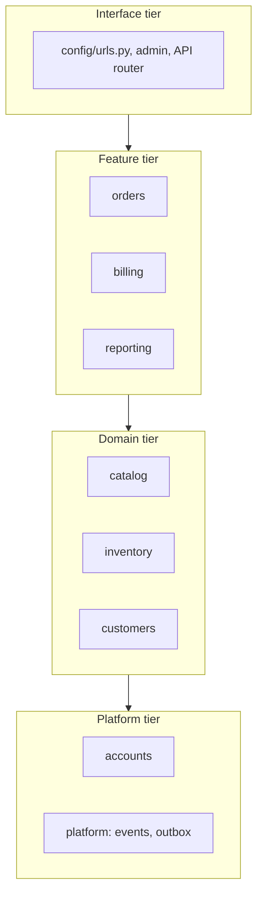

# Modular monolith

> Scope: module fundamentals, module boundaries, communication between modules, dependency
> direction, shared infrastructure, database ownership, boundary enforcement, Django
> implementation patterns. Not covered here: Django app sizing and circular-import mechanics
> ([django-application-boundaries.md](./django-application-boundaries.md)), event plumbing
> ([domain-events.md](./domain-events.md)), extraction to services
> ([distributed-systems.md](./distributed-systems.md)), layout basics
> ([django-core project-structure](../../django-core/references/project-structure.md)).

## Purpose

The default architecture for Django systems in this skill set. One deployable, one database,
with modules that behave as if they *could* be separate services: they own data, publish a
small API, and depend in one direction. This keeps ACID transactions and Django's productivity
while preventing the big ball of mud.

## Technical concepts

- **Module** — in Django, one app (occasionally a small group of apps under one package) that
  owns a business capability: `inventory`, `orders`, `billing`.
- **Public interface** — the only names other modules may import: `apps/<module>/api.py`, or
  `services.py` + `selectors.py` with `__all__`. Model classes are importable for FKs and type
  hints, but not for writes.
- **Data ownership** — each table has exactly one owning module; only that module writes it.
- **Dependency direction** — modules sit in tiers; imports point downward only.
- **Shared infrastructure** — dependency-free technical code (`apps.platform`: events, outbox,
  base model mixins, clock, request-id) that every module may use and that imports no module.

## Internal mechanics



Communication options inside the process, from tightest to loosest:

| Mechanism | Use when | Consistency |
|---|---|---|
| Call public function (`inventory.api.reserve_stock`) | Caller needs the result now; same transaction | Atomic |
| Read via selector (`inventory.api.stock_level`) | Caller needs data, not behaviour | Read-committed snapshot |
| In-process domain event, dispatched `on_commit` | Lower tier must react to a higher tier, or many reactions | After commit, same process |
| Outbox + task/broker | Reaction is slow, retried, or crosses processes | Eventual |

Because everything shares one database connection per request, a `transaction.atomic` block
in `orders.place_order` naturally covers `inventory.reserve_stock` — the main advantage over
services.

## Decision guidance

| Question | Answer |
|---|---|
| Where does new code go? | The module owning the data it *writes* |
| Module A needs B's data | Call B's selector; FK downward if lifecycle is shared |
| B (lower) must react to A (higher) | B subscribes to an event A publishes; B never imports A |
| Two modules call each other | Concept is misplaced: move it down, merge modules, or invert with an event |
| Need cross-module report | A `reporting` module in the feature tier reads via selectors or a read-model table |
| Separate databases per module? | Usually no. Separate *schemas* or DB routers only for compliance/scale with evidence |

Database ownership levels (choose the lowest that meets the need):

1. **Shared DB, owned tables** (default) — FKs downward allowed; writes only by owner.
2. **Shared DB, no cross-module FKs** — store ids; prepares for extraction; loses DB-level
   referential integrity, so add reconciliation checks.
3. **Separate schema / database via `DATABASE_ROUTERS`** — real isolation, no cross-DB joins or
   transactions. See [django-orm](../../django-orm/SKILL.md) for router mechanics.

## Django implementation examples

Public interface module:

```python
# apps/inventory/api.py
from .selectors import stock_level
from .services import release_stock, reserve_stock

__all__ = ["reserve_stock", "release_stock", "stock_level"]
```

Cross-module use within one transaction:

```python
# apps/orders/services.py
from django.db import transaction
from apps.inventory import api as inventory
from apps.platform.events import publish
from .events import OrderPlaced

@transaction.atomic
def place_order(*, customer, lines) -> Order:
    order = Order.objects.create(customer=customer)
    for line in lines:
        inventory.reserve_stock(product_id=line.product_id, quantity=line.quantity)
        OrderLine.objects.create(order=order, product_id=line.product_id, quantity=line.quantity)
    publish(OrderPlaced(order_id=order.pk, customer_id=customer.pk, total=order.total()))
    return order
```

`publish()` defers handler dispatch to `transaction.on_commit` (see
[domain-events.md](./domain-events.md)), so `billing` can create an invoice without `orders`
importing `billing`.

Bad — writing another module's data:

```python
# apps/orders/services.py
Stock.objects.filter(product_id=pid).update(quantity=F("quantity") - qty)  # bypasses inventory rules
```

Shared infrastructure stays dependency-free:

```python
# apps/platform/models.py
class TimeStampedModel(models.Model):
    created_at = models.DateTimeField(auto_now_add=True)
    updated_at = models.DateTimeField(auto_now=True)
    class Meta:
        abstract = True
```

### Enforcing boundaries

- Code review checklist (see
  [django-application-boundaries.md](./django-application-boundaries.md#review-checklist)).
- Optional, if the team agrees to the tool: `import-linter` contracts in CI.

```ini
# .importlinter
[importlinter]
root_package = apps

[importlinter:contract:tiers]
name = Tiers point downward
type = layers
layers =
    apps.orders | apps.billing | apps.reporting
    apps.catalog | apps.inventory | apps.customers
    apps.accounts | apps.platform

[importlinter:contract:private]
name = Only public interfaces cross modules
type = forbidden
source_modules = apps.orders
forbidden_modules = apps.inventory.services
```

(Verify the contract syntax against the installed import-linter version; the `|` independent-
layer syntax is a newer feature.)

## Production use cases

- An order flow touching inventory, customers and billing that must be all-or-nothing: one
  transaction in one process — something microservices would need a saga for.
- Team scaling: each team owns 2–3 modules; CODEOWNERS per `apps/<module>/`.
- Preparing extraction: a module that already talks only through `api.py` and events and has no
  inbound FKs can move behind HTTP/queue with modest work.

## Advantages and disadvantages

| Advantages | Disadvantages |
|---|---|
| ACID transactions across modules | Boundaries are by convention unless tooled |
| One deploy, one observability stack | One runtime: a memory leak affects all modules |
| Refactors across modules are IDE-safe | Scaling is whole-app (mitigate with worker pools/queues) |
| Admin, ORM joins, migrations just work | Shared DB invites "just one join" shortcuts |
| Cheap path to extraction later | Release cadence shared across teams |

## Security and performance considerations

- Authorisation helpers live in a low tier (`accounts`) and are applied by each module's
  selectors (`for_user`) — never trust that another module filtered already.
- Cross-module selectors should return QuerySets or DTOs with explicit loading
  (`select_related`) to avoid N+1 across boundaries.
- Events dispatched `on_commit` run inside the request; keep handlers fast or hand off to tasks.
- Separate worker queues per module (e.g. `billing` queue) give resource isolation without
  separate services.

## Common mistakes

- A `common`/`core` app that imports feature modules — it becomes the cycle hub.
- Module boundaries that mirror technical layers (`models` app, `api` app).
- Upward imports hidden as function-local imports to dodge circular-import errors.
- Cross-module `ForeignKey` pointing *up* a tier (e.g. `inventory` → `orders`).
- Events used for everything, making the core flow unreadable; direct calls are fine downward.
- Moving to separate databases before the code respects ownership.

## Troubleshooting and evaluation

- **Map dependencies**: `grep -rhoE "from apps\.[a-z_]+" apps/<module> | sort | uniq -c`.
  Any upward or cyclic edge is a finding.
- **Ownership audit**: search for `.objects.` writes (`create`, `update`, `delete`, `save`) on
  models from another app.
- **Migration graph**: `python manage.py showmigrations` / migration `dependencies` that point
  upward reveal upward FKs.
- **Change coupling**: if two modules always change in the same PRs, consider merging them.

## Related knowledge

[django-application-boundaries.md](./django-application-boundaries.md) ·
[architectural-styles.md](./architectural-styles.md) · [service-layer.md](./service-layer.md) ·
[domain-events.md](./domain-events.md) · [domain-driven-design.md](./domain-driven-design.md) ·
[django-orm](../../django-orm/SKILL.md)

## Official documentation

- Applications: https://docs.djangoproject.com/en/stable/ref/applications/
- Multiple databases & routers: https://docs.djangoproject.com/en/stable/topics/db/multi-db/
- Transactions: https://docs.djangoproject.com/en/stable/topics/db/transactions/
- import-linter: https://import-linter.readthedocs.io/
- Martin Fowler, MonolithFirst: https://martinfowler.com/bliki/MonolithFirst.html
