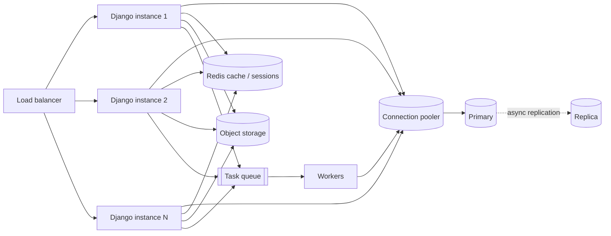

# Scalability patterns

> Scope: architectural choices that let a Django application handle more load — scaling
> direction, stateless design, database scaling and read replicas, caching layers, background
> processing, load balancing, finding bottlenecks and a staged roadmap. Not covered here: cache API
> details ([django-core caching](../../django-core/references/caching.md)), server and worker
> configuration ([django-core asgi-wsgi](../../django-core/references/asgi-wsgi.md)), profiling and
> query tuning ([django-performance](../../django-performance/SKILL.md),
> [django-orm](../../django-orm/SKILL.md)), PostgreSQL internals
> (the PostgreSQL documentation), service extraction
> ([architectural-styles.md](./architectural-styles.md)).

## Purpose

Scaling decisions are architectural because they constrain where state lives, how data flows and
what consistency users see. This reference helps agents pick the **cheapest change that removes
the measured bottleneck**. In most Django systems the database becomes the limit long before
the Python processes do.

## Technical concepts

| Concept | Meaning |
|---|---|
| **Vertical scaling** | A bigger machine or database instance. Simple; bounded; often the right first step for the DB. |
| **Horizontal scaling** | More app instances behind a load balancer. Requires stateless processes. |
| **Stateless app** | Any instance can serve any request: no local sessions, files or in-memory state that matters. |
| **Read replica** | An asynchronously replicated database copy for reads. Introduces replication lag. |
| **Connection pooling** | Reusing DB connections. Needed once instances × workers approaches `max_connections`. |
| **Partitioning** | Splitting one large table by key/range inside one database. |
| **Sharding** | Splitting data across databases. Last resort; Django has no built-in shard routing beyond routers. |
| **Background processing** | Moving slow or bursty work out of the request path into workers. |

## Internal mechanics

**Where Django's capacity comes from.** A WSGI deployment serves at most
`instances × workers × threads` concurrent requests. Each of those can hold one DB connection
(per thread, per alias). So doubling app instances also doubles potential DB connections. This
is why connection pooling (PgBouncer, or psycopg pooling via `OPTIONS["pool"]` on Django ≥ 5.1
with PostgreSQL) usually becomes necessary around the time horizontal scaling starts. See
[django-core production-configuration](../../django-core/references/production-configuration.md).

**How multi-database routing works.** `DATABASE_ROUTERS` is a list of classes. For each query
Django asks `db_for_read` / `db_for_write` in order, and the first non-`None` answer wins.
`using()` on a QuerySet overrides routers. Inside `transaction.atomic(using="default")`, reads
routed to a replica run on a *different connection* outside that transaction, so they can miss
rows the transaction just wrote.



## Decision guidance

**Measure first.** Use APM traces, `pg_stat_statements`, and request/queue latency percentiles.
Then pick the row that matches:

| Measured bottleneck | First move | Later move |
|---|---|---|
| Slow queries / N+1 | Indexes, `select_related`/`prefetch_related`, fewer queries ([django-orm](../../django-orm/SKILL.md)) | Denormalised read tables |
| App CPU saturated | More instances (horizontal) | Move CPU-heavy work to workers |
| DB CPU saturated by reads | Cache hot reads; then a read replica | More replicas; read models |
| DB connections exhausted | Pooler / lower `CONN_MAX_AGE` churn | Fewer workers per instance, async I/O |
| DB write throughput | Vertical DB scaling, batch writes, fewer indexes | Partitioning; sharding/extraction last |
| Slow requests due to external I/O | Background tasks; timeouts | Async views for fan-out I/O |
| Large tables (100M+ rows) | Partitioning by time/tenant | Archive cold data |

**Vertical vs horizontal.** Scale the app tier horizontally (it's cheap once stateless). Scale
the database vertically for as long as it is affordable: it keeps strong consistency and
needs no code changes.

**Caching layer choice** (API details in [django-core caching](../../django-core/references/caching.md)):

| Layer | Use for | Watch out for |
|---|---|---|
| CDN / HTTP caching | Static assets, anonymous pages | Never cache authenticated responses publicly; set `Vary` correctly |
| Per-view / fragment cache | Uniform rendered output | Key per user or tenant when content varies |
| Low-level `cache.get_or_set` | Expensive computations, aggregate counts | Invalidation on write; stampedes |
| Read model table | Complex queries over many rows | Rebuild pipeline; staleness |

## Django implementation examples

**Stateless configuration.** Sessions, files and caches move off the local machine:

```python
# config/settings.py
SESSION_ENGINE = "django.contrib.sessions.backends.cache"      # or "cached_db" for durability
CACHES = {"default": {"BACKEND": "django.core.cache.backends.redis.RedisCache",  # Django ≥ 4.0
                      "LOCATION": os.environ["REDIS_URL"]}}
STORAGES = {
    "default": {"BACKEND": "storages.backends.s3.S3Storage"},  # django-storages, if adopted
    "staticfiles": {"BACKEND": "django.contrib.staticfiles.storage.ManifestStaticFilesStorage"},
}
```

Note: `cache` sessions are lost if Redis evicts or restarts. Use `cached_db` when losing a
session (a logout) is unacceptable.

**Read replica router with read-your-writes protection:**

```python
# config/db_routers.py
from contextvars import ContextVar

_pin_primary: ContextVar[bool] = ContextVar("pin_primary", default=False)

def pin_to_primary() -> None:
    _pin_primary.set(True)

class PrimaryReplicaRouter:
    def db_for_read(self, model, **hints):
        return "default" if _pin_primary.get() else "replica"

    def db_for_write(self, model, **hints):
        return "default"

    def allow_relation(self, obj1, obj2, **hints):
        return True                           # same data, different copies

    def allow_migrate(self, db, app_label, **hints):
        return db == "default"                # never migrate the replica
```

```python
# config/middleware.py — pin the rest of the request after any unsafe method
class PinPrimaryOnWriteMiddleware:
    def __init__(self, get_response):
        self.get_response = get_response

    def __call__(self, request):
        if request.method not in ("GET", "HEAD", "OPTIONS"):
            pin_to_primary()
        return self.get_response(request)
```

Users also expect to see their write on the *next* request (post/redirect/get). Set a short-lived
cookie or session flag after writes and pin while it's present, for longer than the observed
replication lag. Services that read-then-write (e.g. `cancel_order` with `select_for_update`)
must use the primary explicitly: `Order.objects.using("default")`. If the project isn't
async-heavy, a thread-local works too, but a `ContextVar` is safe for both sync and async code.

**Background processing.** The request records intent; the worker does the slow part:

```python
# apps/billing/services.py
def issue_invoice(*, order_id: int) -> Invoice:
    invoice = Invoice.objects.create(order_id=order_id, status=Invoice.Status.PENDING)
    transaction.on_commit(lambda: render_invoice_pdf.delay(invoice.pk))   # Celery/RQ task
    return invoice
```

Task systems: Celery (broker such as Redis/RabbitMQ, mature, many features) and RQ (Redis,
simpler). Django 6.0 adds a built-in `django.tasks` interface for defining and enqueuing tasks.
It ships no production worker backend, so check the 6.0 release notes and the project's version
before relying on it. Tasks must be idempotent and take ids, not model instances (see
[distributed-systems.md](./distributed-systems.md)).

**Load balancing and health checks.** Expose a cheap liveness endpoint (process up) and a
readiness endpoint (DB reachable) that skip auth and sessions. Configure the load balancer to
drain instances on deploy. Details are in
[django-core production-configuration](../../django-core/references/production-configuration.md).

## Production use cases

**Staged scaling roadmap for a typical Django app**. Advance only when metrics demand it.

1. **Single instance + PostgreSQL**: fix N+1s, add indexes, configure `CONN_MAX_AGE`, turn on
   query logging in development.
2. **Stateless app tier**: sessions in cache/DB, media in object storage, 2+ instances behind a
   load balancer with health checks. (High availability arrives here too.)
3. **Background workers**: emails, PDFs, webhooks and imports move out of requests.
4. **Caching**: Redis for hot reads, fragment caching, CDN for static/media.
5. **Connection pooling + bigger DB instance**: PgBouncer or Django 5.1+ psycopg pool.
6. **Read replicas**: for reporting and listing endpoints first (`order_list` selector, admin
   exports), with read-your-writes pinning.
7. **Read models / partitioning**: precomputed reporting tables; time-partitioned event tables.
8. **Extraction or sharding**: only for a component with a proven independent scaling profile
   (e.g. PDF rendering as its own worker pool, then as a service).

## Advantages and disadvantages

| Approach | Advantages | Disadvantages |
|---|---|---|
| Vertical DB scaling | No code change, keeps consistency | Cost curve, hard ceiling, single point of failure |
| Horizontal app scaling | Cheap, resilient | Requires statelessness; multiplies DB connections |
| Read replicas | Offloads reads | Replication lag bugs; routing complexity |
| Caching | Large latency wins | Invalidation bugs, stale data, stampedes |
| Background tasks | Fast responses, smooths bursts | Eventual completion, queue ops, retries to design |
| Sharding | Write scalability | Cross-shard queries/joins lost; very high complexity |

## Security and performance considerations

- Cached or replicated data still needs authorization: scope cache keys per user or tenant, and
  never serve one tenant's cached fragment to another.
- Shared caches and session stores hold sensitive data. Require authentication/TLS to Redis and
  isolate per environment ([django-security-engineering](../../django-security-engineering/SKILL.md)).
- Object storage: private buckets plus signed URLs for user files. Never make media buckets
  public by default.
- Raising worker counts without raising DB capacity moves the bottleneck and can make latency
  worse through lock and connection contention.
- Cache stampede on popular keys: use jittered TTLs, `get_or_set`, or a short lock.

## Common mistakes

- Scaling app instances to fix a slow query.
- Local-disk media or `locmem` cache on multi-instance deployments, causing "works sometimes"
  bugs.
- Routing all reads to a replica, including reads inside write transactions, so users don't see
  their changes.
- Running migrations against the replica (missing `allow_migrate`).
- Adding Redis, Celery and replicas on day one with no measured need.
- Background tasks that receive model instances (stale pickles) or aren't idempotent.
- Sharding before trying partitioning, archiving and vertical scaling.

## Troubleshooting and evaluation

| Symptom | Investigate |
|---|---|
| p95 latency rises with traffic, CPU low | DB waits, connection pool exhaustion, external calls |
| `too many connections` / `remaining connection slots are reserved` | instances × workers × threads vs `max_connections`; add pooler |
| "My change disappeared" after save | Replica read after write; check router pinning |
| Queue depth grows steadily | Worker throughput < arrival rate; slow tasks; separate queues |
| Random logouts after scale-out | Sessions in `locmem`/file backend; `SECRET_KEY` mismatch across instances |
| Cache hit rate low | Keys too specific; TTL too short; per-user caching of shared data |

**Evaluation checklist**: Can any instance be killed without user impact? Is every piece of
state in a shared store? Do we know the DB connection ceiling? Is each scaling step backed by a
metric?

## Related knowledge

- [distributed-systems.md](./distributed-systems.md): timeouts, retries, idempotency for tasks.
- [event-driven-architecture.md](./event-driven-architecture.md): brokers and read-model updates.
- [architecture-decision-records.md](./architecture-decision-records.md): record scaling choices.
- [django-core caching](../../django-core/references/caching.md),
  [asgi-wsgi](../../django-core/references/asgi-wsgi.md),
  [production-configuration](../../django-core/references/production-configuration.md).
- [django-performance](../../django-performance/SKILL.md),
  the PostgreSQL documentation.

## Official documentation

- Multiple databases and routers: https://docs.djangoproject.com/en/stable/topics/db/multi-db/
- Database connection management: https://docs.djangoproject.com/en/stable/ref/databases/
- Cache framework: https://docs.djangoproject.com/en/stable/topics/cache/
- Sessions: https://docs.djangoproject.com/en/stable/topics/http/sessions/
- Deployment checklist: https://docs.djangoproject.com/en/stable/howto/deployment/checklist/
- Tasks framework (Django ≥ 6.0): https://docs.djangoproject.com/en/stable/topics/tasks/
