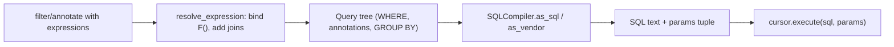

# Advanced Query Expressions

> Scope: the expression API — `F`, `Q`, `Value`, `Func`, `ExpressionWrapper`, `Case`/`When`,
> `Subquery`/`OuterRef`/`Exists`, `Window`, database functions, custom expressions and lookups,
> correlated subqueries and conditional updates. **Window functions are owned here.**
> Not covered here: `aggregate()`/`annotate()` grouping and join fan-out
> ([aggregation-and-annotation.md](./aggregation-and-annotation.md)); per-method QuerySet
> semantics ([queryset-api.md](./queryset-api.md)); locking and race semantics
> ([transactions-and-concurrency.md](./transactions-and-concurrency.md)); hand-written SQL
> ([raw-sql-and-database-access.md](./raw-sql-and-database-access.md)); plan analysis
> ([query-optimization.md](./query-optimization.md)).

## 1. Purpose and scope

Expressions let an agent push computation into the database: arithmetic across columns,
conditional logic, per-row lookups into other tables, rankings and running totals. The goal is
to replace "fetch rows, loop in Python, write back" with a single statement that is correct
under concurrency and does not move unnecessary data. Use this reference when a requirement
cannot be expressed with plain keyword lookups in `filter()`.

SQL in this file is *approximately* what Django generates on PostgreSQL; exact aliases, quoting
and casts differ by backend and version. Examples are illustrative and were not executed.

## 2. Core concepts

| Expression | What it represents | Typical use |
|---|---|---|
| `F("col")` | A column reference (may traverse relations: `F("order__customer_id")`) | Compare two columns; atomic updates |
| `Q(...)` | A boolean filter node; combine with `&`, `\|`, `~`, `^` (XOR, Django ≥ 4.1) | OR/NOT filters; dynamic filters |
| `Value(x)` | A literal bound as a parameter | Constants in annotations, `Coalesce` fallbacks |
| `Func` | A SQL function call; base class of `django.db.models.functions.*` | `Lower`, `Coalesce`, `TruncMonth`, custom functions |
| `ExpressionWrapper(expr, output_field=)` | Declares the result type of a combined expression | Mixed-type arithmetic, `DurationField` results |
| `Case(When(...), default=)` | SQL `CASE WHEN` | Conditional annotation, conditional update, custom ordering |
| `Subquery(qs)` | A scalar subquery (one row, one column) | "Latest X per row" |
| `OuterRef("col")` | Reference to the outer query inside a subquery | Correlation |
| `Exists(qs)` | `EXISTS (...)` boolean | Semi-joins without duplicates |
| `Window(expr, partition_by=, order_by=, frame=)` | `expr OVER (...)` | Ranking, running totals, lag/lead |

Every expression resolves to an `output_field`. Django infers it when all sources share a type;
otherwise the query fails with `FieldError: Expression contains mixed types` and you must
supply `output_field` (directly on `Func`/`Value`/`Case`/`Subquery`, or via
`ExpressionWrapper`).

## 3. Internal mechanics

- **Resolution.** When added to a QuerySet, each expression's `resolve_expression(query, ...)`
  binds `F()` names to concrete columns, adds any joins they require, and returns a resolved
  copy. `OuterRef` stays unresolved until the subquery is embedded in an outer query.
- **Compilation.** The SQL compiler calls `as_sql(compiler, connection)` on each node; a node
  may define `as_<vendor>()` (e.g. `as_postgresql`, `as_sqlite`) to emit backend-specific SQL.
  Literals become bind parameters — values are never interpolated into the SQL text.
- **Combination.** `F("a") + F("b")` builds a `CombinedExpression`; its output type comes from
  a table of supported type combinations (`_connector_combinations` in
  [expressions.py, 5.2 source](https://github.com/django/django/blob/stable/5.2.x/django/db/models/expressions.py)).
  Same-type numeric operands keep their type; `IntegerField` with `DecimalField` → `DecimalField`
  and `IntegerField` with `FloatField` → `FloatField` for `+ - * / %` (not `^`).
  `DateTimeField - DateTimeField` resolves to `DurationField` automatically. Other mixes — e.g.
  `DecimalField` with `FloatField` — need `output_field` / `ExpressionWrapper`
  ([docs: output_field](https://docs.djangoproject.com/en/5.2/ref/models/expressions/#output-field)).
- **Conditional expressions** (`Exists`, `Q`, lookups, `BooleanField` output) can be used
  directly in `filter()`, `When()`, and as annotations.
- **Window expressions** are evaluated after `WHERE`/`GROUP BY`/`HAVING`, so filtering on them
  requires an outer query. Django ≥ 4.2 does this for you by wrapping the query in a subquery
  when you `filter()` on a window annotation.



## 4. Engineering decisions and trade-offs

| Need | Prefer | Avoid |
|---|---|---|
| Increment/decrement a counter | `update(col=F("col") + n)` | read, mutate in Python, `save()` (lost update) |
| "Customers with at least one paid order" | `filter(Exists(...))` | `filter(orders__status=...)` + `distinct()` on large joins |
| Latest related value per row | `Subquery(... .order_by(...).values("x")[:1])` | Prefetching all children to pick one in Python |
| Many conditional counts | `Count(..., filter=Q(...))` (see aggregation ref) | One query per condition |
| Ranking / running total | `Window` | Python sorting over the whole result set |
| Business-rule ordering ("pending first") | `Case/When` in `order_by` | Sorting in Python after pagination (wrong page contents) |
| Logic that changes often or needs Python libraries | Python (on a bounded set) | Encoding complex rules in SQL nobody can review |

Trade-offs to state explicitly:

- **Readability.** A five-level nested `Subquery` is harder to review than two simple queries.
  Two indexed queries are often fine; prefer the expression when it eliminates N queries or
  provides atomicity, not merely to make it "one query".
- **Plan quality.** Correlated subqueries execute per outer row unless the planner decorrelates
  them; with a supporting index they are usually cheap, without one they can be quadratic.
  Measure with `explain()` ([query-optimization.md](./query-optimization.md)).
- **Portability.** Window functions need MySQL 8.0 / SQLite ≥ 3.25
  ([SQLite](https://www.sqlite.org/windowfunctions.html)). Every database version Django 5.2
  supports (PostgreSQL 14+, MySQL 8.0.11+, MariaDB 10.5+, SQLite 3.31+, Oracle 19c+ —
  [databases](https://docs.djangoproject.com/en/5.2/ref/databases/)) meets this, so the minimums
  only matter on older Django releases. Frame options vary by backend (e.g. PostgreSQL's limited
  `ValueRange` support); some functions are backend-specific (`django.contrib.postgres`
  functions, JSON operators).

## 5. Django implementation patterns

### F expressions: column comparison and atomic updates

```python
from django.db.models import F

# Stock items where reservations exceed what is on hand (should be impossible — a CheckConstraint
# guards it; this is a data-quality probe).
StockItem.objects.filter(quantity_reserved__gt=F("quantity_on_hand"))

# Atomic decrement; the WHERE clause makes the check-and-set a single statement.
updated = StockItem.objects.filter(
    product_id=product_id, warehouse_id=warehouse_id,
    quantity_on_hand__gte=F("quantity_reserved") + qty,
).update(quantity_reserved=F("quantity_reserved") + qty)
if updated == 0:
    raise InsufficientStock(product_id)
```

```sql
UPDATE inventory_stockitem
SET quantity_reserved = (inventory_stockitem.quantity_reserved + %s)
WHERE product_id = %s AND warehouse_id = %s
  AND quantity_on_hand >= (inventory_stockitem.quantity_reserved + %s);
```

After `instance.field = F("field") + 1; instance.save()` the attribute still holds the
expression object, not the new value — call `refresh_from_db(fields=[...])` before reading it
(Django 5.2). Saving the same instance twice re-applies the increment
([docs](https://docs.djangoproject.com/en/5.2/ref/models/expressions/#f-assignments-persist-after-model-save)).
Django ≥ 6.0 refreshes expression-assigned fields after `save()` on backends with `RETURNING`
(PostgreSQL, SQLite, Oracle); on MySQL/MariaDB the fields are marked deferred and reloaded on
next access ([6.0 release notes](https://docs.djangoproject.com/en/6.0/releases/6.0/)).

### Q expressions: OR, NOT, XOR and dynamic filters

```python
from django.db.models import Q

Order.objects.filter(
    Q(status=Order.Status.PENDING) | Q(status=Order.Status.PAID, placed_at__isnull=True),
    customer__is_active=True,
)

def search_products(*, term: str | None, category_id: int | None, active_only: bool):
    conditions = Q()
    if term:
        conditions &= Q(name__icontains=term) | Q(sku__iexact=term)
    if category_id:
        conditions &= Q(category_id=category_id)
    if active_only:
        conditions &= Q(is_active=True)
    return Product.objects.filter(conditions)
```

`~Q(...)` on a multi-valued relation (`~Q(order_lines__quantity__gt=10)`) compiles to a
`NOT IN`/`NOT EXISTS` subquery and means "no line with quantity > 10", not "some line with
quantity ≤ 10". When intent is unclear, write the `Exists` explicitly.

### Value, Func and database functions

```python
from django.db.models import CharField, Value
from django.db.models.functions import Coalesce, Concat, Lower, TruncMonth, Greatest

Customer.objects.annotate(
    display=Concat("name", Value(" <"), "email", Value(">"), output_field=CharField()),
)
Customer.objects.filter(email__iexact=email)          # prefer lookups over Lower() in filters
Order.objects.annotate(month=TruncMonth("created_at"))  # honours USE_TZ / current timezone
StockItem.objects.annotate(available=Greatest(F("quantity_on_hand") - F("quantity_reserved"), Value(0)))
```

Custom `Func` for a function Django does not wrap:

```python
from django.db.models import Func, FloatField

class Similarity(Func):           # PostgreSQL pg_trgm; contrib.postgres already ships TrigramSimilarity
    function = "SIMILARITY"
    arity = 2
    output_field = FloatField()

Product.objects.annotate(score=Similarity("name", Value(term))).filter(score__gt=0.3)
```

Before writing a `Func`, check `django.db.models.functions` and `django.contrib.postgres` —
most common functions already exist with cross-backend handling.

### ExpressionWrapper and output types

```python
from django.db.models import DecimalField, DurationField, ExpressionWrapper

OrderLine.objects.annotate(
    line_total=ExpressionWrapper(F("quantity") * F("unit_price"),
                                 output_field=DecimalField(max_digits=12, decimal_places=2)),
)
Order.objects.annotate(
    time_to_place=ExpressionWrapper(F("placed_at") - F("created_at"), output_field=DurationField()),
)
```

### Case / When: conditional annotation, ordering and updates

```python
from django.db.models import Case, IntegerField, When

priority = Case(
    When(status=Order.Status.PENDING, then=Value(0)),
    When(status=Order.Status.PAID, then=Value(1)),
    default=Value(2),
    output_field=IntegerField(),
)
Order.objects.alias(priority=priority).order_by("priority", "-created_at")   # alias(): Django ≥ 3.2
```

**Conditional update** — one statement instead of loading rows:

```python
# Cancel stale pending orders and stamp shipped ones in one pass.
Order.objects.filter(status__in=[Order.Status.PENDING, Order.Status.SHIPPED]).update(
    status=Case(
        When(status=Order.Status.PENDING, created_at__lt=cutoff, then=Value(Order.Status.CANCELLED)),
        default=F("status"),
    ),
)
```

Always give `default=F("col")` in updates; without it unmatched rows get `NULL`.

### Subquery and OuterRef: correlated subqueries

```python
from django.db.models import OuterRef, Subquery

latest_order = Order.objects.filter(customer=OuterRef("pk")).order_by("-created_at")

customers = Customer.objects.annotate(
    last_order_at=Subquery(latest_order.values("created_at")[:1]),
    last_order_status=Subquery(latest_order.values("status")[:1]),
)
```

```sql
SELECT customers_customer.*,
  (SELECT U0.created_at FROM orders_order U0
    WHERE U0.customer_id = customers_customer.id ORDER BY U0.created_at DESC LIMIT 1) AS last_order_at,
  ...
```

Rules: the inner QuerySet must return **one column** (`values("x")`) and **at most one row**
(`[:1]`) for scalar use. Each `Subquery` is a separate correlated subquery — two of them over
the same rows cost two index probes per outer row; an index on `(customer_id, created_at)` makes
them cheap.

Aggregating in a subquery (avoids join fan-out, see aggregation ref):

```python
from django.db.models import Sum
from django.db.models.functions import Coalesce

paid_total = (Payment.objects.filter(order=OuterRef("pk"), status="captured")
              .values("order").annotate(s=Sum("amount")).values("s"))
Order.objects.annotate(
    paid=Coalesce(Subquery(paid_total), Value(Decimal("0")), output_field=DecimalField()),
)
```

### Exists

```python
from django.db.models import Exists

has_paid_order = Order.objects.filter(customer=OuterRef("pk"), status=Order.Status.PAID)
Customer.objects.filter(Exists(has_paid_order))         # semi-join, no duplicates
Customer.objects.filter(~Exists(has_paid_order))        # anti-join
Customer.objects.annotate(is_buyer=Exists(has_paid_order))
```

`Exists` ignores the inner select list and stops at the first match. Prefer it over
`filter(orders__status="paid").distinct()`, which joins every matching order and then sorts or
hashes to deduplicate.

### Window expressions

```python
from django.db.models import Window
from django.db.models.functions import Lag, Rank, RowNumber

# Rank products by revenue within each category.
revenue_by_product = (Product.objects
    .annotate(revenue=Sum(F("order_lines__quantity") * F("order_lines__unit_price")))
    .annotate(rank_in_category=Window(Rank(), partition_by=F("category_id"),
                                      order_by=F("revenue").desc(nulls_last=True))))

# Running balance-style total per customer.
Order.objects.filter(status=Order.Status.PAID).annotate(
    running_total=Window(Sum("total"), partition_by=F("customer_id"), order_by=F("placed_at").asc()),
    previous_total=Window(Lag("total"), partition_by=F("customer_id"), order_by=F("placed_at").asc()),
)

# Top 3 per category (filtering on a window: Django ≥ 4.2 wraps it in a subquery).
revenue_by_product.filter(rank_in_category__lte=3)
```

Frames: `frame=RowRange(start=-6, end=0)` for a 7-row moving window; `ValueRange` for value-based
frames. Before Django 4.2, filtering on a window annotation raised `NotSupportedError`; use an
outer `Subquery`/`pk__in` or raw SQL there.

### Custom expressions and lookups

Prefer, in order: built-in function → `Func` subclass with `function`/`template` → custom
`Lookup`/`Transform` registered on a field → full `Expression` subclass.

```python
from django.db.models import CharField, Lookup

@CharField.register_lookup
class NotEqual(Lookup):
    lookup_name = "ne"
    def as_sql(self, compiler, connection):
        lhs, lhs_params = self.process_lhs(compiler, connection)
        rhs, rhs_params = self.process_rhs(compiler, connection)
        return f"{lhs} <> {rhs}", (*lhs_params, *rhs_params)

Order.objects.filter(status__ne=Order.Status.CANCELLED)
```

Custom `as_sql` must return SQL built only from compiled sub-expressions and placeholders, with
values in the params tuple — never format values into the string.

## 6. Production use cases

- **Inventory reservation** with a guarded `F()` update (above) — one round trip, no lock held
  across Python code; combine with a `CheckConstraint` as the last line of defence.
- **Customer list page** showing last order date and "has open payment" flags via `Subquery`
  and `Exists` — replaces N+1 per row.
- **Back-office queue ordering** with `Case/When` priority, compatible with DB-side pagination.
- **Analytics endpoints**: month buckets via `TruncMonth`, per-category ranking via `Window`.
- **Batch state transitions**: conditional `update()` with `Case` for scheduled jobs.

## 7. Advantages and disadvantages

| Advantages | Disadvantages |
|---|---|
| Work happens where the data lives; less transfer | Complex trees are hard to read and review |
| `F()`-based updates are atomic per statement | Type inference errors (`mixed types`) are confusing |
| Parameters are bound — injection-safe by construction | Backend differences in functions and window support |
| Composable and reusable in QuerySet methods | Correlated subqueries can be slow without indexes |
| Correct pagination/ordering on computed values | Debugging requires reading generated SQL |

## 8. Security and performance considerations

- Expressions bind values as parameters. The risk returns when you pass user input as a
  **column or function name** (`F(request.GET["sort"])`, `order_by(user_value)`): validate
  against an allow-list mapping, never pass raw input. See
  [raw-sql-and-database-access.md](./raw-sql-and-database-access.md) and
  [django-security-engineering](../../django-security-engineering/SKILL.md).
- Functions on columns in `WHERE` (`Lower("email")`, `TruncDate("created_at")`) defeat ordinary
  B-tree indexes; use a functional index or rewrite as a range predicate
  (`created_at__gte=day_start, created_at__lt=next_day`). See
  [database-constraints-and-indexes.md](./database-constraints-and-indexes.md).
- Every `Subquery` annotation adds per-row work; in list endpoints check the plan for
  `SubPlan` nodes without index scans.
- Window functions sort the partition; large partitions without a supporting index spill to disk.

## 9. Common mistakes and anti-patterns

- Read-modify-write in Python (`stock.quantity_reserved += qty; stock.save()`) instead of `F()`.
- `Subquery` returning several columns or rows → `ProgrammingError`/"more than one row returned".
- Forgetting `output_field` on `Value(None)`, `Case` mixing types, or temporal arithmetic.
- `Case` in `update()` without `default=F("col")` — silently nulls non-matching rows.
- `filter(orders__...)` + `distinct()` where `Exists` was meant; or `~Q` on multi-valued
  relations with the wrong semantics.
- Using `extra()` — legacy, slated for deprecation per the docs; express with expressions or `RawSQL`.
- Building SQL strings in `Func.template` from user input.
- Reaching for expressions when the logic is genuinely Python-shaped and the set is small.

## 10. Troubleshooting and validation

| Symptom | Likely cause | Fix |
|---|---|---|
| `FieldError: Expression contains mixed types` | Combined fields of different types | `ExpressionWrapper(..., output_field=...)` |
| `Cannot resolve keyword ... into field` inside subquery | `F()` used where `OuterRef()` was needed | Reference outer columns with `OuterRef` |
| `more than one row returned by a subquery` | Missing `[:1]` or non-unique correlation | Add ordering + `[:1]`, or aggregate |
| `NotSupportedError` on window filter | Django < 4.2 | Upgrade, or wrap in `Subquery`/`pk__in` |
| Attribute shows `CombinedExpression` after save | `F()` assigned to instance | `refresh_from_db(fields=[...])` |
| Query unexpectedly slow | Correlated subquery without index; function on indexed column | `explain(analyze=True)`; add index |

Validate by printing SQL (`print(qs.query)` — not executable as-is, params are interpolated for
display only), `qs.explain()`, and tests that assert results on edge cases (no related rows →
`NULL`; use `Coalesce`).

## 11. Related references and skills

- [aggregation-and-annotation.md](./aggregation-and-annotation.md) — `annotate`/`aggregate`, GROUP BY, fan-out.
- [queryset-api.md](./queryset-api.md) — `update()`, `alias()`, `order_by()` semantics.
- [transactions-and-concurrency.md](./transactions-and-concurrency.md) — when `F()` updates are not enough.
- [query-optimization.md](./query-optimization.md) — plans and measurement.
- [raw-sql-and-database-access.md](./raw-sql-and-database-access.md) — when expressions run out.
- [postgresql-engineering](../../postgresql-engineering/SKILL.md) — planner behaviour, window/sort internals.

## 12. Official documentation and external references

- Query expressions: https://docs.djangoproject.com/en/stable/ref/models/expressions/
- Conditional expressions: https://docs.djangoproject.com/en/stable/ref/models/conditional-expressions/
- Database functions: https://docs.djangoproject.com/en/stable/ref/models/database-functions/
- Custom lookups: https://docs.djangoproject.com/en/stable/howto/custom-lookups/
- Making queries (F, Q): https://docs.djangoproject.com/en/stable/topics/db/queries/
- PostgreSQL window functions: https://www.postgresql.org/docs/current/tutorial-window.html
- PostgreSQL subquery expressions: https://www.postgresql.org/docs/current/functions-subquery.html
