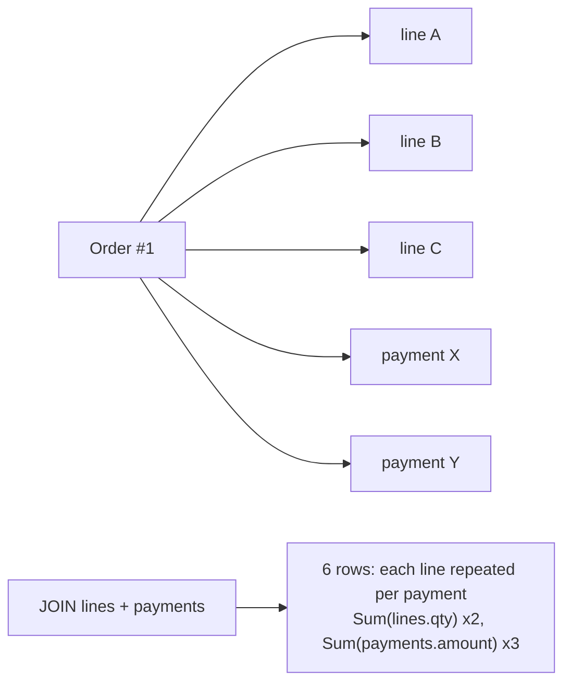

# Aggregation and Annotation

> Scope: `aggregate()` and `annotate()`, the aggregate functions (`Count`, `Sum`, `Avg`, `Min`,
> `Max`, backend-specific aggregates), conditional/filtered aggregation, how Django builds
> `GROUP BY`, annotation and aggregation ordering, aggregating across multiple relations, and the
> duplicate-row ("join fan-out") errors that produce wrong counts and sums.
> Not covered here: the expression building blocks and **window functions**
> ([advanced-query-expressions.md](./advanced-query-expressions.md)); method-level QuerySet
> semantics ([queryset-api.md](./queryset-api.md)); measuring and indexing slow reports
> ([query-optimization.md](./query-optimization.md)); reporting/export pipelines
> ([django-data-processing](../../django-data-processing/SKILL.md)).

## 1. Purpose and scope

Aggregation answers "how many / how much" in the database instead of in Python. Getting it
right is mostly about knowing **what rows exist after the joins** and **what Django groups by**.
Most aggregation bugs are not exceptions — they are plausible-looking wrong numbers. This
reference teaches an agent to predict the SQL, choose between `annotate()` and subqueries, and
verify totals.

SQL shown is approximately what Django generates on PostgreSQL; examples were not executed.

## 2. Core concepts

| API | Returns | SQL shape |
|---|---|---|
| `qs.aggregate(name=Agg(...))` | `dict` — evaluates immediately (terminal) | `SELECT AGG(...) FROM ... WHERE ...` (no GROUP BY) |
| `qs.annotate(name=Agg(...))` | QuerySet — one value **per row of the model** | `... GROUP BY <model pk + selected columns>` |
| `qs.values("k").annotate(n=Agg(...))` | QuerySet of dicts — one per distinct `k` | `GROUP BY k` |
| `qs.alias(name=...)` (Django ≥ 3.2) | QuerySet; usable in filter/order, not selected | same, but column omitted from SELECT |

Aggregate functions: `Count(expr, distinct=False, filter=None)`, `Sum`, `Avg`, `Min`, `Max`,
`StdDev`, `Variance`; all accept `filter=Q(...)` and `default=` (Django ≥ 4.0; `Count` never
returns `NULL` so it has no `default`). PostgreSQL-only aggregates live in
`django.contrib.postgres.aggregates` (`ArrayAgg`, `StringAgg`, `BoolAnd`, `JSONBAgg`, …);
Django ≥ 6.0 adds a cross-backend `StringAgg` in `django.db.models` and deprecates the
PostgreSQL one ([6.0 release notes](https://docs.djangoproject.com/en/6.0/releases/6.0/)); on
5.2 it is PostgreSQL-only.

Empty input: `Sum`/`Avg`/`Min`/`Max` return `None`, not `0`. Use `default=0` (≥ 4.0) or
`Coalesce`.

## 3. Internal mechanics

### How Django decides GROUP BY

1. If the QuerySet has `values()`/`values_list()` **before** `annotate()`, those fields are the
   grouping key.
2. Otherwise Django groups by the model's primary key (and, on backends that cannot infer
   functional dependency, every selected column).
3. Non-aggregate annotations and `order_by()` expressions are added to the `GROUP BY`. Since
   Django 3.1, `Meta.ordering` is **not** applied to aggregation queries, but an explicit
   `order_by("x")` still adds `x` to the grouping and can split groups.

### Where filters go

| Placement | Effect | SQL |
|---|---|---|
| `filter()` **before** `annotate()` on a relation | Restricts which related rows are joined and counted | `WHERE` |
| `filter()` **after** `annotate()` on the annotation | Restricts groups | `HAVING` |
| `filter()` after `annotate()` on a relation | Adds a *second* join — counts may change | extra `JOIN` + `WHERE` |
| `Agg(..., filter=Q(...))` | Restricts rows per aggregate only | `FILTER (WHERE ...)` on PostgreSQL/SQLite ≥ 3.30; `CASE WHEN` emulation elsewhere |

### Join fan-out

Annotating over a multi-valued relation joins one row per related object. Two multi-valued
relations in one query produce a **cross product per parent**: an order with 3 lines and 2
payments yields 6 joined rows. `Sum("lines__quantity")` is then doubled and
`Sum("payments__amount")` tripled. `Count(..., distinct=True)` fixes counts; there is no
safe `distinct=True` for sums (two equal amounts would be collapsed). Use subqueries.



## 4. Engineering decisions and trade-offs

| Situation | Choose | Why |
|---|---|---|
| One aggregate over one relation | `annotate(Count/Sum("rel__x"))` | Simple, single GROUP BY |
| Several aggregates over **different** multi-valued relations | One relation via `annotate`, others via `Subquery` | Avoids fan-out |
| Several conditional counts over the **same** relation | `Count("rel", filter=Q(...))` repeated | One pass, one join |
| Existence only | `Exists` annotation | No grouping, stops at first match |
| Totals for a dashboard (no per-row output) | `aggregate()` | One row back |
| Grouped report by a derived key (month, status) | `values(key).annotate(...).order_by(key)` | Explicit grouping |
| Repeated heavy report over large history | Precomputed/summary table or materialized view | Measured need only — see [django-performance](../../django-performance/SKILL.md) |

Correlated subqueries per row versus one grouped join: grouped joins are usually faster for
"all rows" reports; subqueries win for paginated lists (work only for the visible page) and are
the only correct choice under fan-out. Measure with `explain(analyze=True)`.

## 5. Django implementation patterns

### aggregate(): terminal totals

```python
from decimal import Decimal
from django.db.models import Avg, Count, Max, Q, Sum

stats = Order.objects.filter(status=Order.Status.PAID, placed_at__date=day).aggregate(
    order_count=Count("pk"),
    revenue=Sum("total", default=Decimal("0")),     # default=: Django ≥ 4.0
    average_order=Avg("total"),
    largest=Max("total"),
)
# {'order_count': 42, 'revenue': Decimal('...'), 'average_order': Decimal('...'), 'largest': ...}
```

```sql
SELECT COUNT(id), COALESCE(SUM(total), 0), AVG(total), MAX(total)
FROM orders_order WHERE status = 'paid' AND placed_at::date = %s;
```

`Avg` over a `DecimalField` returns `Decimal` on most backends; over integers it returns a
float. Cast explicitly if the type matters for display/rounding.

### annotate(): per-row values

```python
customers = (Customer.objects
    .filter(is_active=True)
    .annotate(
        order_count=Count("orders"),
        paid_order_count=Count("orders", filter=Q(orders__status=Order.Status.PAID)),
        lifetime_value=Sum("orders__total", filter=Q(orders__status=Order.Status.PAID), default=Decimal("0")),
    )
    .order_by("-lifetime_value"))
```

```sql
SELECT c.*, COUNT(o.id) AS order_count,
       COUNT(o.id) FILTER (WHERE o.status = 'paid') AS paid_order_count,
       COALESCE(SUM(o.total) FILTER (WHERE o.status = 'paid'), 0) AS lifetime_value
FROM customers_customer c LEFT OUTER JOIN orders_order o ON o.customer_id = c.id
WHERE c.is_active
GROUP BY c.id
ORDER BY lifetime_value DESC;
```

`LEFT OUTER JOIN` keeps customers with no orders (count 0). Filtering on the relation *before*
annotate (`filter(orders__status="paid").annotate(Count("orders"))`) turns it into an inner join
and drops customers without paid orders — sometimes intended, often not.

### Grouping by a key with values()

```python
monthly = (Order.objects
    .filter(status=Order.Status.PAID)
    .annotate(month=TruncMonth("placed_at"))
    .values("month")
    .annotate(orders=Count("pk"), revenue=Sum("total"))
    .order_by("month"))
```

Order matters: `values()` then `annotate()` groups; `annotate()` then `values()` merely
projects per-row annotations.

Group by a related field:

```python
(OrderLine.objects
    .filter(order__status=Order.Status.PAID)
    .values("product__category_id", "product__category__name")
    .annotate(units=Sum("quantity"),
              revenue=Sum(F("quantity") * F("unit_price")))
    .order_by("-revenue"))
```

### Filtering and ordering on aggregates (HAVING)

```python
# Products sold more than 100 units in the period.
(Product.objects
    .filter(order_lines__order__placed_at__gte=start)            # WHERE: limits joined lines
    .annotate(units=Sum("order_lines__quantity"))
    .filter(units__gt=100)                                        # HAVING
    .order_by("-units"))
```

Use `alias()` when the aggregate is only needed for filtering/ordering, to keep it out of the
SELECT list.

### Multiple relations: the fan-out fix

Wrong — both sums inflated:

```python
Order.objects.annotate(
    units=Sum("lines__quantity"),
    paid=Sum("payments__amount"),
)
```

Right — aggregate one relation in a correlated subquery:

```python
from django.db.models import DecimalField, OuterRef, Subquery, Value
from django.db.models.functions import Coalesce

paid_subquery = (Payment.objects
    .filter(order=OuterRef("pk"), status="captured")
    .values("order")                 # group by the correlation key
    .annotate(total=Sum("amount"))
    .values("total"))

orders = Order.objects.annotate(
    units=Sum("lines__quantity"),
    paid=Coalesce(Subquery(paid_subquery), Value(Decimal("0")),
                  output_field=DecimalField(max_digits=12, decimal_places=2)),
)
```

Counts across two relations can use `distinct=True`:

```python
Customer.objects.annotate(
    order_count=Count("orders", distinct=True),
    payment_count=Count("orders__payments", distinct=True),
)
```

### Aggregating over annotations

```python
# Average number of lines per paid order — Django wraps the annotated query in a subquery.
Order.objects.filter(status=Order.Status.PAID).annotate(n=Count("lines")).aggregate(avg_lines=Avg("n"))
```

### Window functions where aggregation is not enough

When each row needs both its own value and a group value (share of category revenue, running
totals), use `Window(Sum(...), partition_by=...)` instead of grouping — details in
[advanced-query-expressions.md](./advanced-query-expressions.md#window-expressions).

## 6. Production use cases

- **Admin/back-office lists**: per-customer order count and lifetime value with `filter=`
  aggregates, paginated, with an index on `orders_order(customer_id, status)`.
- **Daily revenue dashboard**: `aggregate()` per day; cache the result at the application level
  ([django-core caching](../../django-core/references/caching.md)) when it is read far more than
  it changes.
- **Inventory availability per product**: `StockItem.objects.values("product_id").annotate(
  available=Sum(F("quantity_on_hand") - F("quantity_reserved")))`.
- **Reconciliation**: compare `Order.total` to `Sum(lines)` and `Sum(payments)` via subqueries —
  a classic place where fan-out silently corrupts results.

## 7. Advantages and disadvantages

| Advantages | Disadvantages |
|---|---|
| Moves computation to the database; transfers one row per group | GROUP BY rules are implicit and order-sensitive |
| Composable with filters, pagination and ordering | Fan-out errors are silent |
| `filter=` aggregates replace many separate queries | Large GROUP BYs can be expensive (sort/hash on many rows) |
| Backend-portable for the standard aggregates | Specialised aggregates are backend-specific |

## 8. Security and performance considerations

- User-chosen grouping or sort keys (`?group_by=`) must map through an allow-list to field
  names; never pass raw input to `values()`/`order_by()`.
- Aggregates over unbounded history are full scans. Constrain by time range, add a composite
  index matching `WHERE` + `GROUP BY` columns, or maintain summary tables for hot reports.
- Grouped queries on `annotate()` group by **all** selected columns on some backends; wide models
  make the sort/hash expensive. Use `values()` to narrow the select list.
- Heavy reports belong on a read replica where the architecture provides one — see
  [django-architecture scalability](../../django-architecture/references/scalability-patterns.md).

## 9. Common mistakes and anti-patterns

- Summing in Python: `sum(o.total for o in Order.objects.all())` — loads every row.
- Two multi-valued relations in one `annotate()` (fan-out) — wrong sums.
- `Count("orders", distinct=True)` used to "fix" a `Sum` — doesn't apply to sums.
- `order_by("created_at")` on a grouped `values()` query, splitting groups unexpectedly.
- `annotate()` before `values()` when grouping was intended.
- Treating `Sum` of no rows as `0` without `default=`/`Coalesce`, then doing arithmetic on `None`.
- Filtering a relation after `annotate()` and expecting it to restrict the aggregate.
- `qs.count()` on a grouped `values().annotate()` — counts groups (correct) but is often mistaken
  for counting rows; be explicit.

## 10. Troubleshooting and validation

| Symptom | Diagnosis | Fix |
|---|---|---|
| Totals roughly 2×/3× expected | Fan-out across relations | Move one aggregate into `Subquery` |
| One row per object instead of per group | `annotate()` before `values()`, or ordering column in GROUP BY | Reorder; clear with `order_by()` or order by the group key |
| Rows missing from annotated list | Relation filter before `annotate()` turned LEFT into INNER JOIN | Use `filter=` on the aggregate |
| `TypeError` adding `None` | Empty aggregate | `default=` / `Coalesce` |
| `FieldError: ... is an aggregate` | Aggregate used inside `update()` or another aggregate | Use `Subquery` |

Validation practice: print `qs.query`; check the `GROUP BY` and joins; write a test with
fixtures designed to expose fan-out (an order with ≥ 2 lines **and** ≥ 2 payments) and with
empty relations. See [django-testing](../../django-testing/SKILL.md).

## 11. Related references and skills

- [advanced-query-expressions.md](./advanced-query-expressions.md) — `Subquery`, `Exists`, `Case`, `Window`.
- [queryset-api.md](./queryset-api.md) — `values()`, `order_by()`, `distinct()`.
- [query-optimization.md](./query-optimization.md) — plans, indexes for GROUP BY, pagination.
- [orm-anti-patterns.md](./orm-anti-patterns.md) — incorrect aggregation catalogue entry.
- [django-performance](../../django-performance/SKILL.md) — profiling report endpoints.

## 12. Official documentation and external references

- Aggregation topic guide: https://docs.djangoproject.com/en/stable/topics/db/aggregation/
- Aggregation functions: https://docs.djangoproject.com/en/stable/ref/models/querysets/#aggregation-functions
- PostgreSQL-specific aggregates: https://docs.djangoproject.com/en/stable/ref/contrib/postgres/aggregates/
- Conditional aggregation: https://docs.djangoproject.com/en/stable/ref/models/conditional-expressions/#conditional-aggregation
- PostgreSQL aggregate functions: https://www.postgresql.org/docs/current/functions-aggregate.html
