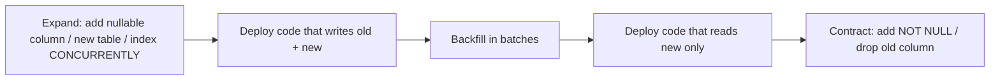

# Migrations and Schema Evolution

> Scope: Django's migration system and how to evolve a production schema safely —
> `makemigrations`/`migrate`, the migration graph and dependencies, operations, schema vs data
> migrations, `RunPython`/`RunSQL`, reversibility, squashing, conflicts, custom operations,
> large-table changes, expand-and-contract, zero-downtime deploys and rollback.
> Not covered here: which constraints and indexes to define
> ([database-constraints-and-indexes.md](./database-constraints-and-indexes.md)), field semantics
> ([field-types-and-options.md](./field-types-and-options.md)), batching mechanics for backfills
> ([bulk-operations-and-batching.md](./bulk-operations-and-batching.md)), lock internals and
> `ALTER TABLE` lock levels per engine ([postgresql-engineering](../../postgresql-engineering/SKILL.md)),
> data import pipelines ([django-data-processing](../../django-data-processing/SKILL.md)),
> testing migrations ([django-testing](../../django-testing/SKILL.md)).

## 1. Purpose and scope

Migrations are code that runs against production data. They are part of the application's
release lifecycle: they ship with the code, run once per environment, are ordered by a graph,
and are effectively permanent once applied anywhere shared. A careless migration can lock a hot
table for minutes, break the version of the code still serving traffic, or lose data with no
reverse path. This reference teaches how to author, review and deploy them so that every
schema change is **reviewed, reversible where possible, and compatible with the code running on
both sides of the deploy**.

SQL in this reference is illustrative PostgreSQL output; it was not executed. Use
`sqlmigrate` against your own backend to see real DDL.

## 2. Core concepts

| Concept | Meaning |
|---|---|
| Migration file | A Python module in `<app>/migrations/` with a `Migration` class: `dependencies`, `operations`, optional `atomic`, `initial`, `replaces`, `run_before`. |
| Migration state | Django reconstructs historical model state by replaying operations; it never introspects the live DB to decide what changed. |
| Autodetector | `makemigrations` diffs the current models against the state from the existing migrations and emits operations. |
| `django_migrations` table | Records which `(app, name)` pairs are applied. `migrate` applies unapplied nodes in graph order. |
| Schema migration | DDL: `CreateModel`, `AddField`, `AlterField`, `RemoveField`, `AddIndex`, `AddConstraint`, `RenameField`… |
| Data migration | `RunPython` / `RunSQL` that transforms rows. |
| Reversible | Every operation has a backwards path; `RunPython`/`RunSQL` are reversible only if you supply the reverse. |
| Squash | Replace a chain with one migration that `replaces` the originals. |
| Expand / contract | Add new structure compatible with old code (expand), migrate data and code, later remove the old structure (contract). |

## 3. Internal mechanics

1. `makemigrations` loads every app's migrations into a `MigrationGraph`, builds a
   `ProjectState` by applying operations in memory, compares it to the current models via the
   `MigrationAutodetector`, and writes new operations. It may ask interactive questions
   (renames, defaults for non-null columns).
2. `migrate` builds the graph, computes a plan (`showmigrations --plan`), and for each node:
   opens a transaction **if the backend supports transactional DDL and `atomic=True`**
   (PostgreSQL and SQLite do; MySQL and Oracle do not — a failed migration on MySQL can leave a
   half-applied schema), runs each operation's `database_forwards` through the
   `SchemaEditor`, then inserts the row into `django_migrations`.
3. Operations act on *historical* models: `apps.get_model("orders", "Order")` inside
   `RunPython` returns a model built from migration state — no custom methods, no custom
   `save()`, managers only if `use_in_migrations = True`.
4. `post_migrate` fires after the run (content types and permissions are created there).

```bash
python manage.py makemigrations orders            # generate
python manage.py makemigrations --check --dry-run # CI: fail if models and migrations diverge
python manage.py sqlmigrate orders 0042           # show DDL that will run
python manage.py showmigrations --plan            # ordered plan / applied state
python manage.py migrate orders 0041              # migrate backwards to 0041
python manage.py migrate --plan                   # preview without applying
```



## 4. Engineering decisions and trade-offs

| Decision | Prefer | Because |
|---|---|---|
| One big migration vs several | Several small ones, each one deploy step | Each step must be compatible with the code running during the deploy. |
| Schema + data in one migration | Separate files | Mixed DDL and row updates in one transaction hold locks for the whole backfill; on PostgreSQL, altering a table after updating rows in the same transaction can fail with `cannot ALTER TABLE ... because it has pending trigger events` — the pending triggers are deferred FK checks (Django creates PostgreSQL FKs `DEFERRABLE INITIALLY DEFERRED`); see Django tickets [#28914](https://code.djangoproject.com/ticket/28914), [#25105](https://code.djangoproject.com/ticket/25105). Not described in the Django docs themselves. |
| `RunPython` vs `RunSQL` for data | `RunPython` for portable, small/medium data; `RunSQL` for set-based updates on large tables | SQL `UPDATE ... WHERE` is one statement; Python loops pull rows into memory. |
| Backfill in a migration vs a management command | Command (or background job) for large tables | Migrations block the deploy and run in one transaction by default; commands can batch, resume and throttle. |
| `atomic = False` | Only when required (`AddIndexConcurrently`, batched backfills) | Non-atomic migrations can partially apply; make each operation idempotent. |
| Squash | When a long chain slows tests/startup and all environments are past it | Squashing is churn and must be coordinated with every deployed environment. |
| Rollback by reverse migration vs roll-forward fix | Roll forward for anything that touched data | Reversing `RemoveField` cannot restore data; reverse paths on large tables are as risky as forwards. |

## 5. Django implementation patterns

### Data migration with historical models and a reverse

```python
# apps/orders/migrations/0043_backfill_placed_at.py
from django.db import migrations
from django.db.models import F


def forwards(apps, schema_editor):
    Order = apps.get_model("orders", "Order")          # historical model, never import apps.orders.models
    db = schema_editor.connection.alias                 # respect multi-db routing
    Order.objects.using(db).filter(
        placed_at__isnull=True, status__in=["paid", "shipped"]
    ).update(placed_at=F("created_at"))                 # one set-based UPDATE


def backwards(apps, schema_editor):
    pass  # data-only change; leaving values is safe. State this explicitly instead of noop-by-omission.


class Migration(migrations.Migration):
    dependencies = [("orders", "0042_order_placed_at")]
    operations = [migrations.RunPython(forwards, backwards)]
    # migrations.RunPython.noop is the documented helper for an intentional no-op reverse.
```

### RunSQL with reverse and state

```python
migrations.RunSQL(
    sql="CREATE INDEX CONCURRENTLY IF NOT EXISTS order_customer_created_idx "
        "ON orders_order (customer_id, created_at DESC);",
    reverse_sql="DROP INDEX CONCURRENTLY IF EXISTS order_customer_created_idx;",
    state_operations=[
        migrations.AddIndex(
            "order",
            models.Index(fields=["customer", "-created_at"], name="order_customer_created_idx"),
        ),
    ],
)
```

`state_operations` keeps Django's model state in sync so the autodetector does not try to add
the index again. `RunSQL` accepts parameterised `(sql, params)` tuples — never format values into
the SQL string.

### Concurrent index on PostgreSQL (preferred over hand-written SQL)

```python
from django.contrib.postgres.operations import AddIndexConcurrently


class Migration(migrations.Migration):
    atomic = False  # CREATE INDEX CONCURRENTLY cannot run inside a transaction
    dependencies = [("orders", "0043_backfill_placed_at")]
    operations = [
        AddIndexConcurrently(
            "order",
            models.Index(fields=["customer", "-created_at"], name="order_customer_created_idx"),
        ),
    ]
```

`RemoveIndexConcurrently` is the counterpart. Both are PostgreSQL-only. A failed concurrent build
leaves an `INVALID` index that must be dropped before retrying.

### Expand-and-contract: making `Order.placed_at` required

```text
Release 1 (expand)   AddField placed_at null=True; code writes placed_at on every new order.
Release 2 (backfill) Batched command or RunSQL backfill; verify no NULLs remain.
Release 3 (enforce)  AlterField null=False (or add CheckConstraint first, see below).
```

On PostgreSQL, `SET NOT NULL` scans the table under an `ACCESS EXCLUSIVE` lock. For very large
tables a common technique is to add `CHECK (placed_at IS NOT NULL) NOT VALID`, `VALIDATE` it
(`SHARE UPDATE EXCLUSIVE` lock), then set `NOT NULL` — PostgreSQL ≥ 12 skips the scan when a
valid `CHECK` proves no NULLs exist ([ALTER TABLE](https://www.postgresql.org/docs/current/sql-altertable.html),
[12 release notes](https://www.postgresql.org/docs/release/12.0/)). Drop the helper CHECK afterwards.
Django does not generate this sequence; use `RunSQL` with `state_operations`. Engine details →
[postgresql-engineering](../../postgresql-engineering/SKILL.md).

### Renaming a column without downtime

`RenameField` is a single `ALTER TABLE ... RENAME COLUMN` — fast, but old code still running
during the deploy queries the old name and fails. Zero-downtime rename = expand/contract:
add new field → dual-write → backfill → switch reads → remove old field. Or keep the column name
and change only the Python name with `db_column="old_name"` (no DDL).

### Removing a field safely

1. Release N: remove all code references; keep the field in the model (or mark it with
   `editable=False`) so the ORM still selects it harmlessly.
2. Release N+1: delete the field and generate `RemoveField`.

Removing the field and the code in one release breaks old processes, because Django `SELECT`s
every concrete column it knows about and old code knows about the dropped column.

### Adding a column with a default

Django ≤ 4.x applied defaults in Python and dropped the DB default after `AddField`.
`db_default` (Django ≥ 5.0) creates a persistent database default. On PostgreSQL ≥ 11 adding a
column with a non-volatile default (a constant, or a stable function such as `now()`, evaluated
once) does not rewrite the table; volatile defaults (e.g. `clock_timestamp()`,
`gen_random_uuid()`) rewrite the whole table and its indexes
([ALTER TABLE notes](https://www.postgresql.org/docs/current/sql-altertable.html),
[11 release notes](https://www.postgresql.org/docs/release/11.0/)). MySQL/MariaDB/Oracle have
their own instant-ADD-COLUMN rules — check that engine's docs.

### Migration conflicts

Two branches each add `0044_*` in `orders` → `migrate` refuses with "Conflicting migrations
detected". Resolve with `makemigrations --merge` (creates a merge node depending on both) only
after checking the two branches don't touch the same columns; otherwise rebase one migration on
the other and renumber before it is applied anywhere shared.

### Custom operations

Subclass `django.db.migrations.operations.base.Operation` and implement `state_forwards`,
`database_forwards`, `database_backwards`, `describe` (and `deconstruct`). Justified only when a
recurring DDL pattern (e.g. enabling a PostgreSQL extension — already provided as
`django.contrib.postgres.operations.CreateExtension`) is not covered. Prefer `RunSQL` with
`state_operations` for one-offs.

### Squashing

```bash
python manage.py squashmigrations orders 0001 0040
```

The squashed migration has `replaces = [...]`. Keep the originals until **every** environment
(including developer databases and long-lived branches) has applied past 0040, then delete them,
convert the squashed migration to a normal one (remove `replaces`) and update dependencies that
pointed at the old names. `RunPython` functions are copied as references; ones marked
`elidable=True` are dropped by squashing.

## 6. Production use cases

- **New `StockItem` CheckConstraint on a 50M-row table**: on PostgreSQL add the constraint
  `NOT VALID` via `RunSQL` (fast, enforces new writes), then `VALIDATE CONSTRAINT` in a separate
  migration, with `state_operations=[AddConstraint(...)]`.
- **Changing `Product.price` precision**: `AlterField` on a numeric column may rewrite the table.
  Check `sqlmigrate`; schedule or use a new column + backfill.
- **Splitting `Customer.name` into first/last**: expand (add fields), dual-write, backfill
  command, switch reads, contract.
- **Multi-tenant hot tables**: set `lock_timeout` for the migration session
  (`RunSQL("SET lock_timeout = '5s'")` at the start of a non-atomic migration or via DB OPTIONS)
  so DDL fails fast instead of queuing behind a long transaction and blocking all traffic.

## 7. Advantages and disadvantages

| Advantages | Disadvantages |
|---|---|
| Schema is versioned with code and reproducible from zero. | Autodetector knows nothing about lock levels, table size or deploy order. |
| Historical models keep old data migrations runnable. | Large migration graphs slow test setup and `migrate`. |
| Backend-agnostic DDL generation. | Engine-specific safety techniques need `RunSQL` + `state_operations`. |
| Reversibility is explicit and testable. | Reversal of destructive changes is impossible without backups. |

## 8. Security and performance considerations

- Migrations run with the deploy user's privileges; keep that role separate from the runtime
  role where possible so the app cannot `DROP` tables.
- Never embed secrets or environment-specific values in migration files — they are immutable
  history.
- Lock duration, not statement duration, is what hurts: any `ALTER TABLE` waits for an exclusive
  lock behind running transactions, and every query behind it waits too. Use `lock_timeout`, run
  migrations when long-running transactions are not active, and keep migrations short.
- Data migrations that iterate in Python over large tables can exhaust memory; use set-based SQL
  or batched `iterator()` loops ([bulk-operations-and-batching.md](./bulk-operations-and-batching.md)).
- MySQL/Oracle: no transactional DDL — a failure mid-migration needs manual repair. Keep one
  DDL operation per migration on these backends.

## 9. Common mistakes and anti-patterns

- Importing application models (`from apps.orders.models import Order`) in a data migration —
  breaks when the model later changes. Always `apps.get_model`.
- Editing or deleting a migration already applied in a shared environment.
- `RunPython(forwards)` without a reverse, making the whole app irreversible past that point.
- Adding a non-nullable field to a large table in one step; adding a unique index without
  `CONCURRENTLY` on a hot PostgreSQL table.
- Dropping a column in the same release that stops using it.
- Running backfills of millions of rows inside an atomic migration.
- `--fake` used to "fix" errors without understanding the real DB state.
- Ignoring `makemigrations --check` in CI so model drift accumulates.
- Merge migrations created blindly over semantically conflicting changes.

## 10. Troubleshooting and validation

| Symptom | Check |
|---|---|
| "Conflicting migrations detected" | `showmigrations app`; inspect both leaves; `makemigrations --merge` or rebase. |
| Migration hangs in production | Blocked on a lock: on PostgreSQL inspect `pg_stat_activity` / `pg_locks` for the blocker. |
| `InconsistentMigrationHistory` | A migration is applied before its dependency — usually a renamed/squashed file; fix the dependency or the `django_migrations` row deliberately. |
| Autodetector keeps generating the same change | Model state and `RunSQL` changes diverge — add `state_operations` or use `SeparateDatabaseAndState`. |
| `INVALID` index after failed concurrent build | Drop it and re-run. |
| Unexpected table rewrite | Read `sqlmigrate` output before merging; test on a production-sized copy. |

Validation before merging a migration:

- [ ] `makemigrations --check --dry-run` clean; `sqlmigrate` reviewed by a human.
- [ ] Compatible with the previous release's code (expand/contract respected).
- [ ] Reverse path exists, or the irreversibility is documented.
- [ ] Data migrations use historical models and are set-based or batched.
- [ ] Lock impact assessed for tables above a size threshold your team agrees on.
- [ ] Forward and backward run in CI on a fresh DB ([django-testing](../../django-testing/SKILL.md)).

## 11. Related references and skills

- [database-constraints-and-indexes.md](./database-constraints-and-indexes.md) — what to add.
- [bulk-operations-and-batching.md](./bulk-operations-and-batching.md) — batched backfills.
- [transactions-and-concurrency.md](./transactions-and-concurrency.md) — locks and atomicity.
- [orm-anti-patterns.md](./orm-anti-patterns.md) — migration anti-patterns catalogue.
- [django-core: models-application-lifecycle](../../django-core/references/models-application-lifecycle.md) — app registry, `post_migrate`.
- [postgresql-engineering](../../postgresql-engineering/SKILL.md) — lock levels, `NOT VALID`, rewrites.
- [django-testing](../../django-testing/SKILL.md) — migration tests.

## 12. Official documentation and external references

- https://docs.djangoproject.com/en/stable/topics/migrations/
- https://docs.djangoproject.com/en/stable/ref/migration-operations/
- https://docs.djangoproject.com/en/stable/howto/writing-migrations/
- https://docs.djangoproject.com/en/stable/ref/contrib/postgres/operations/
- https://docs.djangoproject.com/en/stable/ref/django-admin/#makemigrations
- https://www.postgresql.org/docs/current/sql-altertable.html
- https://www.postgresql.org/docs/current/sql-createindex.html#SQL-CREATEINDEX-CONCURRENTLY
- https://www.postgresql.org/docs/current/explicit-locking.html
