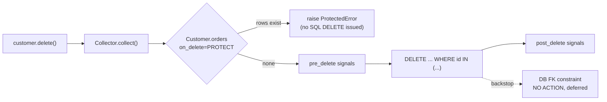

# Model Relationships

> Scope: designing relationships between models — one-to-one, one-to-many, many-to-many,
> explicit `through` models, reverse relationships, `related_name` / `related_query_name`,
> `on_delete` and cascading, referential integrity (ORM emulation vs database foreign-key
> constraints), self-referential and recursive relationships, and relationship design
> trade-offs.
> Not covered here: relation fields' column-level options ([field-types-and-options.md](./field-types-and-options.md));
> loading strategy and N+1 fixes ([query-optimization.md](./query-optimization.md));
> `select_related`/`prefetch_related` method semantics ([queryset-api.md](./queryset-api.md));
> counting across relations ([aggregation-and-annotation.md](./aggregation-and-annotation.md));
> cross-app ownership of models ([django-architecture django-application-boundaries](../../django-architecture/references/django-application-boundaries.md)).

## 1. Purpose and scope

Relationships decide what the database can guarantee (no orphan order lines, no deleting a
product that appears on an invoice), how queries join, and what happens on delete. Mistakes
here are expensive: changing cardinality or `on_delete` after data exists needs data
migrations, and Django's delete emulation can silently remove far more rows than intended.

Baseline Django 5.2 LTS; SQL is approximately PostgreSQL output.

## 2. Core concepts

| Cardinality | Field | Lives on | Database shape |
|---|---|---|---|
| Many-to-one (one-to-many from the other side) | `ForeignKey` | The "many" side (`OrderLine.order`) | `order_id` column + FK constraint + index |
| One-to-one | `OneToOneField` | The dependent side (`CustomerProfile.customer`) | FK column + **unique** constraint |
| Many-to-many | `ManyToManyField` | Either side (pick the one that "owns" the concept) | Join table `(a_id, b_id)` unique together |

**Forward access** (`line.order`) uses the descriptor on the declaring model; **reverse
access** (`order.lines`) is a related manager created on the target model, named by
`related_name` (default `<model>_set`). **`related_query_name`** names the reverse relation
in lookups (`Order.objects.filter(lines__product__sku=...)`); it defaults to
`related_name` if set, else the model name.

`related_name="+"` disables the reverse accessor (useful for audit FKs like `created_by` on
dozens of models).

## 3. Internal mechanics

### ORM integrity vs database integrity

Two separate mechanisms are at work:

1. **Database FK constraint.** Django creates `FOREIGN KEY ... REFERENCES` for every
   `ForeignKey`/`OneToOneField` (unless `db_constraint=False`). On PostgreSQL (and Oracle)
   Django creates it `DEFERRABLE INITIALLY DEFERRED`, so it is checked at commit. The
   constraint's own action is **`NO ACTION`** — Django does *not* emit `ON DELETE CASCADE`.
2. **`on_delete` emulation.** When you call `Model.delete()` or `QuerySet.delete()`, Django's
   `Collector` walks relations in Python, collects dependent rows, fires
   `pre_delete`/`post_delete` signals, and issues the deletes/updates itself, in dependency
   order, inside a transaction.

Consequences:

- `on_delete=CASCADE` only cascades when the delete goes through the ORM. Raw SQL
  `DELETE FROM customers_customer` is rejected by the FK constraint (`NO ACTION`), not
  cascaded.
- `PROTECT`/`RESTRICT` are checked in Python before deleting (raising `ProtectedError`/
  `RestrictedError`); the DB constraint is the backstop.
- Database-level actions `on_delete=models.DB_CASCADE`/`DB_SET_NULL`/`DB_SET_DEFAULT` are
  **Django ≥ 6.1** (not in 6.0); `DB_SET_DEFAULT` needs `db_default` and is unsupported on
  MySQL/MariaDB, `DB_CASCADE` sends no delete signals, and `DB_*` variants can't be mixed with
  Python variants other than `DO_NOTHING` in related models
  ([dev docs](https://docs.djangoproject.com/en/dev/ref/models/fields/#django.db.models.ForeignKey.on_delete)).
  On 5.2/6.0, database-level cascades require `RunSQL`.
- On SQLite, FK enforcement depends on `PRAGMA foreign_keys`, which Django enables. MySQL
  MyISAM has no FK support at all.



### Fast deletes

When the collected model has no signals receivers and no further cascades, the collector
uses a single `DELETE ... WHERE fk_id IN (...)` ("fast delete") instead of fetching rows.
Registering a `pre_delete`/`post_delete` receiver on `OrderLine` disables that and makes
Django load every line into memory before deleting — a frequent cause of slow deletes.

### Many-to-many internals

An auto-created through model (`Product_tags`) has `id`, `product_id`, `tag_id` and a
unique constraint on the pair. `product.tags.add(t1, t2)` does a bulk `INSERT` with
`ignore_conflicts` when the backend supports it (`ON CONFLICT DO NOTHING` on PostgreSQL).
If the through model is auto-created, the backend can ignore conflicts and no
`m2m_changed` receivers are registered, it skips the `SELECT` for existing pairs entirely;
otherwise it first selects existing pairs, sends `m2m_changed` `pre_add`, inserts the missing
ones and sends `post_add` (Django 5.2 source, `related_descriptors.py` `_get_add_plan`).

## 4. Engineering decisions and trade-offs

### Choosing `on_delete`

| Option | Behaviour (ORM) | Use for |
|---|---|---|
| `PROTECT` | Refuse delete if referenced | Business records: `Order.customer`, `OrderLine.product`, `Payment.order`. Default choice. |
| `RESTRICT` | Like PROTECT but allows deletion when the referencing object is also being deleted via another CASCADE path | Complex composition graphs. |
| `CASCADE` | Delete dependents | True composition: `OrderLine.order`, `StockItem` ↔ `Warehouse` only if stock rows have no history value. |
| `SET_NULL` | Null the FK (`null=True` required) | Optional links that should survive: `Order.assigned_agent`. |
| `SET_DEFAULT` / `SET(callable)` | Set a value | Reassigning to a sentinel ("deleted user"). |
| `DO_NOTHING` | Nothing in Python; the DB constraint decides | Only with your own DB-level `ON DELETE` or a deliberately unconstrained FK. |

Prefer **soft deactivation** (`is_active=False`) over deleting master data (customers,
products) referenced by financial records; then `PROTECT` almost never fires in normal
operation and history stays intact.

### Many-to-many: auto vs explicit `through`

Use an explicit through model as soon as the relationship has attributes (quantity, role,
date added), needs its own constraints/indexes, or needs auditing. Migrating from auto to
explicit later is possible (`SeparateDatabaseAndState`) but fiddly — when in doubt, start
explicit. `Order` ↔ `Product` is the canonical case: `OrderLine` *is* the through table and
is modelled as two FKs, often without declaring a `ManyToManyField` at all.

### One-to-one vs extra columns vs MTI

`OneToOneField` is right for optional, separately-owned or bulky data (`CustomerProfile`,
`ProductSEO`). If the data is always needed and small, add columns. Avoid multi-table
inheritance as a relationship tool ([model-design.md](./model-design.md)).

### Self-referential hierarchies

Adjacency list (`parent = ForeignKey("self")`) is simple and correct for shallow trees.
Deep or frequently-traversed trees need a recursive CTE (raw SQL —
[raw-sql-and-database-access.md](./raw-sql-and-database-access.md)), a materialised path
column, or a library (django-treebeard / django-mptt). Choose based on read/write ratio and
depth.

### `GenericForeignKey`

No FK constraint, no cascade at the database, awkward joins. Use it for genuinely
polymorphic attachments (comments, audit logs, tags across many models). Never for an
ordinary relationship you can name.

## 5. Django implementation patterns

### The order domain

```python
# apps/orders/models.py
from django.db import models
from django.db.models import Q, F

# OrderStatus: module-level TextChoices — see field-types-and-options.md


class Order(models.Model):
    customer = models.ForeignKey(
        "customers.Customer",
        on_delete=models.PROTECT,
        related_name="orders",
    )
    status = models.CharField(max_length=16, choices=OrderStatus, default=OrderStatus.PENDING)
    total = models.DecimalField(max_digits=12, decimal_places=2)
    created_at = models.DateTimeField(auto_now_add=True)
    placed_at = models.DateTimeField(null=True, blank=True)


class OrderLine(models.Model):
    order = models.ForeignKey(Order, on_delete=models.CASCADE, related_name="lines")
    product = models.ForeignKey(
        "catalog.Product", on_delete=models.PROTECT, related_name="order_lines"
    )
    quantity = models.PositiveIntegerField()
    unit_price = models.DecimalField(max_digits=10, decimal_places=2)  # snapshot, not a join

    class Meta:
        constraints = [
            models.UniqueConstraint(fields=["order", "product"], name="orderline_order_product_uniq"),
            models.CheckConstraint(condition=Q(quantity__gt=0), name="orderline_quantity_gt_0"),
        ]
```

Design notes: `unit_price` is copied at order time — price history must not change when
`Product.price` changes; `product` is `PROTECT` so catalogue cleanup cannot destroy invoice
lines; `order` is `CASCADE` because a line has no meaning without its order.

### Inventory with an explicit association model

```python
# apps/inventory/models.py
class Warehouse(models.Model):
    code = models.CharField(max_length=16, unique=True)
    name = models.CharField(max_length=200)
    products = models.ManyToManyField(
        "catalog.Product", through="StockItem", related_name="warehouses"
    )


class StockItem(models.Model):
    product = models.ForeignKey("catalog.Product", on_delete=models.PROTECT, related_name="stock_items")
    warehouse = models.ForeignKey(Warehouse, on_delete=models.PROTECT, related_name="stock_items")
    quantity_on_hand = models.PositiveIntegerField(default=0)
    quantity_reserved = models.PositiveIntegerField(default=0)

    class Meta:
        constraints = [
            models.UniqueConstraint(fields=["product", "warehouse"], name="stockitem_product_warehouse_uniq"),
            models.CheckConstraint(
                condition=Q(quantity_reserved__lte=F("quantity_on_hand")),
                name="stockitem_reserved_lte_on_hand",
            ),
        ]
```

Querying through both paths:

```python
warehouse.products.filter(is_active=True)                    # via M2M accessor
product.stock_items.select_related("warehouse")              # via the through model directly
Product.objects.filter(stock_items__quantity_on_hand__gt=0).distinct()
```

Approximate SQL for the last query:

```sql
SELECT DISTINCT p.* FROM catalog_product p
INNER JOIN inventory_stockitem s ON s.product_id = p.id
WHERE s.quantity_on_hand > 0;
```

The `DISTINCT` is needed because the join multiplies product rows per warehouse — the same
fan-out that corrupts aggregates ([aggregation-and-annotation.md](./aggregation-and-annotation.md)).
`Exists()` avoids it entirely ([advanced-query-expressions.md](./advanced-query-expressions.md)):
`Product.objects.filter(Exists(StockItem.objects.filter(product=OuterRef("pk"), quantity_on_hand__gt=0)))`.

With an explicit `through`, `warehouse.products.add(product, through_defaults={"quantity_on_hand": 5})`
works; for anything non-trivial create `StockItem` rows directly.

### One-to-one

```python
# apps/customers/models.py
class CustomerProfile(models.Model):
    customer = models.OneToOneField(
        "customers.Customer", on_delete=models.CASCADE, related_name="profile", primary_key=True
    )
    marketing_opt_in = models.BooleanField(default=False)
    preferences = models.JSONField(default=dict, blank=True)
```

`primary_key=True` saves a column and index. Reverse access `customer.profile` raises
`Customer.profile.RelatedObjectDoesNotExist` (a subclass of both `DoesNotExist` and
`AttributeError`) when absent — handle it or `hasattr(customer, "profile")`.

### Self-referential and recursive

```python
# apps/catalog/models.py
class Category(models.Model):
    name = models.CharField(max_length=100)
    parent = models.ForeignKey(
        "self", null=True, blank=True, on_delete=models.PROTECT, related_name="children"
    )

    class Meta:
        constraints = [
            models.UniqueConstraint(fields=["parent", "name"], name="category_parent_name_uniq"),
            models.UniqueConstraint(
                fields=["name"], condition=Q(parent__isnull=True), name="category_root_name_uniq"
            ),
            models.CheckConstraint(condition=~Q(parent=F("pk")), name="category_not_own_parent"),
        ]
```

The second constraint exists because `NULL` parents do not collide in the first unique
constraint (until PostgreSQL 15's `NULLS NOT DISTINCT`, exposed as `nulls_distinct=False`
in Django ≥ 5.0, honoured on PostgreSQL 15+ only —
[docs](https://docs.djangoproject.com/en/5.2/ref/models/constraints/#nulls-distinct)). Cycles longer than one hop cannot be prevented by a CHECK; validate in the
service before re-parenting.

Fetching a subtree with the ORM costs one query per level; use a recursive CTE for depth:

```sql
WITH RECURSIVE tree AS (
  SELECT id, parent_id, name FROM catalog_category WHERE id = %s
  UNION ALL
  SELECT c.id, c.parent_id, c.name FROM catalog_category c JOIN tree t ON c.parent_id = t.id
)
SELECT id FROM tree;
```

Symmetric self-M2M: `friends = ManyToManyField("self")` is symmetrical by default; set
`symmetrical=False` for directed relations (followers).

### Many FKs to the same model

```python
class Transfer(models.Model):
    source = models.ForeignKey("billing.Account", on_delete=models.PROTECT, related_name="outgoing_transfers")
    target = models.ForeignKey("billing.Account", on_delete=models.PROTECT, related_name="incoming_transfers")
```

Without distinct `related_name`s the system check reports clashing reverse accessors.

### Cross-app references

Use string references (`"catalog.Product"`) to avoid import cycles. Which app may reference
which is an architectural decision ([django-architecture django-application-boundaries](../../django-architecture/references/django-application-boundaries.md)).

## 6. Production use cases

- **Customer deletion request (GDPR)**: `Order.customer` is `PROTECT`; the service
  anonymises the customer row instead of deleting it, preserving financial history.
- **Removing a warehouse**: `StockItem.warehouse` `PROTECT` forces an explicit stock
  transfer before decommissioning.
- **Product discontinuation**: set `is_active=False`; historical `OrderLine.product` stays valid.
- **Payment retries**: `Payment.order` many-to-one with `PROTECT`; multiple attempts per
  order, at most one successful enforced by a conditional `UniqueConstraint`
  ([database-constraints-and-indexes.md](./database-constraints-and-indexes.md)).

## 7. Advantages and disadvantages

| Design | Advantages | Disadvantages |
|---|---|---|
| FK with DB constraint | Guaranteed referential integrity | Write cost; deletes need ordering. |
| ORM `CASCADE` | Signals fire; works across backends | Loads rows into memory when signals exist; not applied to raw SQL. |
| Explicit through | Attributes, constraints, auditing | Slightly more code. |
| `db_constraint=False` | Cross-database or legacy tables | Orphans; no integrity. |
| `GenericForeignKey` | Polymorphic | No FK, no cascades, poor query plans. |
| Adjacency list | Simple writes | Recursive reads need CTE. |

## 8. Security and performance considerations

- A broad `CASCADE` chain lets one delete remove thousands of rows (customer → orders →
  lines → payments). Prefer `PROTECT` on anything with legal/financial retention value.
- Reverse accessors bypass tenant scoping unless you scope them explicitly
  (`customer.orders.filter(tenant=...)` is still needed if the parent could be shared) —
  see [managers-and-querysets.md](./managers-and-querysets.md) and
  [django-security-engineering](../../django-security-engineering/SKILL.md).
- Accessing `line.product` in a loop is one query per line — use `select_related` /
  `prefetch_related` ([query-optimization.md](./query-optimization.md)).
- Filtering across multi-valued relations multiplies rows; use `Exists` or `.distinct()`
  knowingly.
- Every FK gets an index by default; if a composite index starts with the FK column, set
  `db_index=False` on the FK to avoid a redundant index (measure first).
- Large `QuerySet.delete()` with signals attached is O(rows) Python work; batch it
  ([bulk-operations-and-batching.md](./bulk-operations-and-batching.md)).

## 9. Common mistakes and anti-patterns

- Default `CASCADE` everywhere copied from tutorials.
- Assuming the database will cascade raw SQL deletes because the model says `CASCADE`.
- Forgetting `related_name`, leading to `orderline_set` and clashes when a second FK is added.
- Auto M2M later needing attributes — then a painful migration.
- Filtering `filter(lines__product=a).filter(lines__product=b)` vs
  `filter(lines__product=a, lines__product=b)` confusion: chained filters on multi-valued
  relations may match different related rows (separate joins); a single `filter()` requires
  the same row.
- `GenericForeignKey` for a relationship with a known target.
- Looking up prices through `line.product.price` for historical orders instead of a snapshot.

## 10. Troubleshooting and validation

| Symptom | Cause | Fix |
|---|---|---|
| `ProtectedError` on delete | A `PROTECT` FK references the row | Intended: deactivate, reassign, or delete dependents explicitly. |
| `IntegrityError ... violates foreign key constraint` at commit | Raw SQL / `DO_NOTHING` / deferred check | Find the orphan; review delete order. |
| `fields.E304` reverse accessor clash | Two FKs to the same model without `related_name` | Name both. |
| Duplicate rows in results | Join across multi-valued relation | `Exists()` or `.distinct()`. |
| Delete takes minutes | Signals or cascades force row loading | Move signal work into the service, delete in batches; measure with query logging. |
| `RelatedObjectDoesNotExist` | Missing one-to-one row | `hasattr()` / create on demand. |

Validate: `python manage.py check`; read FK DDL via `sqlmigrate`; tests that `delete()` on a
customer with orders raises `ProtectedError` ([django-testing](../../django-testing/SKILL.md));
`Collector` preview via the admin's delete confirmation page or
`django.contrib.admin.utils.NestedObjects` to see what a delete would remove.

## 11. Related references and skills

- [field-types-and-options.md](./field-types-and-options.md) — relation field options.
- [database-constraints-and-indexes.md](./database-constraints-and-indexes.md) — FK and composite constraints.
- [query-optimization.md](./query-optimization.md) — loading related data.
- [queryset-api.md](./queryset-api.md) — `select_related`, `prefetch_related`.
- [aggregation-and-annotation.md](./aggregation-and-annotation.md) — counts across relations.
- [migrations-and-schema-evolution.md](./migrations-and-schema-evolution.md) — changing relations safely.
- [django-architecture django-application-boundaries](../../django-architecture/references/django-application-boundaries.md).

## 12. Official documentation and external references

- https://docs.djangoproject.com/en/stable/topics/db/models/#relationships
- https://docs.djangoproject.com/en/stable/ref/models/fields/#module-django.db.models.fields.related
- https://docs.djangoproject.com/en/stable/ref/models/fields/#django.db.models.ForeignKey.on_delete
- https://docs.djangoproject.com/en/stable/topics/db/examples/
- https://docs.djangoproject.com/en/stable/ref/models/relations/
- https://www.postgresql.org/docs/current/ddl-constraints.html#DDL-CONSTRAINTS-FK
