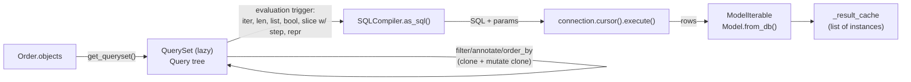

# ORM Fundamentals

> Scope: what the Django ORM is, its layered architecture (Model → Manager → QuerySet → Query →
> SQLCompiler → backend → DB-API connection), model-to-table mapping, the QuerySet lifecycle from
> construction to execution at overview level, connection management, backend abstraction, the
> result cache and its limits, and when the ORM is or isn't the right tool.
> Not covered here: evaluation triggers, cloning and iterator mechanics in depth
> ([queryset-internals.md](./queryset-internals.md)); per-method semantics
> ([queryset-api.md](./queryset-api.md)); model inheritance, `Meta`, PKs and validation
> ([model-design.md](./model-design.md)); raw SQL ([raw-sql-and-database-access.md](./raw-sql-and-database-access.md));
> transactions ([transactions-and-concurrency.md](./transactions-and-concurrency.md)); the general
> model/app lifecycle and `AppConfig` ([django-core models-application-lifecycle](../../django-core/references/models-application-lifecycle.md)).

## 1. Purpose and scope

The Django ORM is the default data-access layer of a Django application. This reference gives an
agent the mental model it needs before touching any query: what objects exist between a line of
Python and a row in the database, when SQL is actually sent, which connection it travels on, and
which parts of behaviour are portable across backends versus database-specific.

Baseline: Django 5.2 LTS. SQL in this skill is shown approximately as Django generates it for
PostgreSQL; exact quoting, aliasing and column lists differ by backend and version. Examples are
illustrative and were not executed.

## 2. Core concepts

| Concept | What it is | Key property |
|---|---|---|
| **Model** | A Python class subclassing `models.Model`; one class ↔ one table (except abstract/proxy models) | Declares fields, relations, `Meta` options |
| **Field** | Maps an attribute to a column; converts Python ↔ DB values | Owns `db_type`, `get_prep_value`, `from_db_value` |
| **Manager** | Class-level gateway (`Order.objects`) that produces QuerySets | Not available on instances |
| **QuerySet** | Lazy, chainable description of a query plus a result cache | Builds SQL only when evaluated |
| **Query** (`django.db.models.sql.Query`) | Internal tree of WHERE nodes, joins, annotations, ordering | Not public API — don't depend on it |
| **SQLCompiler** | Turns a `Query` into SQL + params for a specific connection | Backend-specific subclasses |
| **DatabaseWrapper** (`connection`) | Per-alias, per-thread wrapper around a DB-API connection | Owns `ops`, `features`, `vendor` |
| **Router** | Optional `DATABASE_ROUTERS` deciding which alias reads/writes/migrates | Multi-database only |

Model-to-table mapping defaults:

- Table name: `<app_label>_<model_name_lower>` → `orders_order`, `orders_orderline`. Override with
  `Meta.db_table` only for legacy schemas.
- Column name: attribute name; a `ForeignKey` named `customer` becomes column `customer_id`
  (`attname`), and the Python attribute `order.customer_id` reads it without a query.
- Primary key: implicit `id` of type `DEFAULT_AUTO_FIELD` (projects created since Django 3.2 set
  `BigAutoField`).
- `ManyToManyField` creates an implicit junction table `<app>_<model>_<field>` unless `through=`
  is given.

## 3. Internal mechanics

### The QuerySet lifecycle



1. **Construction** — `Order.objects` calls `Manager.get_queryset()`, returning a `QuerySet`
   wrapping an empty `Query`.
2. **Refinement** — each chained method (`filter`, `exclude`, `annotate`, `order_by`,
   `select_related`, …) clones the QuerySet and mutates the clone's `Query`. No SQL yet.
3. **Evaluation trigger** — iteration, `len()`, `list()`, `bool()`, `repr()`, stepped slicing, or
   a terminal method (`get`, `count`, `exists`, `aggregate`, `update`, `delete`, `first`).
4. **Compilation** — `query.get_compiler(using=alias)` returns the backend's `SQLCompiler`, which
   resolves expressions, joins and aliases into SQL text plus a parameter list.
5. **Execution** — the compiler runs `cursor.execute(sql, params)` on the connection for that alias.
   Parameters are passed separately to the DB-API driver — this is why ORM queries are not
   injectable by value.
6. **Materialisation** — rows are turned into model instances via `Model.from_db()` (or tuples /
   dicts for `values_list`/`values`), with `select_related` objects attached and
   `prefetch_related` lookups run as extra queries.
7. **Caching** — results are stored on that QuerySet object's `_result_cache`; re-iterating the
   *same object* doesn't re-query. Details: [queryset-internals.md](./queryset-internals.md).

### Translation example

```python
# apps/orders/selectors.py
recent_paid = (
    Order.objects
    .filter(status=Order.Status.PAID, created_at__gte=since)
    .select_related("customer")
    .order_by("-created_at")[:20]
)
```

Approximate SQL (PostgreSQL):

```sql
SELECT "orders_order"."id", "orders_order"."customer_id", "orders_order"."status", ...,
       "customers_customer"."id", "customers_customer"."email", ...
FROM "orders_order"
INNER JOIN "customers_customer" ON ("orders_order"."customer_id" = "customers_customer"."id")
WHERE ("orders_order"."status" = %s AND "orders_order"."created_at" >= %s)
ORDER BY "orders_order"."created_at" DESC
LIMIT 20
```

Inspect without executing: `print(qs.query)` (params interpolated for display only — not valid,
safely-quoted SQL). See what *was* executed: `connection.queries` (only when `DEBUG=True`) or
`django.test.utils.CaptureQueriesContext`.

### Connection management

- `DATABASES` aliases map to `DatabaseWrapper` objects held in `django.db.connections`, one per
  alias **per thread** (and per async context via `asgiref.local`).
- Connections open lazily on first query. `CONN_MAX_AGE` controls reuse: `0` (default) closes at
  the end of each request; a positive number keeps it for that many seconds; `None` keeps it
  indefinitely. `CONN_HEALTH_CHECKS = True` (Django ≥ 4.1) pings a reused connection before the
  request uses it.
- Native connection pooling for PostgreSQL via psycopg 3 (Django ≥ 5.1): set `OPTIONS["pool"]`
  to `True` (psycopg_pool `ConnectionPool` defaults) or to a dict of `ConnectionPool` kwargs;
  requires `psycopg[pool]`, is ignored with psycopg2
  ([docs](https://docs.djangoproject.com/en/5.2/ref/databases/#postgresql-pool)). Keep
  `CONN_MAX_AGE = 0` — Django raises `ImproperlyConfigured("Pooling doesn't support persistent
  connections.")` otherwise (source: `django/db/backends/postgresql/base.py`, 5.2). With an
  external pooler (PgBouncer in transaction mode) disable server-side cursors
  (`DISABLE_SERVER_SIDE_CURSORS = True`)
  ([docs](https://docs.djangoproject.com/en/5.2/ref/databases/#transaction-pooling-and-server-side-cursors)).
- Outside the request cycle (management commands, Celery workers, threads) Django does not close
  connections for you; long-running processes should call `django.db.close_old_connections()`
  between units of work.
- Autocommit is on by default: each query commits immediately unless inside
  `transaction.atomic()` — see [transactions-and-concurrency.md](./transactions-and-concurrency.md).

### Backend abstraction

Each backend (`django.db.backends.postgresql`, `mysql`, `sqlite3`, `oracle`) provides:

- `connection.ops` — SQL dialect hooks (quoting, date truncation, `LIMIT` syntax, bulk batch size).
- `connection.features` — capability flags the ORM consults (`supports_select_for_update_skip_locked`,
  `can_return_rows_from_bulk_insert`, `supports_partial_indexes`, `has_native_uuid_field`, …).
- `connection.vendor` — `"postgresql"`, `"mysql"`, `"sqlite"`, `"oracle"`.

Portable code still behaves differently per backend. Examples worth remembering:

| Behaviour | PostgreSQL | MySQL/MariaDB | SQLite |
|---|---|---|---|
| `select_for_update()` | Row locks, `nowait`/`skip_locked`/`of`/`no_key` | Row locks (InnoDB). MySQL: `nowait`, `skip_locked`, `of`; MariaDB: `nowait` (+ `skip_locked` on 10.6+), no `of`; `no_key` PostgreSQL-only — unsupported options raise `NotSupportedError` ([docs](https://docs.djangoproject.com/en/5.2/ref/models/querysets/#select-for-update)) | No effect (whole-DB lock on write) |
| Transactional DDL (migration rollback on failure) | Yes | No | Yes |
| `bulk_create` sets PKs (`AutoField`, `ignore_conflicts=False`) | Yes | MariaDB: yes; MySQL: no ([docs](https://docs.djangoproject.com/en/5.2/ref/models/querysets/#bulk-create)) | Yes (3.35+) |
| `distinct("field")` (`DISTINCT ON`) | Yes | No | No |
| Case sensitivity of `=` on text | Case-sensitive | Depends on collation (often insensitive) | Case-sensitive (ASCII `LIKE` insensitive) |

`django.contrib.postgres` adds PostgreSQL-only fields, indexes, lookups and aggregates; importing
it ties code to PostgreSQL — fine when the project has committed to it, but say so explicitly.

## 4. Engineering decisions and trade-offs

**ORM vs direct SQL.** The ORM gives parameterisation by default, composability (QuerySets are
values you can pass around and refine), portability, integration with model fields' type
conversion, and migrations that track schema. Direct SQL gives full access to dialect features
(recursive CTEs, `LATERAL`, `MERGE`, complex window frames) and exact control over the statement
text. Default to the ORM; move to `RawSQL`/`raw()`/`cursor()` only when the ORM cannot express the
query or a measured plan shows the ORM's form is materially worse — see
[raw-sql-and-database-access.md](./raw-sql-and-database-access.md).

**When the ORM is appropriate**

- CRUD and transactional business workflows (the vast majority of Django code).
- Reporting queries expressible with `annotate`/`aggregate`/`Subquery`/`Window`.
- Anything that must respect model field conversion (encrypted fields, `JSONField`, choices).

**When it is not (or needs help)**

- Analytical workloads over very large tables better served by a warehouse or materialised views.
- Recursive hierarchies (recursive CTE) — the ORM has no native CTE API (third-party
  `django-cte` exists; evaluate before adding).
- Bulk ETL of millions of rows where `COPY` is an order of magnitude faster
  ([django-data-processing](../../django-data-processing/SKILL.md)).
- Database-side logic that already lives in views/functions owned by another team.

**Selectors vs scattering queries.** Keeping read queries in `apps/<app>/selectors.py` or QuerySet
methods gives one place to tune loading strategy; that is a placement choice owned by
[django-architecture service-layer](../../django-architecture/references/service-layer.md). Do not
wrap the ORM in a repository layer just to "hide" it — QuerySets are already the abstraction.

## 5. Django implementation patterns

### Reading the canonical domain

```python
# apps/orders/models.py
from django.db import models

class Order(models.Model):
    class Status(models.TextChoices):
        PENDING = "pending"
        PAID = "paid"
        SHIPPED = "shipped"
        CANCELLED = "cancelled"

    customer = models.ForeignKey(
        "customers.Customer", on_delete=models.PROTECT, related_name="orders"
    )
    status = models.CharField(max_length=10, choices=Status, default=Status.PENDING)
    total = models.DecimalField(max_digits=12, decimal_places=2)
    created_at = models.DateTimeField(auto_now_add=True)
    placed_at = models.DateTimeField(null=True, blank=True)
```

(`choices=Status` without `.choices` is accepted since Django 5.0.)

### Build, pass, refine, evaluate once

```python
# apps/orders/selectors.py
def orders_for_customer(customer_id: int):
    return Order.objects.filter(customer_id=customer_id)          # no query

def open_orders_for_customer(customer_id: int):
    return orders_for_customer(customer_id).exclude(              # still no query
        status__in=[Order.Status.SHIPPED, Order.Status.CANCELLED]
    )

orders = list(open_orders_for_customer(42).order_by("-created_at")[:50])  # one query
```

### Use `_id` attributes to avoid queries

```python
line.order_id            # no query — the FK value is on the row
line.order.customer_id   # one query for order (unless select_related("order"))
```

### Multiple databases

```python
Order.objects.using("replica").filter(...)     # explicit alias
with transaction.atomic(using="default"): ...
```

Prefer a router over sprinkling `using()`; replica lag makes read-your-writes bugs likely —
architecture guidance in [django-architecture scalability-patterns](../../django-architecture/references/scalability-patterns.md).

### Async

The ORM exposes async variants (`aget`, `acreate`, `acount`, `aexists`, `async for`). They run the
sync ORM in a thread; there is no native async driver path yet and transactions are not async.
Details: [django-core asynchronous-django](../../django-core/references/asynchronous-django.md).

## 6. Production use cases

- **Order history page**: one selector returns a sliced, ordered QuerySet with `select_related`;
  the view only iterates — exactly one query regardless of page size.
- **Background worker**: a Celery task processes payments in a loop; it calls
  `close_old_connections()` per task so a DB failover doesn't leave a dead connection cached.
- **Read replica**: catalogue browsing goes to `replica` via router; checkout stays on `default`.
- **Cross-backend test suite**: CI runs on PostgreSQL (same as production), not SQLite, because
  locking, collation and `DISTINCT ON` differ.

## 7. Advantages and disadvantages

| Advantages | Disadvantages |
|---|---|
| Parameterised SQL by default | Abstraction hides query count and cost |
| Composable, lazy QuerySets | Lazy evaluation surprises (N+1, repeated evaluation) |
| Field-level type conversion and validation hooks | Some SQL features need raw SQL or third-party packages |
| Migrations generated from models | Portable API, non-portable semantics across backends |
| Integrates with admin, forms, DRF, auth | Model instances are heavier than tuples for bulk reads |

## 8. Security and performance considerations

- Values passed through the QuerySet API are bound parameters. Injection risk appears with
  `extra()`, `RawSQL`, `raw()`, `cursor.execute()` and string-built field names from user input
  (e.g. `order_by(request.GET["sort"])` without a whitelist leaks columns/relations). See
  [django-security-engineering](../../django-security-engineering/SKILL.md).
- Model instances cost CPU and memory: materialising 100k instances can dominate a request even if
  the SQL is fast — use `values_list`, `iterator()`, or aggregate in SQL.
- Every relationship attribute access may be a query. Count queries in tests
  (`assertNumQueries`) — strategy in [query-optimization.md](./query-optimization.md).
- `connection.queries` grows unbounded with `DEBUG=True`; never run long jobs with DEBUG on.
- Connection churn (`CONN_MAX_AGE=0`) costs a TCP+TLS+auth handshake per request; persistent
  connections or pooling fix this but multiply open connections by worker count.

## 9. Common mistakes and anti-patterns

- Assuming a QuerySet variable holds data — it holds a query; each fresh evaluation re-queries.
- Using `print(qs.query)` output as executable SQL.
- Developing on SQLite and deploying to PostgreSQL; locking and collation bugs surface in prod.
- Reaching for raw SQL for queries `annotate`/`Subquery` can express.
- Writing a repository class over QuerySets "for testability" — test against the database instead
  ([django-testing](../../django-testing/SKILL.md)).
- Long-lived worker processes never recycling connections.
- Treating `connection.features` as static across versions — check them, don't hard-code.

## 10. Troubleshooting and validation

| Symptom | Check |
|---|---|
| Unexpected query count | `CaptureQueriesContext` / `assertNumQueries`; django-debug-toolbar in dev |
| Query looks wrong | `str(qs.query)`; `qs.explain()` for the plan |
| "connection already closed" / `InterfaceError` in workers | `close_old_connections()`, `CONN_HEALTH_CHECKS` |
| Works on SQLite, fails on PostgreSQL | Type strictness, `DISTINCT`/`GROUP BY` rules, locking |
| Too many connections | workers × threads × aliases; pooling / PgBouncer |

```python
from django.db import connection
from django.test.utils import CaptureQueriesContext

with CaptureQueriesContext(connection) as ctx:
    list(open_orders_for_customer(42))
for q in ctx.captured_queries:
    print(q["time"], q["sql"])
```

## 11. Related references and skills

- [queryset-internals.md](./queryset-internals.md) — evaluation, cloning, caching in depth.
- [queryset-api.md](./queryset-api.md) — method-by-method semantics.
- [model-design.md](./model-design.md), [field-types-and-options.md](./field-types-and-options.md).
- [query-optimization.md](./query-optimization.md) — measuring and fixing slow access.
- [raw-sql-and-database-access.md](./raw-sql-and-database-access.md).
- [django-core models-application-lifecycle](../../django-core/references/models-application-lifecycle.md),
  [django-core production-configuration](../../django-core/references/production-configuration.md).

## 12. Official documentation and external references

- https://docs.djangoproject.com/en/stable/topics/db/
- https://docs.djangoproject.com/en/stable/topics/db/queries/
- https://docs.djangoproject.com/en/stable/ref/databases/
- https://docs.djangoproject.com/en/stable/ref/settings/#databases
- https://docs.djangoproject.com/en/stable/topics/db/multi-db/
- https://docs.djangoproject.com/en/stable/topics/db/optimization/
