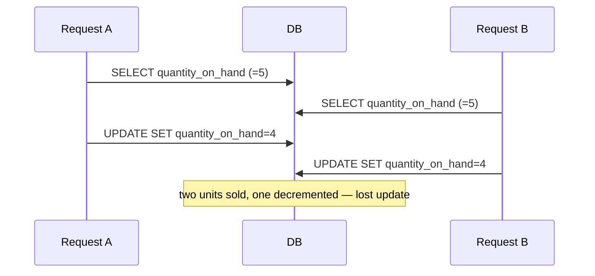

# Transactions and Concurrency

> Scope: correctness of database writes under failure and concurrency — ACID, autocommit,
> `transaction.atomic()`, nesting and savepoints, `on_commit`, isolation levels, row locks and
> `select_for_update()` options, optimistic vs pessimistic concurrency, race conditions, lost
> updates, deadlocks, retries, idempotent writes and transaction boundaries.
> Not covered here: *which layer owns* the transaction and general service design
> ([django-architecture: service-layer](../../django-architecture/references/service-layer.md)),
> constraint design ([database-constraints-and-indexes.md](./database-constraints-and-indexes.md)),
> the `select_for_update()` method signature in the API catalogue ([queryset-api.md](./queryset-api.md)),
> `F()`/`Case` expression mechanics ([advanced-query-expressions.md](./advanced-query-expressions.md)),
> PostgreSQL MVCC and lock internals ([postgresql-engineering](../../postgresql-engineering/SKILL.md)),
> outbox and cross-service consistency ([django-architecture: event-driven-architecture](../../django-architecture/references/event-driven-architecture.md)).

## 1. Purpose and scope

Most data corruption in Django applications is not a bug in a single request; it is two correct
requests interleaving. This reference teaches the agent to recognise read-then-write races, to
choose between atomic SQL, constraints, optimistic and pessimistic locking, and to place
transaction boundaries so side effects never escape a rolled-back transaction. Examples use the
canonical `inventory.StockItem`, `orders.Order`, `payments.Payment` and `billing.Account` models.
SQL shown is illustrative PostgreSQL.

## 2. Core concepts

- **ACID**: atomicity (all or nothing), consistency (constraints hold at commit), isolation
  (concurrent transactions don't see each other's partial work — to a degree set by the
  isolation level), durability (committed data survives crashes).
- **Autocommit**: Django's default. Each query commits immediately unless inside `atomic`.
  `ATOMIC_REQUESTS = True` wraps each view in a transaction — simple but makes every request hold
  a transaction for its whole duration, including template rendering and external calls.
- **`transaction.atomic()`**: decorator or context manager. Outermost block = `BEGIN`/`COMMIT`;
  inner blocks = savepoints (unless `savepoint=False`).
- **`transaction.on_commit(fn)`**: run `fn` after the outermost transaction commits; discarded on
  rollback. `robust=True` (Django ≥ 4.2) logs and continues if `fn` raises.
- **Isolation level**: PostgreSQL default `READ COMMITTED`; MySQL/InnoDB default `REPEATABLE READ`;
  SQLite serialises writers. Django uses the backend's default unless configured.
- **Optimistic concurrency**: detect conflicting writes at write time (version column or
  conditional `UPDATE`). **Pessimistic**: lock the row first (`SELECT ... FOR UPDATE`).
- **Lost update**: two transactions read the same value, both write a value computed from it,
  one write is silently overwritten.

## 3. Internal mechanics

```python
with transaction.atomic():           # BEGIN
    create_order(...)
    with transaction.atomic():       # SAVEPOINT s1
        reserve_stock(...)           # error -> ROLLBACK TO SAVEPOINT s1, exception propagates
    # RELEASE SAVEPOINT s1 on success
# COMMIT (or ROLLBACK if an exception left the outer block)
```

- Django tracks a per-connection `needs_rollback` flag. If a DB error is raised inside an
  `atomic` block and you catch it *inside the same block*, further queries raise
  `TransactionManagementError` — the transaction is broken. Catch errors **outside** a nested
  `atomic` so the savepoint is rolled back cleanly.
- `on_commit` callbacks are stored on the connection and executed after the outermost commit, in
  registration order. Callbacks registered inside a savepoint that is rolled back are discarded.
  In autocommit mode (no transaction) the callback runs immediately.
- Connections are per thread (and per async context via `sync_to_async` thread). A transaction
  never spans threads. Async code: the transaction API is synchronous — wrap transactional work
  in a sync function and call it with `sync_to_async` ([django-core: asynchronous-django](../../django-core/references/asynchronous-django.md)).
- `select_for_update()` emits `SELECT ... FOR UPDATE`; it raises `TransactionManagementError`
  when evaluated in autocommit mode on backends that support it. The lock is held until the
  transaction ends.



## 4. Engineering decisions and trade-offs

Pick the weakest mechanism that makes the invariant impossible to violate:

| Technique | Use when | Cost |
|---|---|---|
| Database constraint (`UniqueConstraint`, `CheckConstraint`) | The invariant is expressible per row/among rows of one table | Cheapest and strongest; handle `IntegrityError`. |
| Atomic conditional `UPDATE ... WHERE` with `F()` | Increment/decrement with a guard (stock, balance) | One statement; no read; check affected-row count. |
| Optimistic lock (version column) | Low contention, user edits that may conflict, long think time | Extra column; caller must handle conflicts (retry or report). |
| Pessimistic lock (`select_for_update`) | Multi-row/multi-table decision that must see a stable state | Blocks other writers; deadlock risk; must keep transaction short. |
| `SERIALIZABLE` isolation | Complex invariants across rows with no single lock target | Serialization failures; must retry the whole transaction. |
| Advisory locks (PostgreSQL) | Serialising a job/process, not a row | Raw SQL; backend-specific. |

**Application-level check vs atomic database operation**: `if stock.quantity_on_hand >= qty:`
followed by `save()` is a check that is stale the instant it returns. Only the database can
check-and-write atomically — via a constraint, a conditional `UPDATE`, or a lock held across
both steps.

**Transaction boundary**: one use case = one transaction, opened by the service function that
orchestrates the use case. Who owns that function is an architecture decision
([service-layer](../../django-architecture/references/service-layer.md)); this reference only
requires that the boundary is explicit, short, and contains no network I/O.

## 5. Django implementation patterns

### Inventory reservation — atomic conditional update (preferred)

```python
# apps/inventory/services.py
from django.db.models import F


class InsufficientStock(Exception):
    pass


def reserve_stock(*, product_id: int, warehouse_id: int, quantity: int) -> None:
    updated = StockItem.objects.filter(
        product_id=product_id,
        warehouse_id=warehouse_id,
        quantity_on_hand__gte=F("quantity_reserved") + quantity,
    ).update(quantity_reserved=F("quantity_reserved") + quantity)
    if updated == 0:
        raise InsufficientStock(product_id)
```

```sql
UPDATE inventory_stockitem
SET quantity_reserved = quantity_reserved + 3
WHERE product_id = 42 AND warehouse_id = 7
  AND quantity_on_hand >= quantity_reserved + 3;
```

No read, no lock held across Python code, and the `CheckConstraint(quantity_reserved <= quantity_on_hand)`
is the backstop if any other path forgets the guard. `update()` bypasses `save()` and signals
([bulk-operations-and-batching.md](./bulk-operations-and-batching.md)).

### Order placement — pessimistic locking across rows

```python
# apps/orders/services.py
from django.db import transaction


@transaction.atomic
def place_order(*, customer_id: int, items: list[tuple[int, int]]) -> Order:
    product_ids = sorted(pid for pid, _ in items)        # consistent lock order prevents deadlocks
    stock = {
        s.product_id: s
        for s in StockItem.objects.select_for_update()
        .filter(product_id__in=product_ids, warehouse__code="MAIN")
        .order_by("product_id")
    }
    products = Product.objects.in_bulk(product_ids)
    order = Order.objects.create(customer_id=customer_id, status=Order.Status.PENDING, total=0)
    total = Decimal("0")
    lines = []
    for product_id, qty in items:
        s = stock.get(product_id)
        if s is None or s.quantity_on_hand - s.quantity_reserved < qty:
            raise InsufficientStock(product_id)          # whole transaction rolls back
        s.quantity_reserved += qty                       # safe: row is locked
        price = products[product_id].price
        lines.append(OrderLine(order=order, product_id=product_id, quantity=qty, unit_price=price))
        total += price * qty
    StockItem.objects.bulk_update(stock.values(), ["quantity_reserved"])
    OrderLine.objects.bulk_create(lines)
    order.total = total
    order.save(update_fields=["total"])
    transaction.on_commit(lambda: send_order_confirmation.delay(order.pk), robust=True)
    return order
```

`select_for_update()` options:

| Option | Effect | Backend notes |
|---|---|---|
| `nowait=True` | Raise `DatabaseError` immediately if a row is locked | PostgreSQL, Oracle, MySQL, MariaDB |
| `skip_locked=True` | Silently skip locked rows — queue workers | PostgreSQL, Oracle, MySQL, MariaDB ≥ 10.6 |
| `of=("self",)` | Lock only the named tables when the query joins (e.g. with `select_related`) | PostgreSQL, Oracle, MySQL; **not MariaDB** (`NotSupportedError`) — [select_for_update docs](https://docs.djangoproject.com/en/5.2/ref/models/querysets/#select-for-update) |
| `no_key=True` | `FOR NO KEY UPDATE` — does not block inserts of rows referencing this one via FK | PostgreSQL only (Django ≥ 3.2) |

SQLite ignores `select_for_update()` (it locks the whole database on write). With
`select_related()` on nullable FKs PostgreSQL rejects `FOR UPDATE` on the nullable side of an
outer join — use `of=("self",)`.

### Optimistic concurrency — account balance with a version column

```python
# apps/billing/services.py
class ConcurrentModification(Exception):
    pass


def apply_reviewed_balance(*, account_id: int, expected_version: int, new_balance: Decimal) -> None:
    """A back-office user reviewed the account at `expected_version` and set a corrected balance."""
    updated = Account.objects.filter(pk=account_id, version=expected_version).update(
        balance=new_balance, version=F("version") + 1,
    )
    if not updated:
        raise ConcurrentModification(account_id)  # caller re-reads and decides
```

For pure arithmetic (balance += amount) skip versioning — `update(balance=F("balance") + amount)`
is already atomic. Combine with a `CheckConstraint(balance__gte=0)` to make overdrafts
impossible regardless of code path.

### Payment status updates — idempotent state transition

```python
def mark_payment_captured(*, provider_reference: str) -> bool:
    updated = Payment.objects.filter(
        provider_reference=provider_reference,
        status__in=[Payment.Status.PENDING, Payment.Status.AUTHORIZED],
    ).update(status=Payment.Status.CAPTURED)
    return bool(updated)  # False = already captured or unknown → webhook retry is harmless
```

The `WHERE status IN (...)` clause encodes the legal transitions, so replaying a webhook does
nothing. Pair with a unique `idempotency_key` for creates:

```python
def create_payment(*, order_id: int, amount: Decimal, idempotency_key: str) -> Payment:
    try:
        with transaction.atomic():                     # savepoint so the outer tx survives
            return Payment.objects.create(order_id=order_id, amount=amount,
                                          idempotency_key=idempotency_key,
                                          status=Payment.Status.PENDING)
    except IntegrityError:
        return Payment.objects.get(idempotency_key=idempotency_key)
```

`get_or_create()` implements the same pattern but relies on a unique constraint on the lookup
fields to be race-safe ([queryset-api.md](./queryset-api.md)).

### Isolation levels and retries

```python
# settings.py — PostgreSQL
DATABASES["default"]["OPTIONS"] = {
    "isolation_level": psycopg.IsolationLevel.SERIALIZABLE,  # psycopg 3; psycopg2 uses its extensions constants
}
```

Raising isolation per connection affects every query; usually prefer targeted locks. Under
`REPEATABLE READ`/`SERIALIZABLE` (and on deadlock at any level) the database aborts one
transaction; retry the **whole** transaction, not the last statement:

```python
from django.db import OperationalError, transaction

def with_retry(fn, *, attempts=3):
    for attempt in range(attempts):
        try:
            with transaction.atomic():
                return fn()
        except OperationalError as exc:      # serialization_failure / deadlock_detected
            if attempt == attempts - 1 or not _is_retryable(exc):
                raise
```

`_is_retryable` should inspect the driver exception in `exc.__cause__` (Django re-raises driver
errors as the same-named `django.db` class `from` the original): `.sqlstate` on psycopg 3,
`.pgcode` on psycopg2, values `40001` (serialization failure) and `40P01` (deadlock). Both
drivers derive those errors from `OperationalError`, so Django raises
`django.db.OperationalError` on PostgreSQL ([psycopg 3 errors](https://www.psycopg.org/psycopg3/docs/api/errors.html),
[psycopg2 errors](https://www.psycopg.org/docs/errors.html)). Other backends use their own error
codes — check that driver's documentation. Never retry if the
function performed non-transactional side effects; move those into `on_commit`.

### Deadlocks

Two transactions lock rows A then B and B then A. Prevention: lock in a deterministic order
(`order_by("pk")` on the `select_for_update` query), lock everything you need in one query, keep
transactions short, avoid upgrading shared locks. Detection: PostgreSQL logs `deadlock detected`
with both statements; one transaction is aborted.

## 6. Production use cases

- **Flash sale stock**: conditional `UPDATE` per line; constraint backstop; no row locks held
  across Python code.
- **Background job queue in a table**: `select_for_update(skip_locked=True)` with `[:batch]`
  slicing so workers claim disjoint rows.
- **Ledger / balance**: append `LedgerEntry` rows and update `Account.balance` with `F()` in one
  `atomic`; constraint prevents negative balances.
- **Webhook ingestion**: idempotency key unique constraint + state-guarded `update()`.
- **Sending email/tasks after order placement**: `on_commit` so a rolled-back order never sends a
  confirmation; task must re-read the order and tolerate it missing.

## 7. Advantages and disadvantages

| Approach | Advantages | Disadvantages |
|---|---|---|
| Atomic `update()` + `F()` | Fast, no locks held in Python, simple | Bypasses `save()`/signals; only single-statement logic |
| `select_for_update` | Arbitrary logic on a stable snapshot | Contention, deadlocks, needs short transactions |
| Optimistic version | No blocking; good for human edits | Conflict handling UX; extra column |
| `SERIALIZABLE` | Strongest guarantees without explicit locks | Retry loops everywhere; throughput cost |
| `ATOMIC_REQUESTS` | Zero-effort atomicity | Long transactions, side effects inside them, hidden boundaries |

## 8. Security and performance considerations

- Race conditions are security bugs: double-spend, coupon reuse, overselling. Treat any
  read-check-write on money or entitlements as needing a DB-level guarantee
  ([django-security-engineering](../../django-security-engineering/SKILL.md)).
- Long transactions hold locks, delay vacuum on PostgreSQL, and pin a connection. No HTTP calls,
  file I/O or `sleep` inside `atomic`.
- `select_for_update` on a query that joins locks rows in *every* joined table unless `of=` is
  set.
- Set `statement_timeout`/`lock_timeout` (PostgreSQL) for request paths so a stuck lock fails
  fast instead of exhausting workers.
- `on_commit` callbacks run in the request thread after commit — keep them to enqueueing work.

## 9. Common mistakes and anti-patterns

- Read-modify-write via `obj.field += 1; obj.save()` under concurrency.
- Catching `IntegrityError` inside an `atomic` block without a nested savepoint.
- Calling external APIs or enqueueing Celery tasks inside `atomic` (task runs before commit and
  can't see the row, or runs for a rolled-back row).
- `select_for_update()` outside a transaction, or in a view under autocommit expecting a lock.
- Locking rows in inconsistent order across code paths.
- Relying on `get_or_create` without a unique constraint on the lookup fields.
- Retrying only the failed statement instead of the whole transaction.
- Using `ATOMIC_REQUESTS` and also wrapping services in `atomic`, believing inner blocks commit
  independently (they are savepoints).

## 10. Troubleshooting and validation

| Symptom | Likely cause | Action |
|---|---|---|
| `TransactionManagementError: An error occurred in the current transaction` | DB error caught inside `atomic` | Wrap the risky statement in its own `atomic`. |
| Occasional oversell / negative balance | Read-then-write race | Conditional `update()` or lock + `CheckConstraint`. |
| Task can't find the object it was given | Enqueued before commit | Use `on_commit`. |
| `deadlock detected` | Inconsistent lock order | Order locked queries by pk; lock in one statement. |
| Requests hang under load | Lock waits | PostgreSQL: `pg_stat_activity` (`wait_event_type = 'Lock'`), `pg_locks`. |

Validation: test concurrency with real transactions (`TransactionTestCase` and threads, or a
two-connection test) — `TestCase` wraps everything in one transaction and cannot reproduce races
([django-testing](../../django-testing/SKILL.md)). Use `captureOnCommitCallbacks` to assert
`on_commit` behaviour.

## 11. Related references and skills

- [django-architecture: service-layer](../../django-architecture/references/service-layer.md) — transaction ownership.
- [django-architecture: domain-events](../../django-architecture/references/domain-events.md) — dispatch after commit.
- [database-constraints-and-indexes.md](./database-constraints-and-indexes.md) — constraints as the backstop.
- [advanced-query-expressions.md](./advanced-query-expressions.md) — `F`, `Case` in conditional updates.
- [queryset-api.md](./queryset-api.md) — `select_for_update`, `get_or_create`, `update`.
- [django-core: signals-management-commands](../../django-core/references/signals-management-commands.md) — `on_commit` from signals.
- [postgresql-engineering](../../postgresql-engineering/SKILL.md) — MVCC, lock modes, isolation details.

## 12. Official documentation and external references

- https://docs.djangoproject.com/en/stable/topics/db/transactions/
- https://docs.djangoproject.com/en/stable/ref/models/querysets/#select-for-update
- https://docs.djangoproject.com/en/stable/ref/models/expressions/#f-expressions
- https://docs.djangoproject.com/en/stable/ref/databases/#isolation-level
- https://www.postgresql.org/docs/current/transaction-iso.html
- https://www.postgresql.org/docs/current/explicit-locking.html
- https://www.postgresql.org/docs/current/errcodes-appendix.html
