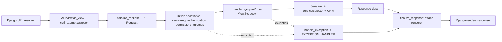

# DRF Fundamentals

> **Scope.** Owns: what Django REST Framework (DRF) is, its component architecture, REST and HTTP
> semantics as applied in DRF, the `REST_FRAMEWORK` settings baseline, the division of
> responsibility between DRF components, and the "DRF or plain Django?" decision.
> Does not cover: the step-by-step dispatch lifecycle
> ([request-response-lifecycle.md](request-response-lifecycle.md)), any single component in depth
> (see the component references linked in §11), or Django's own request handling
> ([django-core request-response-lifecycle](../../django-core/references/request-response-lifecycle.md)).

**Version baseline:** Django 5.2 LTS with DRF 3.16 (DRF 3.16 supports Django 4.2–5.2 and
Python ≥ 3.9). Behaviour introduced in a specific DRF release is qualified "(DRF ≥ 3.x)".
Check the project's lock file before relying on a version-specific feature. Django 6.0 support
depends on the installed DRF release — **VERIFY** against the DRF release notes.

## 1. Purpose and scope

DRF is a toolkit layered on Django for building HTTP APIs. It does not replace Django's URL
resolver, middleware, ORM, or authentication backends; it adds an API-specific request wrapper,
pluggable parsing/rendering, serializers, API-oriented auth/permission/throttle hooks, generic
views, routers, pagination, filtering hooks and schema generation. This reference gives an agent
the mental model needed to pick the right component and the right reference.

## 2. Core concepts

**Resource and representation.** A resource is a noun the API exposes (`orders`, `order lines`,
`customers`). A representation is the serialized form (usually JSON) of that resource at a
moment in time. The same model can have several representations (list vs detail, v1 vs v2,
input vs output).

**HTTP method semantics.**

| Method | Meaning | Safe | Idempotent | Typical success status |
|---|---|---|---|---|
| `GET` | Read a collection or item | Yes | Yes | 200 |
| `HEAD` | `GET` without a body | Yes | Yes | 200 |
| `OPTIONS` | Capabilities/metadata | Yes | Yes | 200 |
| `POST` | Create in a collection, or invoke a command | No | No | 201 (create), 200/202 (command) |
| `PUT` | Full replacement of an item | No | Yes | 200 |
| `PATCH` | Partial modification | No | Not guaranteed | 200 |
| `DELETE` | Remove an item | No | Yes | 204 |

"Safe" means no server-side state change is intended; "idempotent" means repeating the request
leaves the server in the same state. DRF uses `rest_framework.permissions.SAFE_METHODS`
(`GET`, `HEAD`, `OPTIONS`) in its read-only permission classes.

**Status codes DRF produces itself.** 400 (`ValidationError`, `ParseError`), 401
(`NotAuthenticated`/`AuthenticationFailed` when a `WWW-Authenticate` challenge exists), 403
(`PermissionDenied`, or unauthenticated without a challenge), 404 (`NotFound`, `Http404`), 405,
406 (`NotAcceptable`), 415 (`UnsupportedMediaType`), 429 (`Throttled`). Everything else is your
choice; constants live in `rest_framework.status` (`status.HTTP_201_CREATED`).

**Component responsibilities.**

| Component | Responsibility | Must not |
|---|---|---|
| `Request` | Wraps `HttpRequest`; exposes `data`, `query_params`, `user`, `auth` | — |
| Parser | Turns the request body into Python data per `Content-Type` | Validate business rules |
| Authentication class | Identifies the caller (`request.user`, `request.auth`) | Decide access |
| Permission class | Allows/denies the request or a specific object | Filter lists (that's `get_queryset()`) |
| Throttle class | Limits request rate per client/scope | Be the only abuse defence |
| Serializer | Validates input; converts between native data and Python/model objects | Send emails, call APIs, own workflows |
| View / ViewSet | HTTP orchestration: pick queryset/serializer, call service, return `Response` | Contain domain logic |
| Renderer | Turns `Response.data` into bytes for the negotiated media type | — |
| Exception handler | Converts exceptions into error responses | Hide server bugs as 4xx |

## 3. Internal mechanics



Key facts:

- `APIView.as_view()` returns a Django view wrapped in `csrf_exempt`; CSRF is then enforced (if
  at all) by `SessionAuthentication` for session-authenticated requests only.
- The DRF `Request` proxies unknown attributes to the underlying `HttpRequest`
  (`request.META`, `request.session` still work).
- Body parsing is lazy: it happens the first time `request.data` (or `request.POST`/`FILES`) is
  accessed.
- `Response` holds *unrendered* Python data; rendering happens after the view returns.
- Settings are read through `rest_framework.settings.api_settings`; per-view class attributes
  (`permission_classes = [...]`) override the defaults.

Full sequence: [request-response-lifecycle.md](request-response-lifecycle.md).

## 4. Engineering decisions and trade-offs

**DRF vs a plain Django view.**

| Situation | Prefer |
|---|---|
| A resource API consumed by SPAs, mobile apps, partners or other services | DRF |
| Several endpoints sharing auth, permissions, pagination, error format and schema | DRF |
| A single internal JSON endpoint (health check, a webhook receiver with its own signature check) | Plain Django `JsonResponse` view is often enough |
| Server-rendered HTML pages and forms | Django views/forms ([django-core urls-views](../../django-core/references/urls-views.md)) |
| High-throughput, fixed-shape internal read with measured serializer overhead | DRF view returning `values()` dicts, or a plain view — measure first |

**Function-based (`@api_view`) vs class-based.** `@api_view` gives the DRF request/response,
auth, permissions and throttles to a function — good for one-off commands. Class-based generic
views/ViewSets win once the endpoint is standard CRUD or shares behaviour
([views-and-viewsets.md](views-and-viewsets.md)).

**Global defaults vs per-view settings.** Put *secure* defaults globally (authenticated,
paginated, JSON-only) and relax them explicitly per view. Relaxing is visible in review;
tightening forgotten views is not.

## 5. Django/DRF implementation patterns

**Installation** (`djangorestframework` on PyPI):

```python
INSTALLED_APPS = [
    # ...
    "rest_framework",
    # "rest_framework.authtoken",   # only if TokenAuthentication is used (adds a model + migration)
    # "django_filters",             # third-party: django-filter
]
```

**Settings baseline** — secure by default, relaxed per view:

```python
REST_FRAMEWORK = {
    "DEFAULT_AUTHENTICATION_CLASSES": [
        "rest_framework.authentication.SessionAuthentication",
    ],
    "DEFAULT_PERMISSION_CLASSES": ["rest_framework.permissions.IsAuthenticated"],
    "DEFAULT_RENDERER_CLASSES": ["rest_framework.renderers.JSONRenderer"],
    "DEFAULT_PARSER_CLASSES": ["rest_framework.parsers.JSONParser"],
    "DEFAULT_PAGINATION_CLASS": "config.api.pagination.DefaultPagination",
    "PAGE_SIZE": 50,
    "DEFAULT_THROTTLE_CLASSES": [
        "rest_framework.throttling.AnonRateThrottle",
        "rest_framework.throttling.UserRateThrottle",
    ],
    "DEFAULT_THROTTLE_RATES": {"anon": "60/min", "user": "600/min"},
    "EXCEPTION_HANDLER": "config.api.errors.api_exception_handler",
    "TEST_REQUEST_DEFAULT_FORMAT": "json",
}
if DEBUG:
    REST_FRAMEWORK["DEFAULT_RENDERER_CLASSES"].append(
        "rest_framework.renderers.BrowsableAPIRenderer"
    )
```

DRF's own defaults are permissive: `DEFAULT_PERMISSION_CLASSES` is `AllowAny`, authentication is
Session + Basic, no pagination, no throttling, and the browsable API is enabled. Always set them.

**Thin view delegating to a service** (the shape every other reference assumes):

```python
# orders/api.py
class OrderViewSet(mixins.ListModelMixin, mixins.RetrieveModelMixin,
                   mixins.CreateModelMixin, viewsets.GenericViewSet):
    serializer_class = OrderOutputSerializer

    def get_queryset(self):
        return order_list(user=self.request.user)          # selector: scoped + prefetched

    def create(self, request, *args, **kwargs):
        payload = OrderCreateInputSerializer(data=request.data, context=self.get_serializer_context())
        payload.is_valid(raise_exception=True)
        order = place_order(customer=request.user.customer, **payload.validated_data)  # service
        return Response(OrderOutputSerializer(order).data, status=status.HTTP_201_CREATED)
```

Services and selectors are defined in
[django-architecture service-layer](../../django-architecture/references/service-layer.md).

## 6. Production use cases

- **First-party SPA** on the same site: session authentication with CSRF, JSON only,
  page-number pagination for admin tables, cursor pagination for feeds.
- **Mobile/partner API**: token-based authentication (built-in `TokenAuthentication` or a
  third-party package), URL-path versioning, published OpenAPI schema, scoped throttles.
- **Internal service-to-service API**: token or mTLS at the infrastructure layer, strict input
  serializers, idempotency keys on `POST` commands.
- **Back-office API**: `DjangoModelPermissions` mapped onto the admin's groups, filtering and
  export endpoints with bounded page sizes.

## 7. Advantages and disadvantages

| Advantages | Disadvantages |
|---|---|
| Consistent request/response, auth, permissions, throttles across endpoints | Per-object serializer overhead on large payloads |
| Serializer validation with structured error output | Easy to hide business logic in serializers and `perform_*` hooks |
| Generic views/ViewSets remove CRUD boilerplate | Deep mixin/inheritance chains obscure behaviour |
| Schema generation and browsable API | Permissive defaults if settings are left unset |
| Large ecosystem (django-filter, drf-spectacular, simplejwt) | Ecosystem packages version independently; compatibility must be checked |

## 8. Security and performance considerations

- Set `DEFAULT_PERMISSION_CLASSES`; the built-in default `AllowAny` exposes every new view.
- Authentication ≠ authorisation: identifying the caller says nothing about which objects they
  may see ([permissions-and-access-control.md](permissions-and-access-control.md)).
- Disable `BrowsableAPIRenderer` in production unless deliberately offered; it renders forms and
  can trigger extra queries (e.g. related-field choices).
- Unbounded lists are both a performance and a data-exfiltration risk — always paginate.
- Serializer cost is per object and per field; the dominant cost is still usually queries
  ([django-orm query-optimization](../../django-orm/references/query-optimization.md)).
- Deep security design (threat modelling, CSRF/CORS policy, secrets) belongs to
  [django-security-engineering](../../django-security-engineering/SKILL.md).

## 9. Common mistakes and anti-patterns

- Leaving DRF defaults (`AllowAny`, no pagination) in place.
- Treating DRF as "the API layer" and putting the domain inside serializers.
- Using DRF for one webhook endpoint that needs raw-body signature verification — DRF parsing
  consumes the body; read `request.body` before accessing `request.data`, or use a plain view.
- RPC-shaped URLs (`/api/getOrders/`, `/api/doCancel/`) instead of resources
  ([routers-and-url-design.md](routers-and-url-design.md)).
- Returning 200 with `{"error": ...}` instead of an error status.

## 10. Troubleshooting and validation

| Symptom | Likely cause |
|---|---|
| New endpoint is publicly readable | `DEFAULT_PERMISSION_CLASSES` unset → `AllowAny` |
| 403 instead of 401 for missing credentials | First authentication class has no `WWW-Authenticate` header (e.g. `SessionAuthentication`) |
| `RawPostDataException` reading `request.body` | Body already parsed via `request.data` |
| Browsable API appears in production | `BrowsableAPIRenderer` in renderer defaults |
| Setting has no effect | Set on the view class (overrides global) or misspelt key in `REST_FRAMEWORK` |

Validation: `python manage.py check`; an API test asserting 401/403 on an unauthenticated call to
every new endpoint ([drf-testing-and-debugging.md](drf-testing-and-debugging.md)).

## 11. Related references and skills

- Lifecycle: [request-response-lifecycle.md](request-response-lifecycle.md)
- Components: [serializers-and-model-serializers.md](serializers-and-model-serializers.md),
  [views-and-viewsets.md](views-and-viewsets.md), [authentication.md](authentication.md),
  [permissions-and-access-control.md](permissions-and-access-control.md),
  [parsers-renderers-and-content-negotiation.md](parsers-renderers-and-content-negotiation.md)
- URL design: [routers-and-url-design.md](routers-and-url-design.md)
- Django fundamentals: [django-core](../../django-core/SKILL.md)
- Where logic lives: [django-architecture](../../django-architecture/SKILL.md)

## 12. Official documentation and external references

- DRF home and release notes: <https://www.django-rest-framework.org/>,
  <https://www.django-rest-framework.org/community/release-notes/>
- API guide — settings: <https://www.django-rest-framework.org/api-guide/settings/>
- API guide — status codes: <https://www.django-rest-framework.org/api-guide/status-codes/>
- RFC 9110 (HTTP semantics): <https://www.rfc-editor.org/rfc/rfc9110>
- Django request/response objects: <https://docs.djangoproject.com/en/5.2/ref/request-response/>
