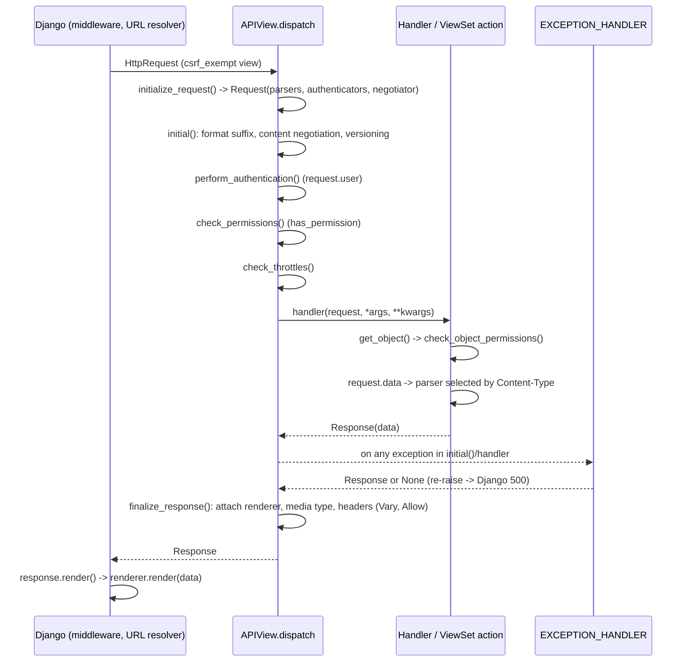

# Request and Response Lifecycle

> **Scope.** Owns: the DRF `Request` and `Response` objects, how DRF wraps Django's
> `HttpRequest`, and the exact `APIView`/ViewSet dispatch sequence — request initialisation,
> content negotiation, versioning, authentication, permissions, throttling, handler execution,
> exception handling and response finalisation/rendering.
> Does not cover: Django's middleware and handler chain
> ([django-core request-response-lifecycle](../../django-core/references/request-response-lifecycle.md)),
> each stage's configuration (see the stage references in §11), or error body design
> ([exception-handling-and-error-responses.md](exception-handling-and-error-responses.md)).

## 1. Purpose and scope

When an API returns an unexpected 401, 403, 406, 415 or 429, or a hook "doesn't run", the cause
is almost always ordering. This reference gives the actual sequence so behaviour can be predicted
and debugged.

## 2. Core concepts

**`rest_framework.request.Request`** wraps `HttpRequest` (available as `request._request`;
unknown attributes are proxied to it).

| Attribute | Meaning |
|---|---|
| `request.data` | Parsed body (JSON, form, multipart incl. files) — lazy |
| `request.query_params` | `request._request.GET` under a clearer name |
| `request.user` / `request.auth` | Set by the first successful authenticator — lazy |
| `request.successful_authenticator` | Authenticator instance that succeeded |
| `request.accepted_renderer` / `accepted_media_type` | Result of content negotiation |
| `request.version` / `versioning_scheme` | Result of versioning |
| `request.content_type`, `request.stream` | Body metadata / raw stream |

**`rest_framework.response.Response(data, status=None, template_name=None, headers=None,
content_type=None)`** is a `SimpleTemplateResponse` holding unrendered Python data. The
negotiated renderer turns it into bytes after the view returns.

## 3. Internal mechanics



**`dispatch()` step by step** (`rest_framework.views.APIView`):

1. `initialize_request()` builds `Request` with `get_parsers()`, `get_authenticators()`,
   `get_content_negotiator()` and parser context. For ViewSets, `initialize_request` also sets
   `self.action` from the method→action map.
2. `initial()`:
   1. `get_format_suffix()` — `format` URL kwarg if format-suffix patterns are used.
   2. `perform_content_negotiation()` — selects the renderer from `Accept` (or `?format=`);
      failure raises `NotAcceptable` (406) **before** authentication.
   3. `determine_version()` — sets `request.version`; a version outside `ALLOWED_VERSIONS` →
      `NotFound` (404) for path/namespace/host/query schemes, `NotAcceptable` (406) for
      `AcceptHeaderVersioning`.
   4. `perform_authentication()` — accesses `request.user`, running each authenticator in
      order until one returns `(user, auth)`; `AuthenticationFailed` stops the chain.
   5. `check_permissions()` — every permission's `has_permission()`; first denial raises
      `NotAuthenticated` (if no authenticated user) or `PermissionDenied`.
   6. `check_throttles()` — every throttle's `allow_request()`; if any refuse, `Throttled`
      (429) with the longest wait.
3. Handler: `getattr(self, request.method.lower(), self.http_method_not_allowed)` — for
   ViewSets, the bound action method.
4. Inside the handler: `request.data` triggers parser selection by `Content-Type` (415 if none
   matches, 400 `ParseError` on malformed body); `get_object()` triggers object permission
   checks.
5. `handle_exception(exc)` — for `NotAuthenticated`/`AuthenticationFailed`, adds
   `WWW-Authenticate` from the first authenticator or downgrades to 403; then calls
   `EXCEPTION_HANDLER`. A `None` return re-raises the exception for Django to produce a 500.
6. `finalize_response()` — asserts a `Response`/`HttpResponseBase` was returned, attaches
   `accepted_renderer`, `accepted_media_type`, `renderer_context`, and adds headers
   (`Allow`, `Vary: Accept`).
7. Django's handler calls `response.render()` — the renderer runs here, after the view and
   after `dispatch()` returned, but before response middleware sees the content.

**Differences from plain Django views:**

| Concern | Plain Django | DRF |
|---|---|---|
| CSRF | `CsrfViewMiddleware` | View is `csrf_exempt`; `SessionAuthentication` enforces CSRF for session-authenticated requests |
| Authentication | `AuthenticationMiddleware` sets `request.user` from session | Authenticators set `request.user` per view (session, token, custom) |
| Body | `request.POST` (form data only), `request.body` | `request.data` for any parser |
| Errors | Exceptions → Django handlers/`handler500` | `APIException`/`Http404`/`PermissionDenied` → `EXCEPTION_HANDLER` |
| Response | Rendered at construction | Rendered lazily by the negotiated renderer |

## 4. Engineering decisions and trade-offs

- **Where to put cross-cutting logic.** Request IDs, tenant resolution from host headers,
  security headers → Django middleware (runs for every request, including non-DRF).
  Caller identity → authentication class. Access → permission class. Rate → throttle.
  Error format → exception handler. Don't override `dispatch()`/`initial()` for these.
- **Middleware sees `request.user` from Django's session middleware, not from DRF
  authenticators.** Token-authenticated users are only known after DRF authentication inside the
  view. Logging the API user therefore belongs in DRF (e.g. an exception handler or a
  `finalize_response` override in one shared base) or in middleware reading the DRF request after
  the response (**VERIFY** availability of the DRF user on `HttpRequest` for your setup).
- **Throttling runs after authentication and permissions.** Requests rejected earlier are never
  counted (see [throttling-and-rate-limiting.md](throttling-and-rate-limiting.md)).

## 5. Django/DRF implementation patterns

**Reading request data correctly:**

```python
def post(self, request):
    payload = WebhookInputSerializer(data=request.data)          # JSON / form / multipart
    page = request.query_params.get("page")                      # not request.GET in new code
```

**Raw body for signature verification** — read before `request.data`:

```python
def post(self, request):
    raw = request.body                       # must happen before request.data is accessed
    verify_signature(raw, request.headers.get("X-Signature"))
    payload = json.loads(raw)
```

**Response with explicit status and headers:**

```python
return Response(
    OrderDetailOutputSerializer(order).data,
    status=status.HTTP_201_CREATED,
    headers={"Location": reverse("v1:order-detail", kwargs={"pk": order.pk}, request=request)},
)
```

**Shared hook via `initial()`** (only when a DRF-specific, per-view concern is unavoidable):

```python
class TenantAPIView(APIView):
    def initial(self, request, *args, **kwargs):
        super().initial(request, *args, **kwargs)          # auth/permissions/throttles first
        request.organization = request.user.organization   # after authentication
```

## 6. Production use cases

- Diagnosing "403 instead of 401": inspect the first authenticator's `authenticate_header()`.
- Diagnosing "406 on every request from a client": `Accept` header lists only a media type no
  configured renderer supports.
- Webhook verification needing raw bytes.
- Adding the authenticated API user to structured logs.

## 7. Advantages and disadvantages

| Advantages | Disadvantages |
|---|---|
| Deterministic, overridable pipeline | Different auth model from Django middleware can confuse logging/auditing |
| Lazy parsing and authentication avoid unnecessary work in some paths | Laziness hides when failures happen (e.g. 415 only on `request.data`) |
| Single exception funnel | Overriding `dispatch`/`initial` breaks guarantees easily |

## 8. Security and performance considerations

- The `csrf_exempt` wrapper means **non-session** authenticators get no CSRF protection — correct
  for header tokens, wrong if you invent cookie-based token auth without adding CSRF.
- Content negotiation and versioning run before authentication: their errors are visible to
  anonymous callers (by design).
- Authentication failures (`AuthenticationFailed`) occur before throttles, so invalid-credential
  attempts are not counted by DRF throttles — rate-limit authentication at another layer.
- Rendering happens after `dispatch()` returns; lazy querysets placed into `Response.data`
  (avoid this) would execute during rendering.

## 9. Common mistakes and anti-patterns

- Using `request.POST` in DRF views (empty for JSON bodies).
- Reading `request.body` after `request.data` (`RawPostDataException`).
- Returning `HttpResponse`/`JsonResponse` from DRF views — bypasses negotiation and renderer
  defaults (allowed, but inconsistent).
- Overriding `dispatch()` and swallowing exceptions.
- Assuming middleware-level `request.user` reflects token authentication.

## 10. Troubleshooting and validation

| Symptom | Stage to inspect |
|---|---|
| 406 Not Acceptable | Negotiation: `Accept` vs `renderer_classes` |
| 415 Unsupported Media Type | Parsing: `Content-Type` vs `parser_classes` |
| 401 vs 403 confusion | Authentication header challenge of first authenticator |
| 403 despite valid token | Permission classes, or session auth CSRF failure (message: "CSRF Failed") |
| 429 unexpectedly | Throttle scope/rates, shared cache key behind a proxy |
| 500 with no error body | Exception handler returned `None` (non-API exception) |

Set breakpoints in `APIView.initial`, `handle_exception` and your exception handler; log
`request.successful_authenticator` and `request.accepted_renderer` when tracing.

## 11. Related references and skills

- [authentication.md](authentication.md), [permissions-and-access-control.md](permissions-and-access-control.md),
  [throttling-and-rate-limiting.md](throttling-and-rate-limiting.md)
- [parsers-renderers-and-content-negotiation.md](parsers-renderers-and-content-negotiation.md)
- [exception-handling-and-error-responses.md](exception-handling-and-error-responses.md)
- [views-and-viewsets.md](views-and-viewsets.md)
- [django-core request-response-lifecycle](../../django-core/references/request-response-lifecycle.md),
  [django-core middleware](../../django-core/references/middleware.md)

## 12. Official documentation and external references

- Requests: <https://www.django-rest-framework.org/api-guide/requests/>
- Responses: <https://www.django-rest-framework.org/api-guide/responses/>
- Views (policy and dispatch): <https://www.django-rest-framework.org/api-guide/views/>
- Source: `rest_framework/views.py` — <https://github.com/encode/django-rest-framework/blob/master/rest_framework/views.py>
